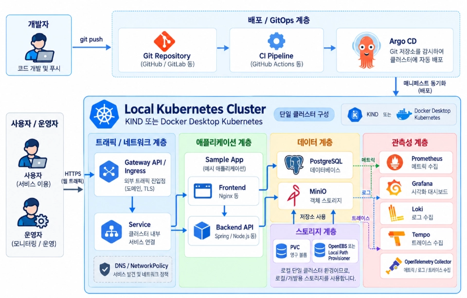

# 10th Kubernetes Study

쿠버네티스를 실제 서비스에 어떻게 활용할 수 있을까요? 이 스터디에서는 쿠버네티스 생태계의 여러 도구를 직접 살펴보고, 애플리케이션을 배포하고 운영하는 데 필요한 구성을 함께 만들어봅니다.

쿠버네티스의 기본 개념을 공부하는 데서 그치지 않고, 네트워크·배포·스토리지·모니터링 같은 주제를 실습으로 연결하는 것이 목표입니다. 쿠버네티스를 배웠지만 실제 프로젝트에 어떻게 적용할지 막막했던 분들과 함께합니다.

## 스터디 안내

- **진행 방식:** 온라인
- **일정:** 목요일 오후 9시, 회당 약 2시간
- **모집 인원:** 리더 포함 10명
- **자료:** 쿠버네티스 공식 문서와 스터디 중 공유·제작하는 자료
- **실습 목표:** 사이드 프로젝트에도 활용할 수 있는 쿠버네티스 클러스터와 서비스 운영 환경 구성

세부 주제와 순서는 진행 상황에 따라 달라질 수 있습니다.

## 이런 분과 함께하고 싶어요

- 쿠버네티스를 꾸준히 배우고 직접 실습해보고 싶은 분
- 컨테이너와 쿠버네티스의 기본 개념을 알고 있는 분
- 혼자 공부하면서 “쿠버네티스를 왜, 언제 쓰는 걸까?” 궁금했던 분
- CKAD, CKA 등 쿠버네티스 자격증을 준비하는 분
- 여러 구성 요소를 갖춘 클러스터를 직접 경험해보고 싶은 분

## 커리큘럼

| 주차 | 주제 |
| --- | --- |
| Week 1 | 쿠버네티스 개념과 클러스터 구축 방법 |
| Week 2 | 애플리케이션 실행과 외부 서비스 노출 |
| Week 3 | 쿠버네티스 네트워크 생태계: 기본 네트워크, Ingress, Gateway API, Service Mesh |
| Week 4 | 배포 생태계: Argo CD, CI 도구, Helm |
| Week 5 | 스토리지 생태계: OpenEBS, NFS, MinIO, Harbor |
| Week 6 | 모니터링 생태계: 메트릭, 로그, Grafana |
| Week 7 | 분산 추적과 OpenTelemetry |
| Week 8 | 주제 추후 안내 |

## 목표 아키텍처

스터디에서는 아래와 같은 로컬 쿠버네티스 환경을 단계적으로 구성하는 것을 목표로 합니다. 세부 도구와 구성은 진행 상황에 따라 바뀔 수 있습니다.



### 구성 요소

- **배포 흐름:** 개발자가 코드를 저장소에 푸시하면 CI가 빌드·검증을 수행하고, Argo CD가 선언된 매니페스트를 클러스터에 동기화합니다.
- **트래픽·네트워크:** Gateway API 또는 Ingress로 외부 HTTPS 요청을 받고, Service를 통해 클러스터 내부 애플리케이션으로 전달합니다. DNS와 NetworkPolicy도 함께 살펴봅니다.
- **애플리케이션:** 예제 Frontend와 Backend API를 배포해 서비스 간 통신을 확인합니다.
- **데이터·스토리지:** PostgreSQL과 MinIO를 실행하고, 영구 볼륨을 통해 데이터가 파드 재시작 후에도 유지되는 구조를 다룹니다.
- **관측성:** Prometheus와 Grafana로 메트릭을 확인하고, Loki로 로그를 모으며, Tempo와 OpenTelemetry로 트레이스를 살펴봅니다.

클러스터는 KIND 또는 Docker Desktop Kubernetes를 이용한 로컬 구성을 기준으로 합니다. 따라서 이 아키텍처는 학습과 사이드 프로젝트를 위한 실습 환경이며, 운영 환경에 그대로 적용할 배포 설계는 아닙니다.

## 저장소 구성

주차별 강의안과 공통 실습 자료는 [`study/`](./study/)에, 과제 안내와 개인 제출물은 [`assaignment/`](./assaignment/)에 정리합니다.

```text
assaignment/
├── week1/              # 1주차 과제 안내와 제출물
├── week2/
└── week3/

study/
└── week1/              # 1주차 강의안·공통 실습 자료
```

### 과제 제출 방법

1. [`assaignment/`](./assaignment/)에서 해당 주차 과제 안내를 확인합니다.
2. 주차별 디렉터리에 본인 이름이 포함된 파일을 만들어 결과와 필요한 화면 캡처를 정리합니다. 다른 사람의 제출물은 수정하지 않습니다.
3. Pull Request로 제출하고, 설명에 주차와 수행 내용을 적습니다.

예시: [`assaignment/week1/week1_이상원.md`](./assaignment/week1/week1_이상원.md)

### 자료 작성 규칙

- 강의안과 공통 실습 자료는 `study/weekN/`, 과제 안내와 개인 제출물은 `assaignment/weekN/`에 둡니다.
- 실습 문서에는 목적, 준비물, 실행 명령, 기대 결과를 적습니다.
- 캡처와 다이어그램은 `img/`에 넣고 Markdown 상대 경로로 연결합니다.
- 비밀번호, 토큰, kubeconfig 등 개인 자격 증명은 커밋하지 않습니다.

## 1주차 과제 미리보기

로컬 Kubernetes를 설치하고 nginx Pod가 클러스터 안에서 실행되는지 확인합니다. [과제 안내](./assaignment/week1/week1_이상원.md)와 [nginx Pod YAML](./assaignment/week1/nginx-pod.yaml)을 확인하세요. 이번 과제에서는 포트 포워딩이나 외부 접속을 요구하지 않습니다. Service와 Ingress 등 서비스 노출은 네트워크 주제에서 다룹니다.

## 공식 참고 자료

스터디에서 다루는 도구의 공식 문서를 모았습니다. 먼저 Kubernetes 개념과 로컬 클러스터 문서를 보고, 각 주차 주제에 맞춰 아래 자료를 참고하면 됩니다.

### Kubernetes와 로컬 클러스터

- [Kubernetes 문서](https://kubernetes.io/docs/): 개념, 워크로드, 서비스·네트워크, 스토리지, 보안
- [Kubernetes 튜토리얼](https://kubernetes.io/docs/tutorials/): 기본 기능을 직접 따라 해보는 실습
- [kind Quick Start](https://kind.sigs.k8s.io/docs/user/quick-start/): Docker 컨테이너로 로컬 Kubernetes 클러스터 만들기
- [Docker Desktop의 Kubernetes](https://docs.docker.com/desktop/use-desktop/kubernetes/): Docker Desktop에서 로컬 클러스터 사용하기

### 애플리케이션 배포와 네트워크

- [Gateway API](https://gateway-api.sigs.k8s.io/): Gateway, HTTPRoute 등 트래픽 라우팅 API
- [Ingress](https://kubernetes.io/docs/concepts/services-networking/ingress/): 외부 HTTP·HTTPS 요청을 클러스터 서비스로 전달하기
- [NetworkPolicy](https://kubernetes.io/docs/concepts/services-networking/network-policies/): 파드 간 네트워크 통신 제어
- [Argo CD](https://argo-cd.readthedocs.io/en/stable/): Git 저장소의 선언적 설정을 Kubernetes에 동기화하는 GitOps 도구
- [GitHub Actions](https://docs.github.com/en/actions): 저장소에서 빌드·검증 등의 자동화 작업 구성
- [Helm](https://helm.sh/docs/): Kubernetes 애플리케이션 패키지와 배포 설정 관리

### 스토리지와 데이터

- [Kubernetes Storage 문서](https://kubernetes.io/docs/concepts/storage/): 볼륨, PersistentVolume, PersistentVolumeClaim
- [OpenEBS 문서](https://openebs.io/docs/): Kubernetes용 스토리지 구성
- [NFS CSI Driver](https://github.com/kubernetes-csi/csi-driver-nfs): NFS 공유 스토리지를 Kubernetes 볼륨으로 연결
- [MinIO 문서](https://min.io/docs/): 오브젝트 스토리지 설치와 사용
- [Harbor 문서](https://goharbor.io/docs/): 컨테이너 이미지 레지스트리 운영
- [PostgreSQL 문서](https://www.postgresql.org/docs/): 관계형 데이터베이스 설치와 관리

### 모니터링과 관측성

- [Prometheus 문서](https://prometheus.io/docs/introduction/overview/): 메트릭 수집과 질의
- [Grafana 문서](https://grafana.com/docs/grafana/latest/): 대시보드와 데이터 시각화
- [Loki 문서](https://grafana.com/docs/loki/latest/): 로그 수집과 조회
- [Tempo 문서](https://grafana.com/docs/tempo/latest/): 분산 트레이스 저장과 조회
- [OpenTelemetry 문서](https://opentelemetry.io/docs/): 메트릭·로그·트레이스 수집 및 전송


