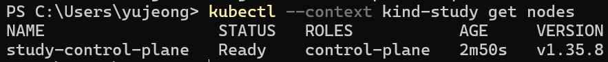
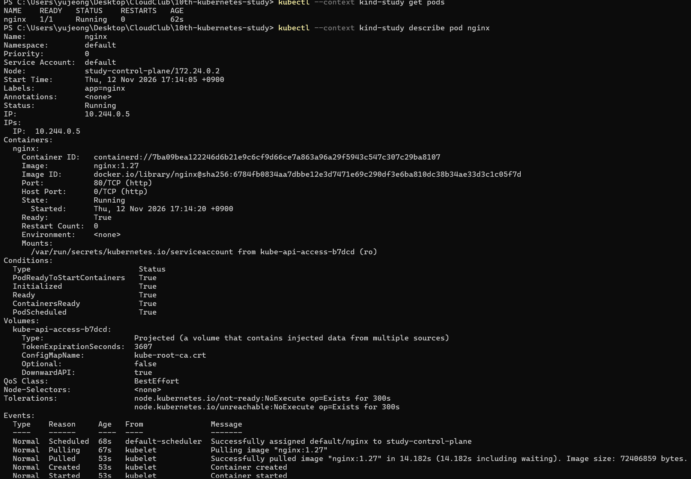

# 1주차 과제: 로컬 Kubernetes 설치와 nginx 실행

- 사용한 클러스터 종류: kind

## 클러스터 확인

```powershell
kubectl cluster-info
kubectl get nodes
```



## nginx Pod 실행

`assaignment/week1` 폴더에서 실행

```powershell
kubectl apply -f nginx-pod.yaml
kubectl get pods -w
```

## Pod 상태 및 설정 확인

```powershell
kubectl get pods
kubectl describe pod nginx
```


