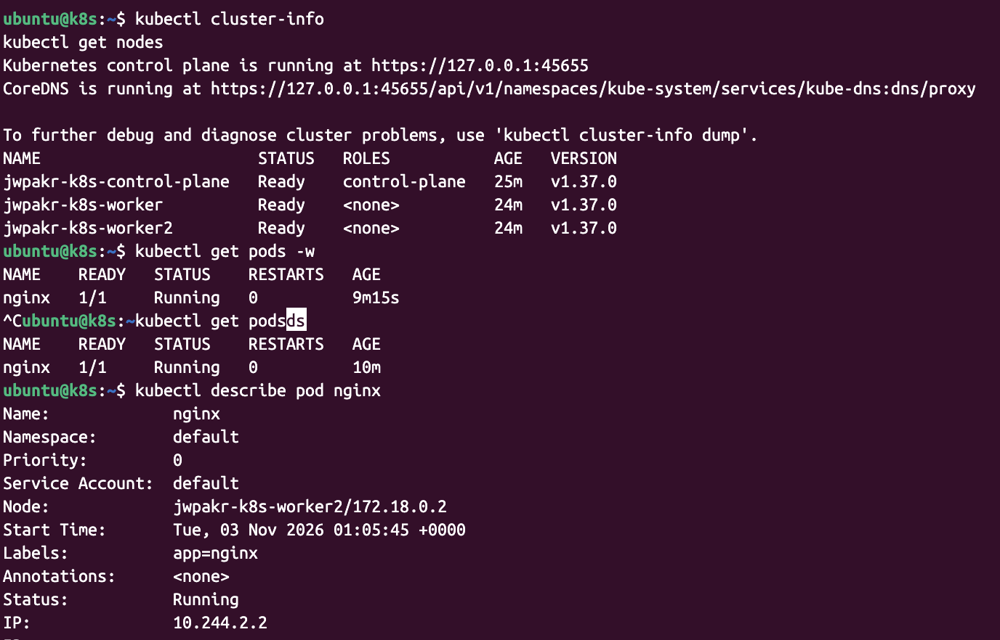

설치 및 실행
```bash
    3  ARCH=$(dpkg --print-architecture)
    4  curl -fLo kind   "https://kind.sigs.k8s.io/dl/v0.33.0/kind-linux-${ARCH}"
    5  chmod +x kind
    6  sudo mv kind /usr/local/bin/kind
    7  kind version
    8  kind create cluster --name jwpark-k8s
   10  k get po
   11  k get all -A
   12  cat > kind-config.yaml <<'EOF'
kind: Cluster
apiVersion: kind.x-k8s.io/v1alpha4
nodes:
  - role: control-plane
  - role: worker
  - role: worker
EOF
   18  kind delete cluster -n jwpark-k8s
   19  k get po
   20  kind create cluster   --name jwpakr-k8s   --config kind-config.yaml
   21  k get po
   22  vi nginx-pod.yaml
   23  k apply -f nginx-pod.yaml
```

스크린샷

