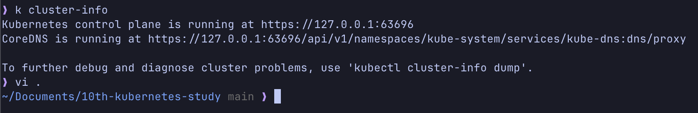
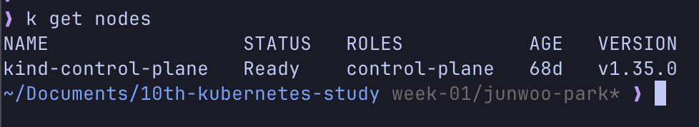
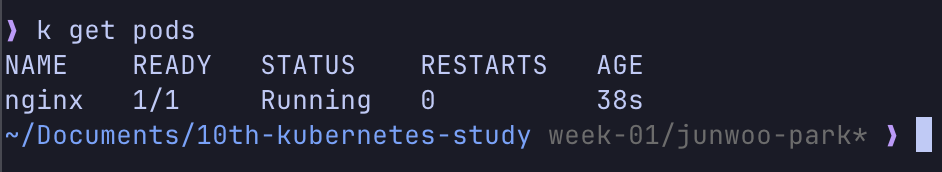
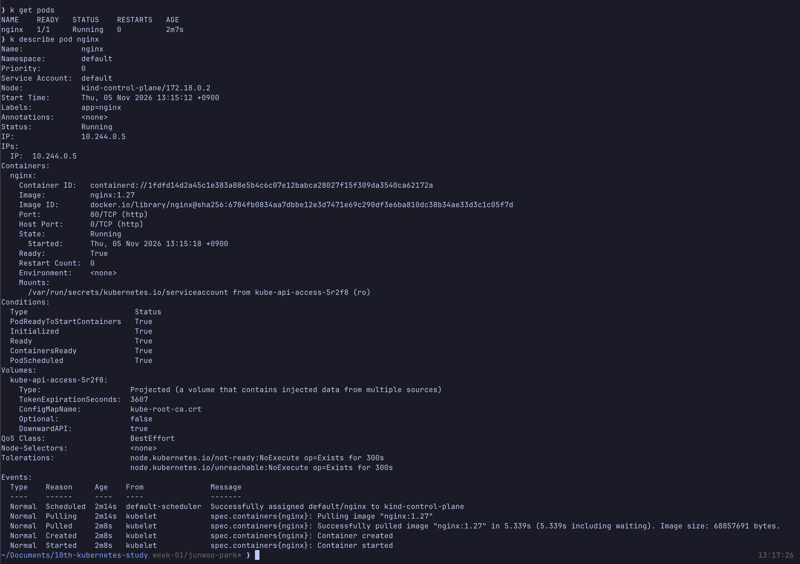

## 1. kind 또는 Docker Desktop Kubernetes 중 하나로 로컬 클러스터를 설치합니다.

## 2. 클러스터가 준비됐는지 확인합니다.

```sh
kubectl cluster-info
kubectl get nodes
```





## 3. 이 저장소의 nginx-pod.yaml을 적용합니다.

```sh
kubectl apply -f nginx-pod.yaml
kubectl get pods -w
```



## 4. Pod 상태와 설정을 확인합니다.

```sh
kubectl get pods
kubectl describe pod nginx
```


