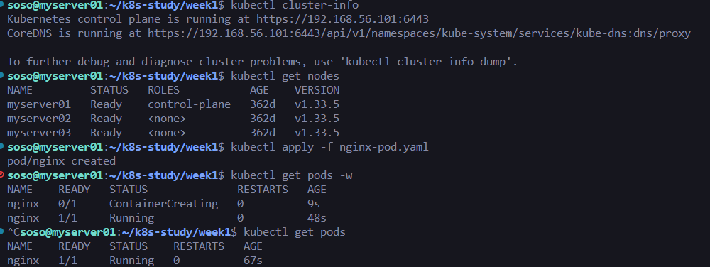
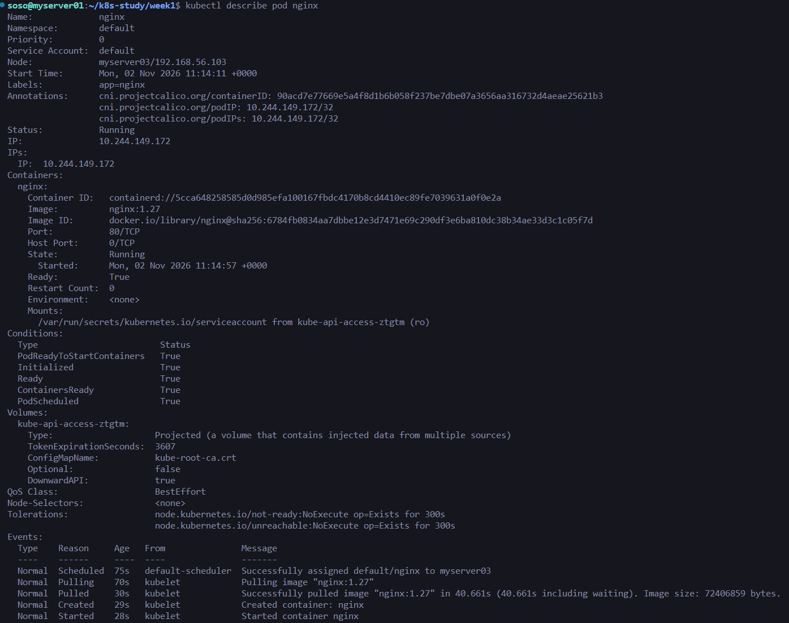
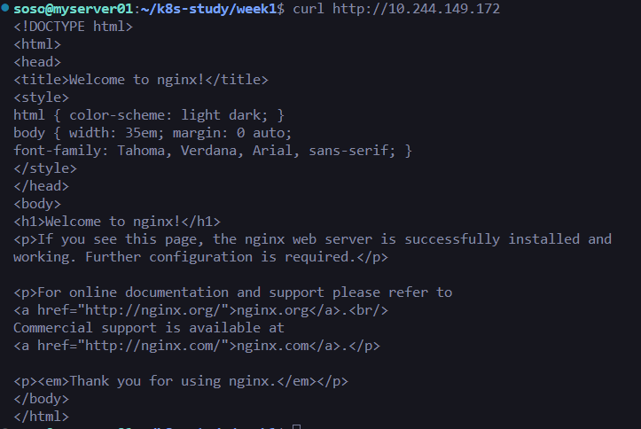

# week1 심소현

## 터미널

## 실행 설명

1. Oracle VirtualBox를 활용한 VM을 사용하여 실습을 진행했습니다.
   - 쿠버네티스 환경은 부트캠프 당시 만들어두었던 세팅을 그대로 재사용하고 있습니다.
   - Control Plane 1대와 Workder Node 2대로 이루어져 있습니다.
2. nginx-pod.yaml 적용했습니다.
   - nginx pod는 myserver03에 배치되었고 정상 실행되는 것까지 확인했습니다.
3. nginx 기본 페이지 응답을 확인했습니다.
   - curl을 사용하여 응답을 확인했습니다.
   - nginx-pod.yaml은 단순히 파드만 생성하며, 브라우저를 통한 접근은 포트 포워딩과 같은 방법을 통해서 가능하다는 것을 알 수 있었습니다.
