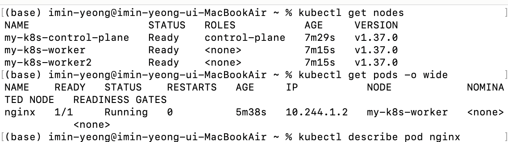
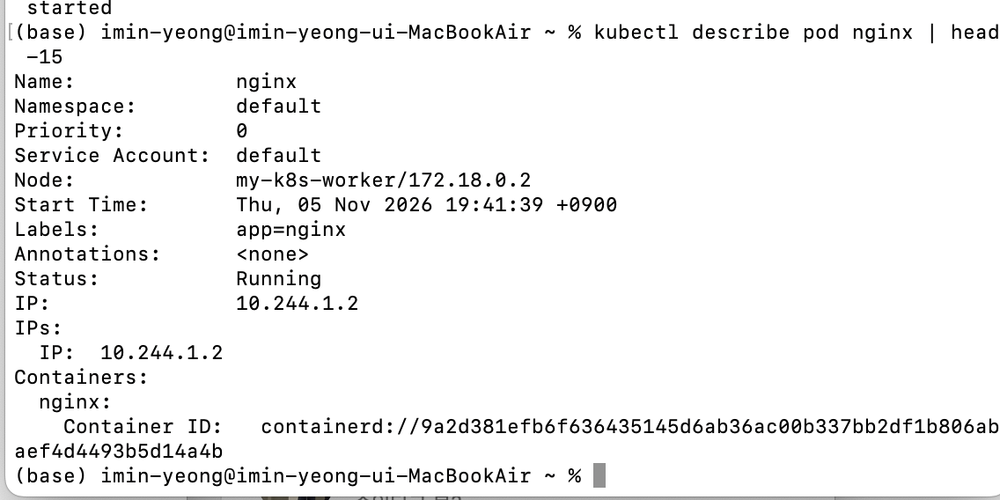

설치 및 실행
```bash
docker version
brew install colima docker
colima start --cpu 2 --memory 4
brew install kind kubectl
kind version
cat > kind-config.yaml <<'EOF'
kind: Cluster
apiVersion: kind.x-k8s.io/v1alpha4
nodes:
  - role: control-plane
  - role: worker
  - role: worker
EOF
kind create cluster --name my-k8s --config kind-config.yaml
kubectl get nodes
vi nginx-pod.yaml
kubectl apply -f nginx-pod.yaml
kubectl get pods -o wide
kubectl describe pod nginx
```

스크린샷



