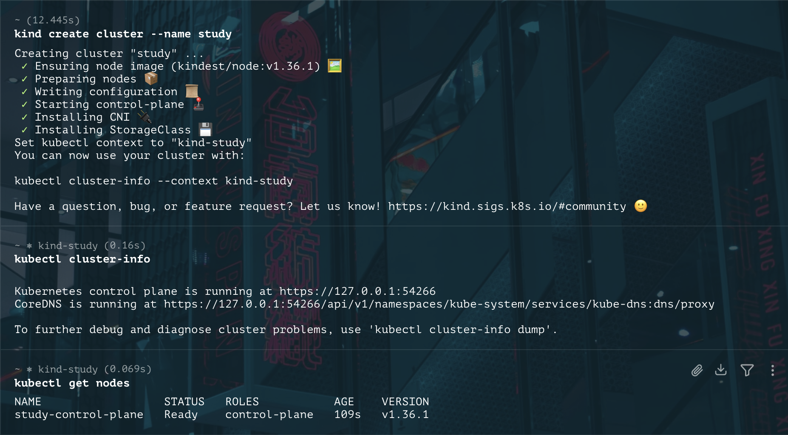
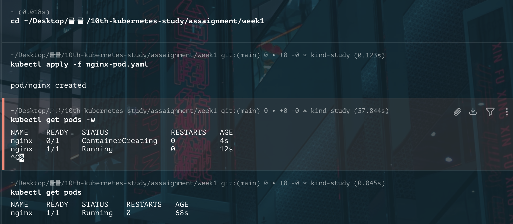
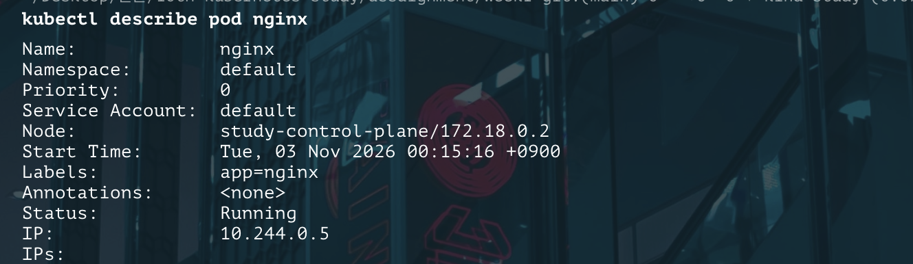
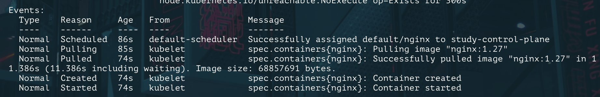

# week1 이연호

## 사용 환경

| 항목 | 내용 |
| --- | --- |
| 클러스터 | kind v0.32.0 (단일 노드, `study-control-plane`) |
| Kubernetes | v1.36.1 (`kindest/node:v1.36.1`) |
| kubectl | v1.36.3 |
| 호스트 | macOS (Apple Silicon), Docker Desktop |

## 1. 클러스터 생성 및 확인

```bash
kind create cluster --name study
kubectl cluster-info
kubectl get nodes
```



- kind가 `study-control-plane`이라는 Docker 컨테이너 하나를 노드로 띄우고, 그 안에서 컨트롤 플레인과 kubelet이 함께 동작합니다.
- 노드 상태가 `Ready`인 것을 확인

## 2. nginx Pod 실행

```bash
kubectl apply -f nginx-pod.yaml
kubectl get pods -w
kubectl get pods
```



- `ContainerCreating` 상태를 거쳐 `Running`(`READY 1/1`)인 것 확인

## 3. Pod 상세 확인

```bash
kubectl describe pod nginx
```





- nginx Pod는 `study-control-plane` 노드에 배치됐고, Pod 전용 IP(`10.244.0.5`)를 받았습니다. 이 IP는 클러스터 안에서만 쓰여서 맥에서 바로 접속할 수는 없습니다
- Events를 보면 스케줄러가 노드를 정한 뒤, 그 노드의 kubelet이 이미지를 받고 컨테이너를 실행하는 순서로 진행됐습니다
