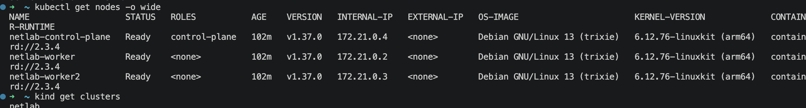
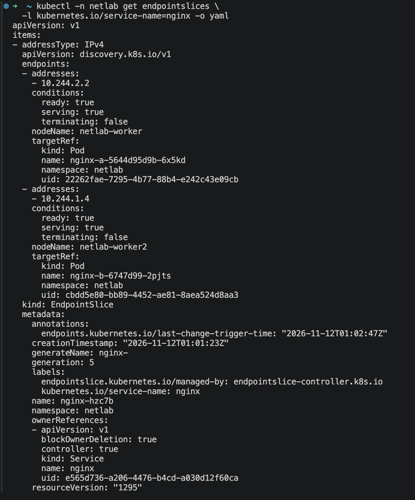
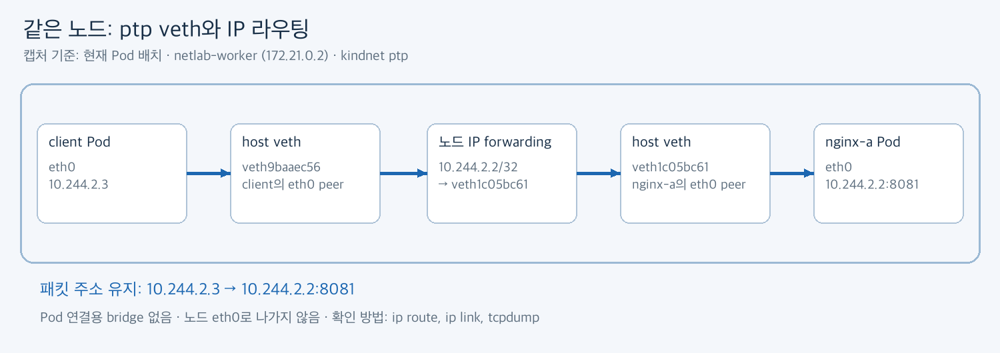
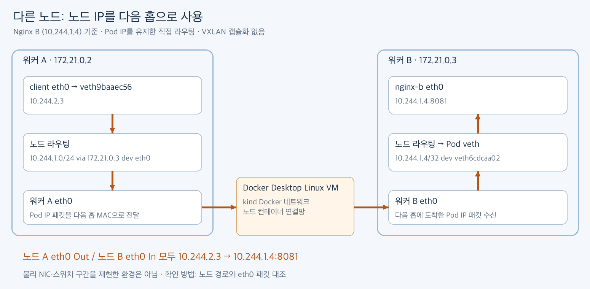
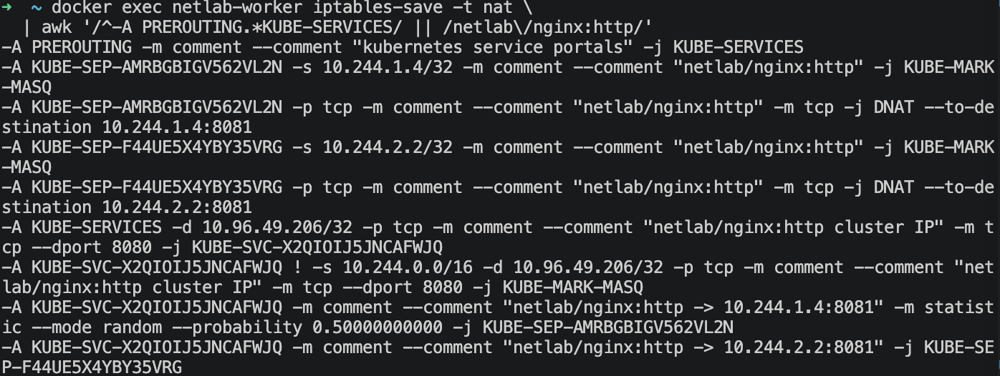
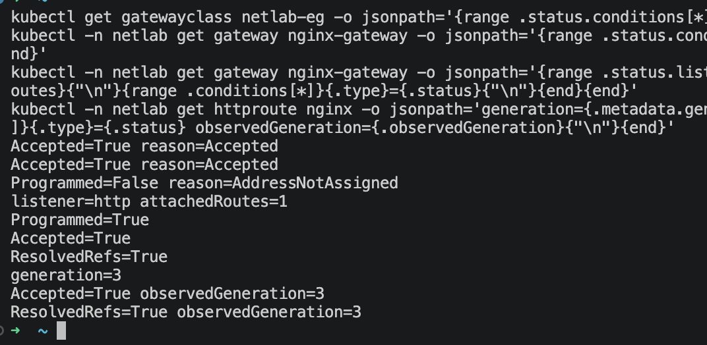
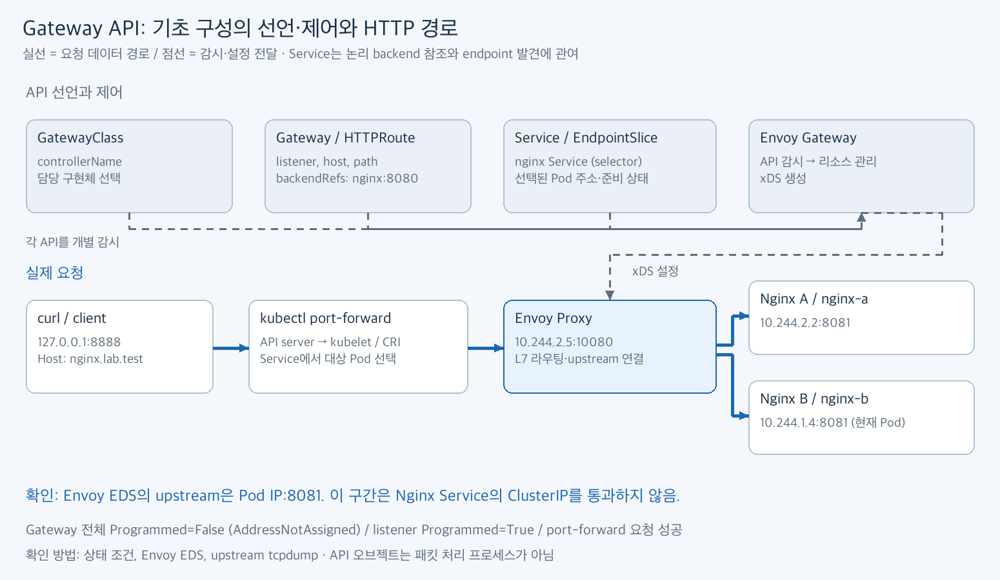

# Week 2. Pod 통신·Service·Gateway API


## 실습 환경

| 항목 | 버전·구성 |
| --- | --- |
| 클러스터 | kind v0.33.0, control-plane 1개 + worker 2개 |
| Kubernetes | v1.37.0 |
| CNI | kindnet `v20260820-69b56db7`, ptp·host-local, 직접 라우팅 |
| kube-proxy | v1.37.0, iptables 모드 |
| Nginx | 1.28.0-alpine, HTTP 8081 |
| Envoy Gateway / Gateway API | v1.10.0 / CRD v1.6.1 |
| Envoy Proxy | v1.40.2 |



## 과제 1. Pod 통신과 Service

### 1-1. Pod·Service·EndpointSlice

| 역할 | Pod 이름 | Pod IP | 노드 |
| --- | --- | --- | --- |
| client | `client` | `10.244.2.3` | `netlab-worker` |
| Nginx A | `nginx-a-5644d95d9b-6x5kd` | `10.244.2.2` | `netlab-worker` |
| Nginx B | `nginx-b-6747d99-2pjts` | `10.244.1.4` | `netlab-worker2` |


| Service 항목 | 값 |
| --- | --- |
| 이름 / 종류 | `netlab/nginx` / ClusterIP |
| ClusterIP | `10.96.49.206` |
| port → targetPort | TCP 8080 → `http`(Pod의 8081) |
| selector | `app: nginx-netlab` |


| EndpointSlice `nginx-hzc7b` | 대응 Pod | ready | 포트 |
| --- | --- | --- | --- |
| `10.244.2.2` | Nginx A | true | 8081 |
| `10.244.1.4` | Nginx B | true | 8081 |





### 1-2. 같은 노드·다른 노드 통신

client Pod에서 `/nginx`로 요청했다. 응답 본문의 Pod 이름·IP로 도착한 backend를 확인했다.

| 요청 대상 | 주소 | 관측 결과 |
| --- | --- | --- |
| 같은 노드 Pod A | `10.244.2.2:8081` | 200, Nginx A |
| 다른 노드 Pod B | `10.244.1.4:8081` | 200, Nginx B |
| ClusterIP | `10.96.49.206:8080` | 200, 이번 연결은 A |
| DNS 이름 | `nginx.netlab.svc.cluster.local:8080` | 200, 이번 연결은 A |

DNS A 응답은 `10.96.49.206`이었다. Service가 선택하는 Pod는 연결마다 달라질 수 있다.


**같은 노드:** client eth0 → host veth → 노드 라우팅 → Nginx A veth/eth0.



**다른 노드:** client → 워커 A eth0 → kind Docker 연결망 → 워커 B eth0 → Nginx B.



실제 CNI는 `ptp`이며 Pod 연결용 bridge·VXLAN을 사용하지 않았다. 확인한 핵심 경로는 다음과 같다.

```text
client:   default via 10.244.2.1 dev eth0
워커 A:   10.244.2.2 dev veth1c05bc61
          10.244.1.0/24 via 172.21.0.3 dev eth0
워커 B:   10.244.1.4 dev veth6cdcaa02
```

근거는 CNI 설정과 `ip route`, `ip -d link`, `bridge link` 조회다. 설정 화면은 추가 예정이다. kind의 노드는 컨테이너이므로 물리 NIC·스위치 구간까지 재현한 실험은 아니다.

### 1-3. Service 동작 원리

| 질문 | 핵심 설명 |
| --- | --- |
| selector·EndpointSlice | selector에 맞는 Pod를 컨트롤러가 주소·포트·준비 상태로 EndpointSlice에 반영한다. |
| Pod IP와 ClusterIP | Pod IP는 특정 Pod에 직접 연결하고, ClusterIP는 가상 주소를 통해 backend를 선택한다. |
| 주소·포트 변환 | DNAT가 `ClusterIP:8080`을 선택된 `PodIP:8081`로 바꾼다. |
| backend 선택 | 이번 규칙은 첫 endpoint를 확률 0.5로 선택하고 나머지를 다음 endpoint로 보낸다. |
| kube-proxy의 역할 | API 변화를 감시해 규칙을 설정한다. 실제 패킷 처리는 커널의 netfilter·conntrack이 담당한다. |
| DNS의 역할 | TCP 연결 전에 이름을 ClusterIP로 해석한다. backend 선택이나 포트 변환은 하지 않는다. |

conntrack이 연결의 NAT 상태를 유지하므로 HTTP keep-alive의 매 요청마다 backend를 다시 고르지는 않는다.

### 1-4. iptables 규칙

client가 있는 **노드의 호스트 네트워크 네임스페이스**에서 확인했다.

```bash
docker exec netlab-worker ip route
docker exec netlab-worker ip link
docker exec netlab-worker iptables-save -t nat
docker exec netlab-worker iptables -t nat -nvL --line-numbers
```



```text
PREROUTING → KUBE-SERVICES
  목적지 10.96.49.206 + TCP 8080 매칭
  → KUBE-SVC-X2QIOIJ5JNCAFWJQ
      ├─ 확률 0.5 → KUBE-SEP-AMRBGBIGV562VL2N
      │               └─ DNAT → 10.244.1.4:8081 (B)
      └─ 나머지   → KUBE-SEP-F44UE5X4YBY35VRG
                      └─ DNAT → 10.244.2.2:8081 (A)
```

변환 후 목적지에 따라 CNI 경로로 전달된다. `KUBE-MARK-MASQ`는 SNAT가 필요한 조건에서 사용되며 모든 ClusterIP 요청이 SNAT되는 것은 아니다. NAT 카운터는 주로 새 연결의 첫 패킷을 세므로 HTTP 요청 수와 같지 않다.

## 과제 2. Ingress와 Gateway API

**Ingress는 라우팅 선언(API), Ingress controller는 이를 프록시·로드밸런서에 반영하는 프로세스다.** 이번 Nginx Pod는 backend 웹 서버이며 Ingress controller가 아니다.

| 기준 | Ingress API | Gateway API |
| --- | --- | --- |
| 기능 | host·path 라우팅, TLS 종료 선언 | 명시적인 listener, 다양한 매칭·필터, 가중 backend 등 |
| 확장 | rewrite·인증·timeout 등은 controller별 annotation·CRD에 의존 | 구조화된 필드, extensionRef·정책 CRD 등 |
| 관리 책임 | 진입점·TLS·앱 규칙이 한 리소스에 모이기 쉬움 | GatewayClass·Gateway·Route로 분리 |

annotation은 구현체마다 이름·의미가 달라 이식과 유지보수가 어렵다. Gateway API는 표준 필드를 늘려 이를 개선하지만 구현체별 지원 기능은 확인해야 한다.

| 리소스 | 역할·관계 |
| --- | --- |
| GatewayClass | 담당 controller 지정 |
| Gateway | GatewayClass를 참조하고 listener·TLS 등 진입점 정의 |
| HTTPRoute | parentRefs로 Gateway에 연결하고 host·path·backend 정의 |

Ingress의 기능 개발 동결은 API 제거와 다르며, 특정 controller의 지원 종료와도 구분한다. [공식 전환 가이드](https://gateway-api.sigs.k8s.io/guides/getting-started/migrating-from-ingress/), [Ingress API 상태](https://kubernetes.io/docs/concepts/services-networking/ingress/)

## 과제 3. Envoy Gateway 적용

### 3-1. 설치와 구성

Envoy Gateway 1.10은 Kubernetes 1.34–1.37, Gateway API 1.6.1, Envoy 1.40.x 조합을 지원한다. 이번 버전은 이 범위에 포함된다. [공식 호환 표](https://gateway.envoyproxy.io/news/releases/matrix/)

```bash
# 최초 설치 시에만 실행 — Gateway API CRD도 함께 설치
helm install eg oci://docker.io/envoyproxy/gateway-helm --version v1.10.0 \
  -n envoy-gateway-system --create-namespace
kubectl -n envoy-gateway-system wait deployment/envoy-gateway --for=condition=Available --timeout=300s
kubectl apply -f assaignment/week2/soyeon/manifests/gateway.yaml
```

| 리소스 | 기초 설정 |
| --- | --- |
| GatewayClass `netlab-eg` | controller: `gateway.envoyproxy.io/gatewayclass-controller` |
| Gateway `nginx-gateway` | HTTP listener `http`, port 80 |
| HTTPRoute `nginx` | Host `nginx.lab.test`, PathPrefix `/nginx` → Service `nginx:8080` |


Nginx는 `location /`에서 응답하므로 `/nginx`와 하위 경로에 별도 rewrite 없이 응답한다.

### 3-2. 상태 검증

| 대상 | 확인한 결과 |
| --- | --- |
| GatewayClass | Accepted=True |
| Gateway | Accepted=True, Programmed=False / AddressNotAssigned |
| HTTP listener | Accepted·ResolvedRefs·Programmed=True |
| HTTPRoute | Accepted·ResolvedRefs=True |
| controller / proxy Pod | 1/1 Ready / 2/2 Ready |



외부 LoadBalancer가 없어 주소는 미할당이다. 공식 port-forward로 검증했으며 Route의 `generation=3`, `observedGeneration=3` 일치를 확인했다.

### 3-3. 요청 검증

| Host / 경로 | 결과 |
| --- | --- |
| `nginx.lab.test` / `/nginx` | 200, Pod 이름·IP·URI 반환 |
| `nginx.lab.test` / `/nginx/hello` | 200, 하위 경로 허용 |
| `wrong.lab.test` / `/nginx` | 404, host 불일치 |
| `nginx.lab.test` / `/other` | 404, path 불일치 |
| `nginx.lab.test` / `/nginx-other` | 404, 경로 요소 경계 불일치 |

도메인 등록 없이 테스트하므로 `Host` 헤더를 지정했다.


### 3-4. 리소스의 역할과 실제 요청 경로

| 구성 요소 | 역할 |
| --- | --- |
| GatewayClass·Gateway·HTTPRoute | controller·진입점·라우팅을 정의하는 API 리소스 |
| Envoy Gateway | 리소스를 감시하고 Envoy 배포·xDS 설정 관리 |
| Envoy Proxy | 실제 HTTP 수신·라우팅·upstream 연결 |
| Service·EndpointSlice | backend 선택 조건·포트·Pod 주소 제공 |
| Nginx Pod | 최종 HTTP 응답 반환 |



실제 요청은 **curl → port-forward(API server·kubelet·런타임) → Envoy Proxy → Nginx Pod**로 전달된다. API 리소스는 패킷을 처리하는 프로세스가 아니다.

Envoy EDS에서 upstream은 `10.244.2.2:8081`, `10.244.1.4:8081`로 확인했다. Service 참조로 backend를 찾지만 이번 Envoy→Nginx 통신은 Pod IP로 직접 연결한다.

