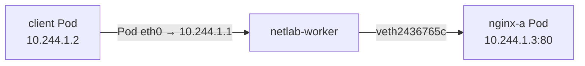
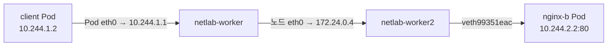
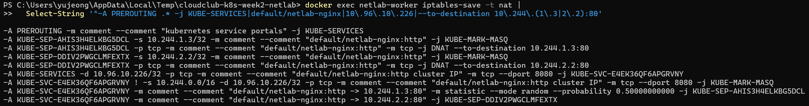
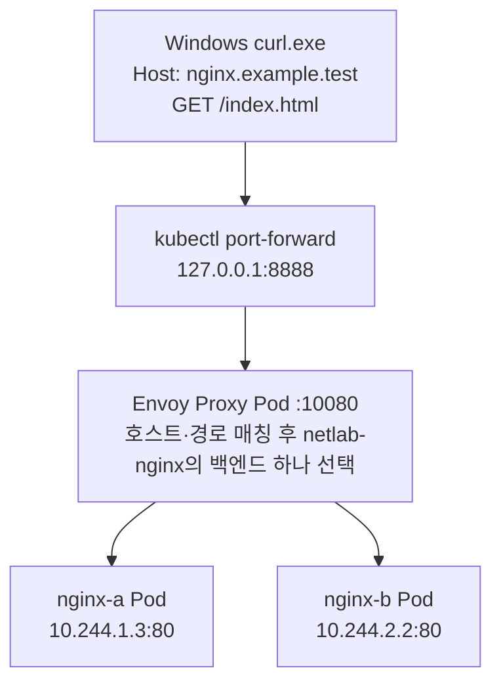

# 2주차 과제

## 실습 환경

| 항목            | 확인한 값                                         |
| --------------- | ------------------------------------------------- |
| Kubernetes 버전 | `v1.35.8`                                         |
| kind 버전       | `v0.33.0`                                         |
| CNI             | `kindnet` (`kindest/kindnetd:v20260820-69b56db7`) |
| CNI 동작 방식   | 직접 라우팅                                       |
| kube-proxy 모드 | `iptables` (`kind.yaml`에서 지정)                 |

## 기초

### 1. Pod와 Service의 구성 확인

#### Pod 배치

```powershell
# kind 설정 파일로 netlab 클러스터 생성
kind create cluster --name netlab --config kind.yaml --image kindest/node:v1.35.8

# Pod 설정 적용
kubectl apply -f .\pods.yaml

# Pod 이름, IP, 배치 노드 확인
kubectl get pods -o wide
```

| Pod       | Pod IP       | 배치 노드        |
| --------- | ------------ | ---------------- |
| `client`  | `10.244.1.2` | `netlab-worker`  |
| `nginx-a` | `10.244.1.3` | `netlab-worker`  |
| `nginx-b` | `10.244.2.2` | `netlab-worker2` |

<details>
<summary>kind.yaml</summary>

```yaml
kind: Cluster
apiVersion: kind.x-k8s.io/v1alpha4
networking:
  kubeProxyMode: iptables
nodes:
  - role: control-plane
  - role: worker
  - role: worker
```

</details>

<details>
<summary>pods.yaml</summary>

```yaml
apiVersion: v1
kind: Pod
metadata:
  name: client
spec:
  nodeSelector:
    kubernetes.io/hostname: netlab-worker
  containers:
    - name: client
      image: busybox:1.37
      command: ["sleep", "86400"]
---
apiVersion: v1
kind: Pod
metadata:
  name: nginx-a
  labels:
    app: netlab-nginx
spec:
  nodeSelector:
    kubernetes.io/hostname: netlab-worker
  containers:
    - name: nginx
      image: nginx:1.27
---
apiVersion: v1
kind: Pod
metadata:
  name: nginx-b
  labels:
    app: netlab-nginx
spec:
  nodeSelector:
    kubernetes.io/hostname: netlab-worker2
  containers:
    - name: nginx
      image: nginx:1.27
```

</details>

#### Service 구성

```powershell
# Service 생성
kubectl apply -f .\service.yaml

# ClusterIP, port, targetPort, selector 확인
kubectl describe service netlab-nginx
```

| 항목         | 확인한 값          |
| ------------ | ------------------ |
| ClusterIP    | `10.96.10.226`     |
| `port`       | `8080/TCP`         |
| `targetPort` | `80/TCP`           |
| `selector`   | `app=netlab-nginx` |

클라이언트는 `10.96.10.226:8080`으로 접속하고, Service는 `app=netlab-nginx` 라벨이 붙은 Pod의 `80`번 포트로 요청을 전달하도록 구성됐다.

<details>
<summary>service.yaml</summary>

```yaml
apiVersion: v1
kind: Service
metadata:
  name: netlab-nginx
spec:
  type: ClusterIP
  selector:
    app: netlab-nginx
  ports:
    - name: http
      port: 8080
      targetPort: 80
```

</details>

#### EndpointSlice 확인

```powershell
# netlab-nginx Service의 백엔드 확인
kubectl get endpointslice -l kubernetes.io/service-name=netlab-nginx -o yaml
```

| 백엔드 주소     | 연결된 Pod | 준비 상태     |
| --------------- | ---------- | ------------- |
| `10.244.1.3:80` | `nginx-a`  | `ready: true` |
| `10.244.2.2:80` | `nginx-b`  | `ready: true` |

`netlab-nginx`의 EndpointSlice에서 두 주소가 각 nginx Pod의 IP와 일치하는 것을 확인했다.

### 2. 같은 노드와 다른 노드의 Pod 간 통신

#### 실습 목적

- **Pod IP 직접 접근** — 같은 노드와 다른 노드의 Nginx에 접속하고 패킷 경로를 비교한다.
- **Service 접근** — ClusterIP와 DNS 이름으로 접속하고, DNS가 어떤 IP를 반환하는지 확인한다.

#### 요청 명령어와 결과

```powershell
# 같은 노드의 nginx-a와 다른 노드의 nginx-b에 직접 요청
kubectl exec client -- wget -S -O /dev/null http://10.244.1.3:80/
kubectl exec client -- wget -S -O /dev/null http://10.244.2.2:80/

# Service의 ClusterIP와 DNS 이름으로 요청
kubectl exec client -- wget -S -O /dev/null http://10.96.10.226:8080/
kubectl exec client -- wget -S -O /dev/null http://netlab-nginx.default.svc.cluster.local:8080/
```

| 요청 대상            | 입력한 주소                                   | 응답              | 확인한 내용                                                                      |
| -------------------- | --------------------------------------------- | ----------------- | -------------------------------------------------------------------------------- |
| Nginx Pod A의 Pod IP | `10.244.1.3:80`                               | `HTTP/1.1 200 OK` | 같은 노드의 `nginx-a`에 직접 접근했다.                                           |
| Nginx Pod B의 Pod IP | `10.244.2.2:80`                               | `HTTP/1.1 200 OK` | 다른 노드의 `nginx-b`에 직접 접근했다.                                           |
| Service의 ClusterIP  | `10.96.10.226:8080`                           | `HTTP/1.1 200 OK` | Service를 통해 Nginx 응답을 받았다.                                              |
| Service의 DNS 이름   | `netlab-nginx.default.svc.cluster.local:8080` | `HTTP/1.1 200 OK` | DNS 이름이 `10.96.10.226`으로 해석됐고, 같은 Service를 통해 Nginx 응답을 받았다. |

#### Pod IP로 직접 요청했을 때의 패킷 경로

- **공통 출발 경로** — `client` Pod → Pod의 `eth0` → 게이트웨이 `10.244.1.1` (`netlab-worker`)

##### ① 같은 노드 — `client` → `nginx-a`



1. `netlab-worker`에서 `nginx-a`의 IP `10.244.1.3`으로 가는 경로는 `dev veth2436765c`였다.
2. `netlab-worker`는 이 가상 인터페이스를 통해 **같은 노드에 있는** `nginx-a`로 전달한다.

##### ② 다른 노드 — `client` → `nginx-b`



1. `netlab-worker`에서 `nginx-b`의 IP `10.244.2.2`로 가는 경로는 `via 172.24.0.4 dev eth0`이었다. `eth0`으로 **다른 노드인** `netlab-worker2`(`172.24.0.4`)에 전달한다.
2. `netlab-worker2`에서 확인한 경로는 `dev veth99351eac`였다. 이 가상 인터페이스를 통해 `nginx-b`로 전달한다.

- **노드 사이 연결**: kindnet 직접 라우팅 (다음 홉 `172.24.0.4`, 터널 미사용)

### 3. Service는 어떻게 동작할까요?

#### 1. Service의 selector와 EndpointSlice는 백엔드 Pod 연결에 어떻게 관여하나요?

Service의 `selector`는 어떤 Pod를 백엔드로 삼을지 정하는 라벨 조건이다. 이 실습의 `netlab-nginx` Service는 다음 조건을 사용한다.

```yaml
selector:
  app: netlab-nginx
```

EndpointSlice 컨트롤러는 Service와 같은 네임스페이스에서 이 라벨이 붙은 Pod를 찾아 IP, 포트, 준비 상태를 기록한다. 실습에서 확인한 EndpointSlice는 다음과 같다.

| Pod       | 접속 주소       | 준비 상태     |
| --------- | --------------- | ------------- |
| `nginx-a` | `10.244.1.3:80` | `ready: true` |
| `nginx-b` | `10.244.2.2:80` | `ready: true` |

조건에 맞는 Pod가 추가·삭제되거나 준비 상태가 바뀌면 EndpointSlice도 갱신된다. `kube-proxy`는 이 정보를 바탕으로 노드의 트래픽 전달 규칙을 갱신한다.

#### 2. Pod IP 직접 접근과 ClusterIP 접근은 무엇이 다른가요?

| 구분        | Pod IP 직접 접근                    | ClusterIP 접근                                     |
| ----------- | ----------------------------------- | -------------------------------------------------- |
| 요청 주소   | `10.244.1.3:80`                     | `10.96.10.226:8080`                                |
| 연결 대상   | 주소를 지정한 `nginx-a`             | 준비된 `nginx-a` 또는 `nginx-b`                    |
| 주소 유지   | Pod를 재생성하면 IP가 바뀔 수 있다. | Service가 유지되는 동안 같은 ClusterIP를 사용한다. |
| 트래픽 분산 | 지정한 Pod에만 연결된다.            | 여러 백엔드에 연결을 분산할 수 있다.               |

예를 들어 `nginx-a`가 교체돼 Pod IP가 바뀌면 직접 접근하는 클라이언트는 새 IP를 알아야 한다. ClusterIP로 접근하는 클라이언트는 백엔드 정보가 갱신된 뒤에도 기존 Service 주소를 사용한다.

#### 3. ClusterIP로 보낸 요청의 목적지 주소와 포트는 어떻게 실제 Pod의 주소와 포트로 바뀌나요?

새 TCP 연결의 첫 패킷이 노드에 들어오면, 리눅스 커널이 `kube-proxy`가 설정한 iptables 규칙에 따라 목적지 IP와 포트를 바꾼다. 이 변환을 **DNAT(Destination Network Address Translation)** 라고 한다. `nginx-b`가 선택된 경우는 다음과 같다.

```text
10.96.10.226:8080 (Service의 ClusterIP와 port)
        ↓ DNAT
10.244.2.2:80    (nginx-b의 Pod IP와 targetPort)
```

커널은 변환된 Pod IP(`10.244.2.2`)를 기준으로 패킷을 전달한다. 응답이 돌아오면 `conntrack`에 기록된 변환을 역으로 적용해 응답의 출발지 `10.244.2.2:80`을 `10.96.10.226:8080`으로 바꾼다. 클라이언트에는 처음 접속한 Service 주소에서 응답이 온 것으로 보인다.

#### 4. 여러 백엔드 Pod 중 요청을 받을 대상은 어떻게 선택되나요?

이 실습의 Service는 세션 고정을 사용하지 않는다(`sessionAffinity: None`). 커널은 iptables 규칙에 따라 새 TCP 연결을 준비된 두 백엔드 중 하나에 무작위로 배정한다.

- **새 TCP 연결** — `nginx-a` 또는 `nginx-b` 중 하나를 선택한다. 두 Pod가 번갈아 선택된다는 보장은 없다.
- **기존 TCP 연결** — `conntrack`에 기록된 변환을 재사용하므로 처음 선택한 Pod로 계속 전달한다. 같은 TCP 연결에서 HTTP 요청을 여러 번 보내도 같은 Pod가 처리한다.

#### 5. kube-proxy의 역할은 무엇이며, iptables 모드에서 실제 패킷을 처리하는 주체는 무엇인가요?

`kube-proxy`는 규칙을 만들고, 실제 패킷에는 리눅스 커널이 그 규칙을 적용한다.

| 구성 요소    | 역할                                                                               |
| ------------ | ---------------------------------------------------------------------------------- |
| `kube-proxy` | Service와 EndpointSlice의 변경을 감시하고 각 노드의 iptables 규칙을 생성·갱신한다. |
| `iptables`   | 커널의 패킷 처리 규칙을 설정하고 조회하는 도구다.                                  |
| Netfilter    | 리눅스 커널에서 규칙을 적용해 실제 패킷을 처리하고 DNAT를 수행한다.                |
| `conntrack`  | 커널에서 연결 상태와 NAT 변환 정보를 추적한다.                                     |

#### 6. Service의 DNS 이름으로 요청하면 DNS는 어느 단계에 관여하나요?

DNS는 TCP 연결을 열기 전에 Service 이름을 ClusterIP로 해석하는 단계에 관여한다.

```text
① client가 DNS에 Service 이름을 조회한다.
   netlab-nginx.default.svc.cluster.local
             ↓
② 클러스터 DNS(CoreDNS)가 ClusterIP를 반환한다.
   10.96.10.226
             ↓
③ client가 요청 URL에 지정한 8080번 포트로 TCP 연결을 시작한다.
   10.96.10.226:8080
             ↓
④ 노드가 iptables 규칙에 따라 백엔드를 선택하고 목적지를 바꾼다.
   10.244.1.3:80 또는 10.244.2.2:80
             ↓
⑤ 선택된 Nginx Pod가 HTTP 요청을 처리한다.
```

### 4. Service 관련 iptables 규칙 캡처

`client` Pod가 배치된 `netlab-worker`의 호스트 네트워크 네임스페이스에서 NAT 규칙을 확인했다.

```powershell
kubectl --context kind-netlab -n default get pod client -o wide
docker exec netlab-worker ip route
docker exec netlab-worker ip link

# Service 진입 규칙과 netlab-nginx 관련 NAT 규칙 확인
docker exec netlab-worker iptables-save -t nat |
  Select-String '^-A PREROUTING .* -j KUBE-SERVICES|default/netlab-nginx|10\.96\.10\.226|--to-destination 10\.244\.(1\.3|2\.2):80'
```



| 처리 순서 | 캡처에서 찾을 줄 (출력 첫 줄부터) | 확인한 동작 |
| --- | --- | --- |
| ① 진입 | 1번째 줄 (`-A PREROUTING`) | 노드에 들어온 패킷을 `KUBE-SERVICES`로 넘긴다. |
| ② Service 매칭 | 6번째 줄 (`-A KUBE-SERVICES`) | 목적지가 `10.96.10.226:8080/TCP`이면 `KUBE-SVC-E4EK36QF6APGRVNY`로 넘긴다. |
| ③ 백엔드 선택 | 마지막 두 줄 (`--probability 0.50000000000`과 그다음 줄) | 50% 확률로 `KUBE-SEP-AHIS3H4ELKBG5DCL`을 선택한다. 첫 규칙에 일치하지 않으면 `KUBE-SEP-DDIV2PWGCLMFEXTX`로 넘긴다. |
| ④ 목적지 변환 | 3번째와 5번째 줄 (`-j DNAT`) | 선택된 체인에 따라 목적지를 `10.244.1.3:80`(`nginx-a`) 또는 `10.244.2.2:80`(`nginx-b`)으로 바꾼다. |

```text
PREROUTING
    ↓
KUBE-SERVICES
    ↓ ClusterIP:Port 매칭 (10.96.10.226:8080/TCP)
KUBE-SVC-E4EK36QF6APGRVNY
    ↓ 백엔드 선택
    ├─ KUBE-SEP-AHIS3H4ELKBG5DCL
    │      └─ DNAT → 10.244.1.3:80 (nginx-a)
    │
    └─ KUBE-SEP-DDIV2PWGCLMFEXTX
           └─ DNAT → 10.244.2.2:80 (nginx-b)
```

## 과제 2. Ingress의 한계와 Gateway API로 전환하는 이유

### 기초

#### 1. Ingress와 Ingress Controller의 역할을 구분해 설명하세요.

##### 1-1. Ingress는 무엇인가?

Ingress는 클러스터 외부의 HTTP(S) 요청을 어느 Service로 보낼지 선언하는 Kubernetes 리소스다. 다음은 `example.com`의 `/users` 요청을 `user-service`로 보내는 규칙이다.

```yaml
apiVersion: networking.k8s.io/v1
kind: Ingress
metadata:
  name: example-ingress
spec:
  rules:
    - host: example.com
      http:
        paths:
          - path: /users
            pathType: Prefix
            backend:
              service:
                name: user-service
                port:
                  number: 8080
```

- **요청 조건** — 호스트가 `example.com`이고 경로가 `/users` 또는 그 하위 경로일 때 일치한다.
- **전달 대상** — 일치한 요청을 `user-service`의 Service 포트 `8080`으로 보낸다.

##### 1-2. Ingress Controller는 왜 필요한가?

Ingress Controller는 API Server에 저장된 Ingress 규칙을 감시하고 프록시나 로드밸런서 설정에 반영한다.

1. **규칙 저장** — `kubectl apply`를 실행하면 API Server가 Ingress 리소스를 저장한다.
2. **설정 반영** — 컨트롤러가 변경을 감지하고 프록시의 라우팅 설정을 갱신한다.
3. **요청 처리** — 외부 요청이 들어오면 프록시가 호스트와 경로를 확인해 대상 Service의 백엔드로 전달한다.

컨트롤러는 이후 변경 사항도 계속 반영한다. 선언한 상태에 맞춰 실제 설정을 갱신하는 동작을 조정(Reconciliation)이라고 한다.

#### 2. Ingress API가 기본으로 제공하는 기능과 컨트롤러별 확장 기능을 구분하세요.

##### Ingress API의 기본 기능

Kubernetes Ingress API는 HTTP/HTTPS 트래픽을 내부 Service로 전달하기 위해 다음 기능을 표준 필드로 제공한다.

| 기능 | 설명 |
|---|---|
| Host 기반 라우팅 | 요청 도메인에 따라 서로 다른 Service로 전달 |
| Path 기반 라우팅 | URL 경로에 따라 서로 다른 Service로 전달 |
| TLS 종료 설정 | HTTPS 연결을 위한 인증서 Secret 지정 |
| Default Backend | 지정한 라우팅 규칙과 일치하지 않는 요청을 처리할 백엔드 설정 |

예를 들어 `example.com/users`는 `user-service`로, `example.com/orders`는 `order-service`로 전달하도록 설정할 수 있다.

##### 컨트롤러별 확장 기능

다음 기능은 컨트롤러가 확장으로 제공할 수 있다. 지원 범위와 설정 방식은 컨트롤러마다 다르다.

| 확장 기능 | 설명 |
|---|---|
| HTTP → HTTPS Redirect | HTTP 요청을 HTTPS로 리다이렉트 |
| URL Rewrite | 백엔드로 전달할 URL 경로 변경 |
| 가중치 기반 트래픽 분산 | 여러 백엔드에 지정한 비율로 트래픽 분배 |
| Rate Limiting | 클라이언트의 요청 횟수 제한 |
| 요청·응답 헤더 제어 | HTTP 헤더 추가·수정·삭제 |

이러한 기능은 주로 **annotation** (리소스에 추가하는 키-값 형태의 메타데이터)으로 설정한다. 컨트롤러에 따라 별도 리소스나 설정을 사용하기도 한다.

#### 3. 컨트롤러별 annotation에 의존하면 설정의 이식성과 유지보수에 어떤 문제가 생기는지 설명하세요.

##### ① 이식성(Portability) 저하

컨트롤러마다 지원하는 annotation의 이름과 동작 방식이 다르다. 예를 들어 A 컨트롤러의 URL 재작성 annotation을 B 컨트롤러가 인식하지 못하면 설정을 다시 작성해야 한다. B에서 같은 기능을 지원하지 않으면 다른 방법으로 구현해야 한다.

##### ② 설정 검증의 어려움

Annotation은 문자열 기반의 키-값 데이터이므로 Kubernetes API Server가 확장 설정의 형식과 의미를 충분히 검증하기 어렵다.

잘못된 값이 설정되어도 리소스 생성 시점에는 오류가 발견되지 않고, 컨트롤러가 해당 설정을 해석할 때 문제가 발생할 수 있다.

##### ③ 유지보수 비용 증가

확장 기능이 많아질수록 annotation이 증가하여 설정의 가독성이 떨어지고, 각 설정의 의미를 파악하기 어려워진다.

또한 컨트롤러별 문서를 확인해야 하며, 컨트롤러 버전 변경이나 교체 시 annotation의 호환성도 별도로 검토해야 한다.

##### Gateway API의 개선 방식

1. **컨트롤러별 annotation에 의존하던 기능을 표준 필드로 제공한다.**

   같은 HTTP → HTTPS 리다이렉트도 API에 설정하는 방식이 다르다.

   | Ingress (`ingress-nginx` 예시) | Gateway API |
   | --- | --- |
   | TLS가 설정된 Ingress에서 `nginx.ingress.kubernetes.io/ssl-redirect: "true"`를 annotation으로 지정할 수 있다. `ingress-nginx`가 이 키와 값을 해석한다. | HTTP 리스너에 연결된 `HTTPRoute`의 `filters`에 `RequestRedirect`와 `scheme: https`를 지정한다. 클라이언트는 리다이렉트 응답을 받고 HTTPS로 다시 요청한다. |

   Gateway API가 필드 이름과 동작을 정의하므로 API 스키마로 설정 형식을 검증할 수 있고, 같은 필터를 지원하는 컨트롤러 간에 설정을 재사용하기 쉽다.

2. **네트워크 설정을 역할별 리소스로 분리한다.**

   Ingress에서는 TLS 설정과 서비스별 라우팅을 같은 리소스에 작성할 수 있다. 여러 팀이 이를 함께 관리하면 어느 팀이 어떤 설정을 수정할 수 있는지 나누기 어렵다. Gateway API는 사용할 구현을 `GatewayClass`, 포트와 TLS를 `Gateway`, 서비스별 라우팅을 `HTTPRoute`로 나눈다.

   예를 들어 플랫폼팀이 공용 Gateway와 인증서를 관리하고, 백엔드팀이 `/api/v2`를 추가할 때는 자신의 HTTPRoute만 수정할 수 있다. 관리자는 RBAC로 팀별 수정 권한을 정하고, Gateway의 `allowedRoutes`로 어떤 Route가 진입점에 연결될 수 있는지 정한다.

#### 4. GatewayClass, Gateway, HTTPRoute의 역할과 관계를 정리하세요.

| 리소스 | 역할과 연결 관계 |
| --- | --- |
| `GatewayClass` | Gateway를 구현할 컨트롤러를 지정한다. |
| `Gateway` | `gatewayClassName`으로 GatewayClass를 참조한다. 리스너에서 요청을 받을 프로토콜과 포트, TLS 설정을 정한다. |
| `HTTPRoute` | `parentRefs`로 연결할 Gateway를 지정한다. 요청 경로 등의 조건을 정하고, `backendRefs`로 일치한 요청을 보낼 Service를 지정한다. |

```text
외부 HTTPS 요청
    ↓
Gateway의 HTTPS 리스너 (443번 포트)
    ├─ HTTPRoute의 /api 규칙   → api-service
    └─ HTTPRoute의 /admin 규칙 → admin-service
```

#### 5. Ingress API와 Gateway API를 기능, 확장 방식, 관리 책임 기준으로 비교하세요.

| 기준 | Ingress API | Gateway API |
| --- | --- | --- |
| **기능** | HTTP(S) 호스트·경로 라우팅, 기본 백엔드, TLS 종료를 표준으로 제공한다. | HTTPRoute로 헤더 조건, 백엔드 가중치, 리다이렉트 등을 설정할 수 있다. |
| **확장 방식** | 표준에 없는 기능은 주로 컨트롤러별 annotation으로 설정한다. | 여러 구현에서 쓰는 기능은 표준 필드와 필터로 제공하고, 구현별 기능은 확장 리소스나 정책으로 설정할 수 있다. |
| **관리 책임** | 라우팅과 TLS 설정을 같은 Ingress에 작성할 수 있어 두 설정의 수정 권한을 나누기 어렵다. | 운영팀은 GatewayClass와 Gateway에서 구현과 접속 설정을 관리하고, 앱 팀은 HTTPRoute에서 서비스별 라우팅을 관리할 수 있다. |

## 과제 3. Envoy Gateway로 Nginx Service 노출

### 기초

#### 1. Envoy Gateway와 Gateway API CRD 설치

```powershell
winget install --id Helm.Helm --exact
helm install eg oci://docker.io/envoyproxy/gateway-helm --version v1.10.0 --kube-context kind-netlab -n envoy-gateway-system --create-namespace
kubectl --context kind-netlab -n envoy-gateway-system wait deployment/envoy-gateway --for=condition=Available --timeout=5m
kubectl --context kind-netlab get crd gatewayclasses.gateway.networking.k8s.io gateways.gateway.networking.k8s.io httproutes.gateway.networking.k8s.io
```

Helm `v4.3.1`을 설치했다. Envoy Gateway의 `Available` 상태와 `GatewayClass`, `Gateway`, `HTTPRoute` CRD 등록을 확인했다.

- 확인한 버전은 Envoy Gateway `v1.10.0`, Gateway API `v1.6.1`이다. Envoy Gateway `v1.10`의 지원 범위에 실습 환경의 Kubernetes `v1.35`가 포함된다.

#### 2. GatewayClass, Gateway, HTTPRoute 구성

```powershell
$gatewayYaml = Join-Path $env:LOCALAPPDATA 'Temp\cloudclub-k8s-week2-netlab\gateway.yaml'
kubectl --context kind-netlab apply -f $gatewayYaml
```

<details>
<summary>gateway.yaml</summary>

```yaml
apiVersion: gateway.networking.k8s.io/v1
kind: GatewayClass
metadata:
  name: netlab-envoy
spec:
  controllerName: gateway.envoyproxy.io/gatewayclass-controller
---
apiVersion: gateway.networking.k8s.io/v1
kind: Gateway
metadata:
  name: netlab-gateway
  namespace: default
spec:
  gatewayClassName: netlab-envoy
  listeners:
    - name: http
      protocol: HTTP
      port: 80
---
apiVersion: gateway.networking.k8s.io/v1
kind: HTTPRoute
metadata:
  name: netlab-nginx-route
  namespace: default
spec:
  parentRefs:
    - name: netlab-gateway
      sectionName: http
  hostnames:
    - nginx.example.test
  rules:
    - matches:
        - path:
            type: Exact
            value: /index.html
      backendRefs:
        - name: netlab-nginx
          port: 8080
```

</details>

세 리소스가 생성됐으며, GatewayClass `netlab-envoy`의 `Accepted=True`를 확인했다.

#### 3. Nginx Service에 호스트·경로 라우팅 설정

| 호스트 | 경로 | 대상 Service |
| --- | --- | --- |
| `nginx.example.test` | `/index.html` (`Exact`) | `netlab-nginx:8080` |

#### 4. 리소스 상태와 요청 결과 확인

```powershell
kubectl --context kind-netlab -n default describe gateway netlab-gateway
kubectl --context kind-netlab -n default describe httproute netlab-nginx-route
```

| 확인 대상 | 상태 | 의미 |
| --- | --- | --- |
| Gateway `netlab-gateway` | `Accepted=True`, `Programmed=False` (`AddressNotAssigned`) | 컨트롤러가 설정을 수락했으며, Gateway에 할당된 주소는 없다. |
| HTTP 리스너 `http` | `Programmed=True`, `Attached Routes=1` | 리스너 설정을 데이터 플레인으로 전달하는 상태이며, Route 한 개가 연결됐다. |
| HTTPRoute `netlab-nginx-route` | `Accepted=True`, `ResolvedRefs=True` | Route가 수락됐고 백엔드 Service 등 참조가 해석됐다. |

##### Envoy Proxy 포트포워딩

```powershell
$envoyService = kubectl --context kind-netlab -n envoy-gateway-system get svc -l 'gateway.envoyproxy.io/owning-gateway-namespace=default,gateway.envoyproxy.io/owning-gateway-name=netlab-gateway' -o jsonpath='{.items[0].metadata.name}'
kubectl --context kind-netlab -n envoy-gateway-system port-forward "svc/$envoyService" 8888:80
```

Windows의 `127.0.0.1:8888`을 Envoy Proxy Service의 `80`번 포트에 연결했다 (Envoy Pod의 대상 포트 `10080`).

##### HTTP 요청 결과

```powershell
curl.exe -i -H "Host: nginx.example.test" http://127.0.0.1:8888/index.html
curl.exe -i -H "Host: wrong.example.test" http://127.0.0.1:8888/index.html
curl.exe -i -H "Host: nginx.example.test" http://127.0.0.1:8888/
```

| Host 헤더 | 요청 경로 | 응답 | 확인한 내용 |
| --- | --- | --- | --- |
| `nginx.example.test` | `/index.html` | `200 OK` | Nginx 기본 페이지(`Welcome to nginx!`)를 받았다. |
| `wrong.example.test` | `/index.html` | `404 Not Found` | 경로가 맞아도 호스트가 다르면 규칙에 일치하지 않는다. |
| `nginx.example.test` | `/` | `404 Not Found` | 호스트가 맞아도 `Exact`로 지정한 경로와 다르면 규칙에 일치하지 않는다. |

Gateway에 할당된 주소가 없는 상태에서 포트포워딩을 사용해 Envoy Proxy의 요청 처리를 확인했다.

#### 5. 구성 요소별 역할

| 구성 요소 | 실습에서의 역할 |
| --- | --- |
| GatewayClass `netlab-envoy` | `netlab-gateway`를 처리할 컨트롤러 구현을 지정한다. |
| Gateway `netlab-gateway` | HTTP `80`번 포트에서 요청을 받도록 정의한다. |
| HTTPRoute `netlab-nginx-route` | `nginx.example.test`와 `/index.html`이 일치하는 요청의 백엔드로 `netlab-nginx:8080`을 지정한다. |
| Envoy Gateway | 위 리소스와 백엔드 정보를 읽어 Envoy Proxy의 리스너와 라우팅 설정을 구성한다. |
| Envoy Proxy | 실제 HTTP 요청을 받아 호스트와 경로를 확인한 뒤 백엔드에 전달한다. |
| Service `netlab-nginx` | HTTPRoute가 참조하는 백엔드다. Service 포트 `8080`에 대응하는 Nginx Pod의 포트는 `80`이다. |
| Nginx Pod (`nginx-a`, `nginx-b`) | 선택된 Pod가 `/index.html` 요청에 Nginx 기본 페이지를 반환한다. |

#### 6. 클라이언트에서 Nginx Pod까지의 요청 경로



Envoy Gateway는 `GatewayClass`, `Gateway`, `HTTPRoute`와 Service의 EndpointSlice를 읽어 프록시에 설정을 전달한다. Envoy Proxy는 이 설정을 사용해 선택한 Pod에 요청을 보낸다.
