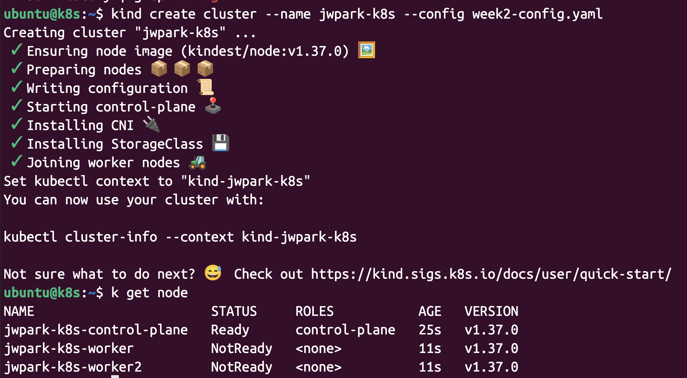
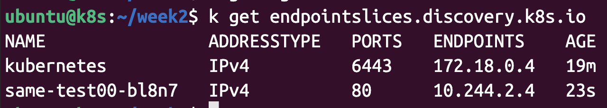
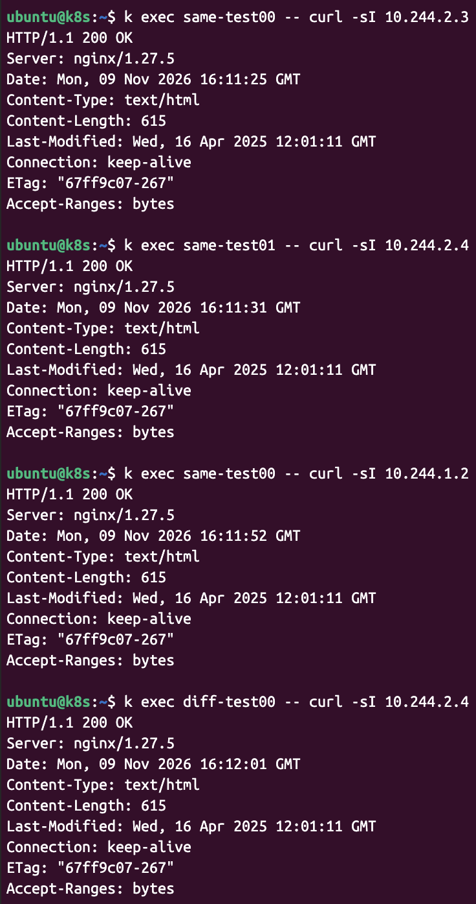
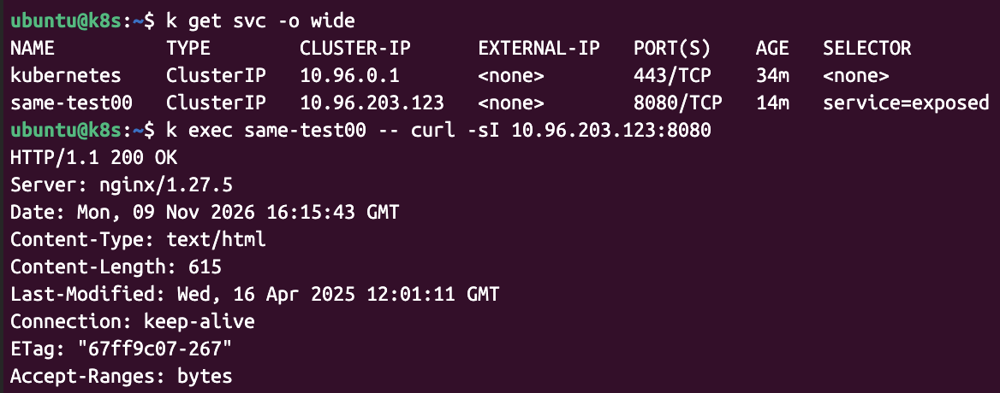

노드 생성


### 1\. Pod와 Service의 구성 확인.   
각 Pod의 이름, Pod IP, 배치된 노드를 표로 정리하세요.  

|pod 명| pod ip | 배치된 노드 |
|---|---|---|
|same-test00| 10.244.2.4 | jwpark-k8s-worker|
|same-test01| 10.244.2.3 | jwpark-k8s-worker|
|diff-test00| 10.244.1.2 | jwpark-k8s-worker2|

Service의 ClusterIP, port, targetPort, selector를 확인하세요.  
|ClusterIP| port | targetPort | selector|
|---|---|---|---|
|10.96.203.123| 8080 | 80| service:exposed|

EndpointSlice에 등록된 백엔드 주소가 어떤 Pod와 대응하는지 확인하세요.



### 2\. 같은 노드와 다른 노드의 Pod 간 통신.   
클라이언트 Pod에서 다음 요청을 수행하고 결과를 기록하세요.

1. 같은 노드의 Pod 간 통신, 서로 다른 노드의 Pod 간 통신.


2. Service의 ClusterIP	Service를 통한 백엔드 접근. 



3. Service의 DNS 이름 해석과 Service 접근
```bash
ubuntu@k8s:~$ k run client --image=busybox:1.28 -it --rm  -- nslookup same-test00
If you don't see a command prompt, try pressing enter.
warning: couldn't attach to pod/client, falling back to streaming logs: Internal error occurred: Internal error occurred: error attaching to container: container is in CONTAINER_EXITED state
Server:    10.96.0.10
Address 1: 10.96.0.10 kube-dns.kube-system.svc.cluster.local

Name:      same-test00
Address 1: 10.96.203.123 same-test00.default.svc.cluster.local
pod "client" deleted
```


4. 같은 노드와 다른 노드에서 패킷이 거치는 경로를 각각 그림으로 설명하세요. 
    - 인터페이스, 라우팅, 터널 사용 여부는 실제 CNI 구성에서 확인합니다.

모든 환경이 브리지나 VXLAN을 사용한다고 가정하지 않습니다.

### 3\. Service는 어떻게 동작할까요? 다음 질문에 답하세요.

1. Service의 selector와 EndpointSlice는 백엔드 Pod 연결에 어떻게 관여하나요?  
2. Pod IP 직접 접근과 ClusterIP 접근은 무엇이 다른가요?  
3. ClusterIP로 보낸 요청의 목적지 주소와 포트는 어떻게 실제 Pod의 주소와 포트로 바뀌나요?  
4. 여러 백엔드 Pod 중 요청을 받을 대상은 어떻게 선택되나요?  
5. kube-proxy의 역할은 무엇이며, iptables 모드에서 실제 패킷을 처리하는 주체는 무엇인가요?  
6. Service의 DNS 이름으로 요청하면 DNS는 어느 단계에 관여하나요?  

### 4\. Service 관련 iptables 규칙 캡처

전체 출력에서 실습 Service와 관련된 규칙을 찾아 캡처하고 다음 내용을 표시하세요.

```bash
ubuntu@k8s:~$ docker exec jwpark-k8s-worker iptables-save -t nat | grep "10.96.203.123"
-A KUBE-SERVICES -d 10.96.203.123/32 -p tcp -m comment --comment "default/same-test00 cluster IP" -m tcp --dport 8080 -j KUBE-SVC-DQ6DX5C3VPKO7CII
-A KUBE-SVC-DQ6DX5C3VPKO7CII ! -s 10.244.0.0/16 -d 10.96.203.123/32 -p tcp -m comment --comment "default/same-test00 cluster IP" -m tcp --dport 8080 -j KUBE-MARK-MASQ
ubuntu@k8s:~$ docker exec jwpark-k8s-worker iptables -t nat -nvL --line-numbers | grep "10.96.203.123"
3        1    60 KUBE-SVC-DQ6DX5C3VPKO7CII  tcp  --  *      *       0.0.0.0/0            10.96.203.123        /* default/same-test00 cluster IP */ tcp dpt:8080
1        0     0 KUBE-MARK-MASQ  tcp  --  *      *      !10.244.0.0/16        10.96.203.123        /* default/same-test00 cluster IP */ tcp dpt:8080
ubuntu@k8s:~$ docker exec jwpark-k8s-worker ip route
default via 172.18.0.1 dev eth0
10.244.0.0/24 via 172.18.0.4 dev eth0
10.244.1.0/24 via 172.18.0.2 dev eth0
10.244.2.3 dev vethcadbdd23 scope host
10.244.2.4 dev veth34896298 scope host
172.18.0.0/16 dev eth0 proto kernel scope link src 172.18.0.3
ubuntu@k8s:~$ docker exec jwpark-k8s-worker ip link
1: lo: <LOOPBACK,UP,LOWER_UP> mtu 65536 qdisc noqueue state UNKNOWN mode DEFAULT group default qlen 1000
    link/loopback 00:00:00:00:00:00 brd 00:00:00:00:00:00
2: eth0@if12: <BROADCAST,MULTICAST,UP,LOWER_UP> mtu 1500 qdisc noqueue state UP mode DEFAULT group default
    link/ether aa:26:fb:9b:b7:37 brd ff:ff:ff:ff:ff:ff link-netnsid 0
4: vethcadbdd23@if2: <BROADCAST,MULTICAST,UP,LOWER_UP> mtu 1500 qdisc noqueue state UP mode DEFAULT group default
    link/ether 46:de:c2:5b:e8:8b brd ff:ff:ff:ff:ff:ff link-netns cni-b1841000-b745-8bdc-8933-218ebf161412
5: veth34896298@if2: <BROADCAST,MULTICAST,UP,LOWER_UP> mtu 1500 qdisc noqueue state UP mode DEFAULT group default
    link/ether 06:b6:86:97:16:01 brd ff:ff:ff:ff:ff:ff link-netns cni-927e18a2-8c24-35a7-f222-b100efa7313b
```

Service의 ClusterIP와 포트를 매칭하는 규칙
백엔드를 선택하는 규칙
목적지를 실제 Pod IP와 targetPort로 변환하는 DNAT 규칙
관련 체인 사이의 연결과 요청 처리 순서
일반적인 KUBE-SERVICES → KUBE-SVC-* → KUBE-SEP-* 연결을 참고하되, 실제 환경에서 확인한 체인과 규칙을 근거로 설명하세요.

심화
Service 생성 전후 비교: iptables 규칙을 비교하고 추가된 규칙의 역할을 설명하세요.
백엔드 변경 관찰: Nginx Pod 하나를 삭제·재생성하고 Pod IP, EndpointSlice, iptables 규칙과 요청 결과가 어떻게 바뀌는지 확인하세요.
패킷 경로 검증: tcpdump로 같은 노드·다른 노드의 Pod 통신을 관찰하고, 캡처 위치별 출발지·목적지 주소를 경로 그림과 대조하세요.
iptables / IPVS / nftables 비교: kube-proxy의 세 모드를 다음 기준으로 비교하세요. 비교 조사는 문서를 기준으로 수행할 수 있으며, 세 모드를 모두 설치할 필요는 없습니다.
비교 기준	정리할 내용
동작 원리	Service 요청 처리와 백엔드 선택 방식
커널 기능	사용하는 커널 기능과 자료 구조
관찰 방법	규칙·상태를 확인하는 명령과 출력 예시
성능과 확장성	Service·백엔드 수 증가에 따른 특성과 근거
운영	갱신 방식, 디버깅, 필요한 설정
지원 상태	조사한 Kubernetes 버전에서의 지원·권장·사용 중단 상태
NAT 규칙 카운터는 주로 새 연결의 첫 패킷에 반응하므로 HTTP 요청 횟수와 같다고 가정하지 마세요. kind의 노드는 컨테이너이며, 물리 서버의 NIC·스위치 구간까지 재현하는 환경은 아니라는 점도 구분합니다.