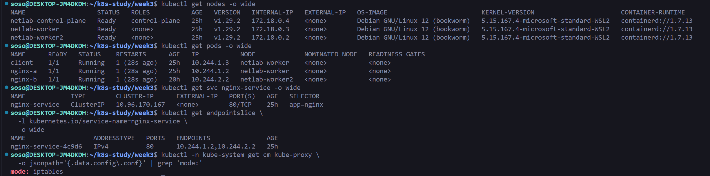
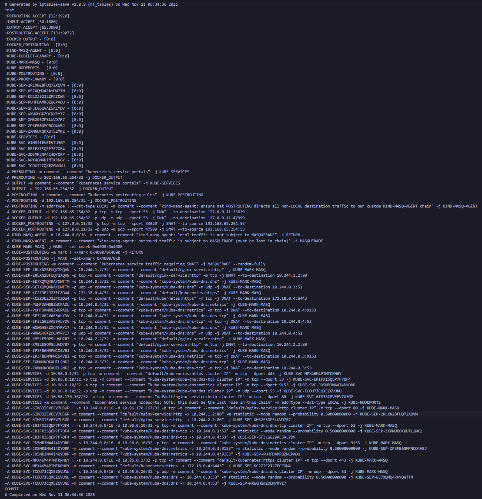

# 과제 1. Nginx로 알아보는 Pod 통신과 Service 동작 원리

## 1. 실습 환경

WSL2에서 kind 멀티 노드 클러스터를 구성하였다.

**kind.yaml**

```yaml
kind: Cluster
apiVersion: kind.x-k8s.io/v1alpha4
networking:
  kubeProxyMode: iptables
nodes:
  - role: control-plane
  - role: worker
  - role: worker
```

```bash
kind create cluster --name netlab --config kind.yaml
kubectl get nodes -o wide
```

| Node                 | Internal IP | Kubernetes |
| -------------------- | ----------- | ---------- |
| netlab-control-plane | 172.18.0.4  | v1.29.2    |
| netlab-worker        | 172.18.0.3  | v1.29.2    |
| netlab-worker2       | 172.18.0.2  | v1.29.2    |

- kind CLI: v0.22.0
- Kubernetes: v1.29.2
- CNI: kindnet (`kindnetd:v20240202-8f1494ea`)
- CNI 동작: veth 기반 직접 라우팅, 터널 미사용
- kube-proxy: iptables 모드

```bash
kubectl get daemonset -A
kubectl -n kube-system get configmap kube-proxy \
  -o jsonpath='{.data.config\.conf}' | grep mode
```

```
kindnet      3/3 Ready
kube-proxy   3/3 Ready
mode: iptables
```

## 2. 기초

### 2.1. Pod 및 Service 구성

`nodeSelector`를 사용하여 client와 nginx-a를 worker에, nginx-b를 worker2에 배치하였다. Nginx는 각각 `nginx-a`, `nginx-b` 문자열을 반환하도록 설정했다.

pod는 다음 pod.yaml을 사용하여 구성하였다.

```bash
apiVersion: v1
kind: Pod
metadata:
  name: nginx-a
  labels:
    app: nginx
spec:
  nodeSelector:
    kubernetes.io/hostname: netlab-worker
  containers:
    - name: nginx
      image: nginx:alpine
      command:
        - /bin/sh
        - -c
        - |
          echo "nginx-a" > /usr/share/nginx/html/index.html
          nginx -g 'daemon off;'
      ports:
        - containerPort: 80
---
apiVersion: v1
kind: Pod
metadata:
  name: nginx-b
  labels:
    app: nginx
spec:
  nodeSelector:
    kubernetes.io/hostname: netlab-worker2
  containers:
    - name: nginx
      image: nginx:alpine
      command:
        - /bin/sh
        - -c
        - |
          echo "nginx-b" > /usr/share/nginx/html/index.html
          nginx -g 'daemon off;'
      ports:
        - containerPort: 80
---
apiVersion: v1
kind: Pod
metadata:
  name: client
spec:
  nodeSelector:
    kubernetes.io/hostname: netlab-worker
  containers:
    - name: client
      image: curlimages/curl:latest
      command: ["sleep", "infinity"]
```

**초기 배치 결과**

| Pod     | IP         | Node           |
| ------- | ---------- | -------------- |
| client  | 10.244.1.3 | netlab-worker  |
| nginx-a | 10.244.1.2 | netlab-worker  |
| nginx-b | 10.244.2.2 | netlab-worker2 |

Service는 다음과 같이 구성하였다.

```yaml
apiVersion: v1
kind: Service
metadata:
  name: nginx-service
spec:
  type: ClusterIP
  selector:
    app: nginx
  ports:
    - name: http
      protocol: TCP
      port: 80
      targetPort: 80
```

```bash
kubectl apply -f service.yaml
kubectl get svc nginx-service -o wide
```

| 항목       | 값            |
| ---------- | ------------- |
| ClusterIP  | 10.96.170.167 |
| port       | 80            |
| targetPort | 80            |
| selector   | app=nginx     |

```bash
kubectl get endpointslice \
  -l kubernetes.io/service-name=nginx-service -o yaml
```

초기 EndpointSlice에는 `10.244.1.2`(nginx-a), `10.244.2.2`(nginx-b)가 등록되었다. Service의 selector에 일치하는 Pod들이 백엔드로 연결된 것을 확인했다.



### 2.2. Pod 간 통신 및 Service 접근

**같은 노드**

```bash
kubectl exec client -- curl -s <http://10.244.1.2>
```

```
nginx-a
```

**다른 노드** (nginx-b 재생성 이후)

```bash
kubectl exec client -- curl -s <http://10.244.2.3>
```

```
nginx-b
```

Pod IP로 직접 요청하면 지정한 Pod에 연결된다.

**ClusterIP 접근**

```bash
SERVICE_IP=$(kubectl get svc nginx-service \
  -o jsonpath='{.spec.clusterIP}')

for i in $(seq 1 10); do
  kubectl exec client -- curl -s http://$SERVICE_IP
done
```

```
nginx-b
nginx-a
nginx-a
nginx-a
nginx-a
nginx-b
nginx-b
nginx-a
nginx-a
nginx-a
```

nginx-a 7회, nginx-b 3회 응답하였다. Service가 두 백엔드에 요청을 전달하는 것을 확인했다.

**DNS 접근**

```bash
kubectl exec client -- curl -v <http://nginx-service>
```

```
Host nginx-service:80 was resolved.
IPv4: 10.96.170.167
Trying 10.96.170.167:80...
HTTP/1.1 200 OK
```

DNS는 `nginx-service`를 ClusterIP로 해석한다. 백엔드 선택은 이후 Service의 네트워크 규칙에서 이루어진다.

### 2.3. 같은 노드와 다른 노드의 패킷 경로

```bash
docker exec netlab-worker ip route
docker exec netlab-worker ip -d link
docker exec netlab-worker2 ip route
docker exec netlab-worker2 ip -d link
```

**같은 노드의 라우팅 규칙**

```
10.244.1.2 dev veth91a1b2b2 scope host
10.244.1.3 dev veth52985aac scope host
```

```
client (10.244.1.3)
    │
    ▼
veth52985aac
    │
    ▼
Linux 라우팅
    │
    ▼
veth91a1b2b2
    │
    ▼
nginx-a (10.244.1.2)
```

두 Pod가 같은 노드에 있으므로 해당 노드 내부의 네트워크 인터페이스만 거쳐 통신한다.

**다른 노드의 라우팅 규칙**

```
# netlab-worker
10.244.2.0/24 via 172.18.0.2 dev eth0

# netlab-worker2 (nginx-b 재생성 후)
10.244.2.3 dev veth063d8d8a scope host
```

```
client (10.244.1.3)
       │
       ▼
veth52985aac
       │
       ▼
netlab-worker eth0 (172.18.0.3)
       │
       │ via 172.18.0.2
       ▼
Docker 가상 네트워크
       │
       ▼
netlab-worker2 eth0 (172.18.0.2)
       │
       ▼
veth063d8d8a
       │
       ▼
nginx-b (10.244.2.3)
```

kindnet은 다른 노드의 Pod CIDR에 대한 직접 라우팅을 구성하였다. 확인한 환경에서는 Linux bridge나 VXLAN 터널을 사용하지 않았다.

| 비교             | 같은 노드 통신   | 다른 노드 통신      |
| ---------------- | ---------------- | ------------------- |
| 요청             | client → nginx-a | client → nginx-b    |
| veth 사용        | O                | O                   |
| 노드 eth0 통과   | X                | O                   |
| 다른 노드로 전달 | X                | O                   |
| 라우팅 방식      | 노드 내부 라우팅 | 노드 간 직접 라우팅 |

### 2.4. Service 동작 원리

Service 요청 처리에서 각 구성 요소의 역할은 다음과 같다.

| 구성 요소          | 역할                                                  |
| ------------------ | ----------------------------------------------------- |
| selector           | Service와 연결할 Pod 식별                             |
| EndpointSlice      | 백엔드 IP, 포트 및 준비 상태 관리                     |
| kube-proxy         | Service와 EndpointSlice를 감시하고 iptables 규칙 갱신 |
| iptables/netfilter | 패킷의 백엔드 선택 및 DNAT 처리                       |
| DNS                | Service 이름을 ClusterIP로 해석                       |

Pod IP 직접 접근은 특정 Pod를 지정하지만, ClusterIP 접근은 Service를 거쳐 백엔드가 선택된다.

kube-proxy가 패킷을 직접 전달하는 것은 아니며, 실제 처리는 Linux 커널의 netfilter에서 이루어진다. kube-proxy는 규칙을 만들어 놓는 역할이다.

- ex) 10.96.170.167:80으로 요청이 오면 nginx-a 또는 nginx-b로 전달하도록 설정해.

### 2.5. iptables 규칙 분석



```bash
docker exec netlab-worker iptables-save -t nat

docker exec netlab-worker \
  iptables -t nat -nvL --line-numbers
```

**① ClusterIP 매칭**

```
-A KUBE-SERVICES -d 10.96.170.167/32 \
  -p tcp --dport 80 \
  -j KUBE-SVC-6IM33IEVEEV7U3GP
```

목적지가 Service의 ClusterIP:80인 요청을 Service 전용 체인으로 전달한다.

**② 백엔드 선택**

```
-A KUBE-SVC-6IM33IEVEEV7U3GP \
  -m statistic --mode random \
  --probability 0.50000000000 \
  -j KUBE-SEP-2RLXN2BFUQ72XQVN

-A KUBE-SVC-6IM33IEVEEV7U3GP \
  -j KUBE-SEP-XM52E5OP5LUVD7R7
```

새 연결에서 nginx-a를 50% 확률로 선택하고, 나머지는 nginx-b로 전달한다.

**③ DNAT**

- DNAT이란, 외부 네트워크에서 내부 네트워크로 들어오는 패킷의 **목적지(Destination) IP 주소와 포트**를 다른 주소로 변환하는 기술.

```
KUBE-SEP-2RLXN2BFUQ72XQVN
DNAT --to-destination 10.244.1.2:80

KUBE-SEP-XM52E5OP5LUVD7R7
DNAT --to-destination 10.244.2.2:80
```

ClusterIP로 향하던 패킷의 목적지를 실제 Pod IP와 포트로 변경한다.

```
10.96.170.167:80
      │
      ▼
KUBE-SERVICES
      │
      ▼
KUBE-SVC-6IM33IEVEEV7U3GP
      │
      ├── KUBE-SEP-2RLXN... → 10.244.1.2:80
      │
      └── KUBE-SEP-XM52...  → 10.244.2.2:80
```

---

## 3. 심화

### 3.1. Service 생성 전후 iptables 비교

Service 생성 전과 후의 NAT 규칙을 저장하였다.

```bash
docker exec netlab-worker iptables-save -t nat \
  > iptables-before.txt

# Service 생성 이후
docker exec netlab-worker iptables-save -t nat \
  > iptables-after.txt

diff -u iptables-before.txt iptables-after.txt
```

실제 추가된 체인:

```diff
+:KUBE-SEP-2RLXN2BFUQ72XQVN - [0:0]
+:KUBE-SEP-XM52E5OP5LUVD7R7 - [0:0]
+:KUBE-SVC-6IM33IEVEEV7U3GP - [0:0]
```

Service 생성 후 ClusterIP 매칭 규칙, 백엔드 선택 규칙, DNAT 규칙이 추가되었다.

### 3.2. 백엔드 삭제 및 재생성

**nginx-b 삭제**

```bash
kubectl delete pod nginx-b
kubectl get pods -o wide

kubectl get endpointslice \
  -l kubernetes.io/service-name=nginx-service -o yaml
```

EndpointSlice에서 nginx-b가 제거되고 nginx-a(`10.244.1.2`)만 남았다.

```bash
for i in $(seq 1 5); do
  kubectl exec client -- curl -s <http://nginx-service>
done
```

```
nginx-a
nginx-a
nginx-a
nginx-a
nginx-a
```

**nginx-b 재생성**

```bash
kubectl apply -f pod.yaml
kubectl get pods -o wide
```

```
nginx-a   Running   10.244.1.2   netlab-worker
nginx-b   Running   10.244.2.3   netlab-worker2
client    Running   10.244.1.3   netlab-worker
```

Pod IP가 `10.244.2.2`에서 `10.244.2.3`으로 변경되었다.

**EndpointSlice 변경**

```bash
diff -u endpointslice-before.yaml endpointslice-after.yaml
```

```diff
- 10.244.2.2
+ 10.244.2.3
```

**iptables 변경**

```bash
diff -u iptables-backend-before.txt \
  iptables-backend-after.txt
```

```diff
- KUBE-SEP-XM52E5OP5LUVD7R7
+ KUBE-SEP-YCCJEHRLM7UYVT5W

- DNAT --to-destination 10.244.2.2:80
+ DNAT --to-destination 10.244.2.3:80
```

Service IP는 그대로 유지되고, EndpointSlice와 DNAT 규칙만 새 백엔드 IP에 맞춰 갱신되었다.

**재생성 후 요청**

```bash
for i in $(seq 1 10); do
  kubectl exec client -- curl -s <http://nginx-service>
done
```

결과: nginx-a 7회, nginx-b 3회. 재생성된 백엔드로도 요청이 정상적으로 전달되었다.

### 3.3. tcpdump 패킷 경로 검증

**같은 노드**

```bash
docker exec netlab-worker \
  tcpdump -i any -nn 'host 10.244.1.2 and tcp port 80'
```

client에서 요청:

```bash
kubectl exec client -- curl -s <http://10.244.1.2>
```

실제 캡처:

```
veth52985aac In
10.244.1.3.58746 > 10.244.1.2.80: Flags [S]

veth91a1b2b2 Out
10.244.1.3.58746 > 10.244.1.2.80: Flags [S]

10.244.1.3.58746 > 10.244.1.2.80:
HTTP: GET / HTTP/1.1

10.244.1.2.80 > 10.244.1.3.58746:
HTTP: HTTP/1.1 200 OK
```

같은 패킷이 client 측 veth에서 들어오고 nginx-a 측 veth로 나가는 것을 확인했다. `-i any`를 사용했기 때문에 두 인터페이스에서 각각 캡처되었다.

**다른 노드**

```bash
docker exec netlab-worker \
  tcpdump -i eth0 -nn 'host 10.244.2.3 and tcp port 80'
```

요청:

```bash
kubectl exec client -- curl -s <http://10.244.2.3>
```

출발 노드의 실제 캡처:

```
10.244.1.3.43060 > 10.244.2.3.80: Flags [S]

10.244.1.3.43060 > 10.244.2.3.80:
HTTP: GET / HTTP/1.1

10.244.2.3.80 > 10.244.1.3.43060:
HTTP: HTTP/1.1 200 OK
```

목적지 노드에서도 확인하였다.

```bash
docker exec netlab-worker2 \
  tcpdump -i eth0 -nn 'host 10.244.1.3 and tcp port 80'
```

```
10.244.1.3.52586 > 10.244.2.3.80: Flags [S]

10.244.1.3.52586 > 10.244.2.3.80:
HTTP: GET / HTTP/1.1

10.244.2.3.80 > 10.244.1.3.52586:
HTTP: HTTP/1.1 200 OK
```

두 노드의 eth0에서 Pod IP를 출발지와 목적지로 하는 패킷을 확인했다. 두 캡처는 별도 요청이므로 출발지 포트가 다르다.

### 3.4. iptables / IPVS / nftables 비교

| 항목           | iptables                                     | IPVS                                    | nftables                           |
| -------------- | -------------------------------------------- | --------------------------------------- | ---------------------------------- |
| 동작 원리      | 규칙 체인을 통한 백엔드 선택 및 DNAT         | IPVS 가상 서버 및 스케줄러              | nftables 규칙과 집합을 통한 NAT    |
| 커널 기능      | netfilter, conntrack                         | IPVS, netfilter                         | nf_tables, conntrack               |
| 자료 구조      | 규칙 체인                                    | 해시 테이블, 백엔드 목록                | set/map, 체인                      |
| 확인 명령어    | `iptables-save -t nat`                       | `ipvsadm -Ln`                           | `nft list ruleset`                 |
| 성능·확장성    | 규칙 수 증가에 따른 처리·갱신 비용 발생 가능 | 해시 기반 조회, Service API 구현상 제약 | 대규모 규칙 관리 및 갱신 효율 개선 |
| 운영           | kube-proxy가 규칙 갱신                       | IPVS 커널 모듈 필요                     | nftables 지원 커널 필요            |
| v1.29.2 지원   | 지원                                         | 지원                                    | Alpha                              |
| 이후 지원 상태 | 지원 유지                                    | v1.35부터 Deprecated                    | v1.33부터 Stable                   |

실습에서는 `iptables-save v1.8.9 (nf_tables)`가 출력되었으나, 이는 iptables 명령이 nft 호환 백엔드를 사용한다는 뜻이다. 실제 kube-proxy는 `iptables` 모드로 동작하였다.

또한 NAT 규칙 카운터는 주로 새 연결의 첫 패킷에 반응하므로 HTTP 요청 횟수와 동일하게 해석하지 않았다.

참고: Kubernetes Service Proxy 공식 문서

---

# 과제 2. Ingress의 한계와 Gateway API로 전환하는 이유

## 1. 기초

### 1.1. Ingress와 Ingress Controller의 역할

- Ingress: 외부 HTTP/HTTPS 요청을 어떤 Service로 전달할지 정의하는 Kubernetes API 리소스이다.
- Ingress Controller: Ingress 설정을 실제 로드 밸런싱 인프라에 적용하는 구현체이다.

Ingress는 라우팅 규칙을 정의하며, Ingress Controller는 해당 규칙이 실제로 동작하도록 한다.

### 1.2. Ingress의 기본 기능과 확장 기능

| 구분                   | 기능                                                  |
| ---------------------- | ----------------------------------------------------- |
| Ingress 기본 기능      | Host 기반 라우팅, Path 기반 라우팅, TLS 종료          |
| Controller별 확장 기능 | HTTP→HTTPS 리다이렉트 등 annotation으로 제공하는 기능 |

Ingress API는 기본적인 HTTP 라우팅과 TLS 종료만 제공한다. 추가 기능은 주로 컨트롤러별 annotation에 의존한다.

### 1.3. Annotation 의존의 문제점

1. 이식성: 컨트롤러마다 지원하는 annotation이 달라 교체할 때 설정을 수정해야 한다. 일부 기능은 다른 컨트롤러에서 지원하지 않을 수도 있다.
2. 유지보수: annotation은 문자열 형태의 key-value 설정이며 리소스 상단에 모여 있어, 설정이 많아질수록 관리하기 불편하다.

Gateway API는 여러 기능을 구조화된 필드로 제공하고, 추가 확장은 별도의 리소스와 Policy 등을 활용한다.

### 1.4. GatewayClass, Gateway, HTTPRoute의 역할

| 리소스       | 역할                                      |
| ------------ | ----------------------------------------- |
| GatewayClass | Gateway가 사용할 구현체의 클래스 지정     |
| Gateway      | HTTP/HTTPS 진입점, 포트, TLS 설정         |
| HTTPRoute    | Host, Path, 백엔드 Service 등 라우팅 규칙 |

```
GatewayClass (prod)
       │
       ▼
Gateway (example-gateway)
       │
       ├── HTTP :80
       └── HTTPS :443
                │
                ▼
            HTTPRoute
                │
                ▼
          Backend Service
```

Gateway는 `gatewayClassName`으로 GatewayClass를 지정하고, HTTPRoute는 `parentRefs`를 통해 연결할 Gateway를 지정한다.

### 1.5. Ingress API와 Gateway API 비교

| 비교 항목 | Ingress API                         | Gateway API                                            |
| --------- | ----------------------------------- | ------------------------------------------------------ |
| 기능      | 기본 HTTP 라우팅, TLS 종료          | 리다이렉트, 트래픽 분할, 헤더 기반 라우팅 등 추가 기능 |
| 확장 방식 | Annotation, Resource Backend        | 외부 리소스 참조, 커스텀 구현, Policy                  |
| 관리 책임 | 주로 Ingress 리소스 중심            | Gateway와 HTTPRoute로 책임 분리                        |
| 규칙 충돌 | 컨트롤러별 처리 방식이 다를 수 있음 | 병합 및 충돌 처리 방식 명세화                          |
| 이식성    | Annotation 의존으로 제한            | 표준 필드가 많아 상대적으로 높음                       |

## 2. 심화

### 2.1. 관리 책임 분리 및 RBAC

여러 개발팀이 하나의 진입점을 공유하는 상황에서 Gateway API는 관리 책임을 다음과 같이 나눌 수 있다.

| 담당자                       | 관리 리소스 | 담당 내용                            |
| ---------------------------- | ----------- | ------------------------------------ |
| 운영자 / 애플리케이션 관리자 | Gateway     | 진입점, 포트, TLS 인증서             |
| 개발팀                       | HTTPRoute   | 애플리케이션별 경로와 백엔드 Service |

장점: 운영자가 공통 진입점을 관리하면서 개발팀은 자신의 애플리케이션 라우팅만 수정할 수 있다.

RBAC를 활용하면 운영자에게 Gateway 관리 권한을, 개발팀에게 HTTPRoute 관리 권한을 부여하는 식으로 책임을 구분할 수 있다.

공식 문서에서는 이러한 분리가 필수는 아니며, 하나의 RBAC Role에 여러 역할의 권한을 통합하는 것도 가능하다고 설명한다. 구체적인 Role YAML 예제는 제공하지 않는다.

### 2.2. Ingress와 Gateway API YAML 비교

공식 문서는 `foo.example.com`, `bar.example.com`을 사용하는 Ingress를 하나의 Gateway와 세 개의 HTTPRoute로 전환한다.

① Host와 Path 설정

Ingress:

```
rules:
- host: foo.example.com
  http:
    paths:
    - path: /orders
      pathType: Prefix
      backend:
        service:
          name: foo-orders-app
          port:
            number: 80
```

Gateway API의 HTTPRoute:

```
spec:
  parentRefs:
  - name: example-gateway
    sectionName: https
  hostnames:
  - foo.example.com
  rules:
  - matches:
    - path:
        type: PathPrefix
        value: /orders
    backendRefs:
    - name: foo-orders-app
      port: 80
```

Ingress의 `rules.host`와 `paths`가 HTTPRoute의 `hostnames`, `matches.path`, `backendRefs`로 이동한다.

② TLS 설정

Ingress:

```
tls:
- hosts:
  - foo.example.com
  - bar.example.com
  secretName: example-com
```

Gateway:

```
listeners:
- name: https
  port: 443
  protocol: HTTPS
  hostname: "*.example.com"
  tls:
    mode: Terminate
    certificateRefs:
    - kind: Secret
      name: example-com
```

Ingress의 TLS 설정은 Gateway의 HTTPS listener로 이동한다.

③ HTTP → HTTPS 리다이렉트

Ingress에서는 컨트롤러별 annotation을 사용한다.

```
annotations:
  example-ingress-controller.example.org/tls-redirect: "True"
```

Gateway API에서는 HTTPRoute의 `RequestRedirect` 필터를 사용한다.

```
spec:
  parentRefs:
  - name: example-gateway
    sectionName: http
  hostnames:
  - foo.example.com
  - bar.example.com
  rules:
  - filters:
    - type: RequestRedirect
      requestRedirect:
        scheme: https
        port: 443
```

전환 관계를 정리하면 다음과 같다.

| Ingress                    | Gateway API                        |
| -------------------------- | ---------------------------------- |
| `ingressClassName`         | Gateway의 `gatewayClassName`       |
| 암묵적인 HTTP/HTTPS 진입점 | Gateway의 `listeners`              |
| `tls.secretName`           | Gateway의 `tls.certificateRefs`    |
| `rules.host`               | HTTPRoute의 `hostnames`            |
| `paths.path`               | HTTPRoute의 `matches.path`         |
| `backend.service`          | HTTPRoute의 `backendRefs`          |
| TLS redirect annotation    | HTTPRoute의 `RequestRedirect` 필터 |

### 2.3. Gateway API 전환 판단

기대 효과

- 기존 annotation에 의존하던 여러 기능을 표준 API 필드로 관리할 수 있다.
- Gateway와 HTTPRoute를 분리하여 운영팀과 개발팀의 관리 책임을 구분할 수 있다.
- 라우팅 규칙의 병합과 충돌 처리가 표준화되어 있다.

구현체별 확인 사항

- 사용하려는 Gateway 컨트롤러가 필요한 기능을 지원하는지 확인해야 한다.
- 인증, 연결 시간 제한, 헬스 체크 등은 컨트롤러마다 지원 방식이 다를 수 있으므로 관련 문서를 확인해야 한다.

Annotation 자동 변환

- 기존 annotation 중 리다이렉트, 트래픽 분할 등 일부 기능은 Gateway API의 표준 기능으로 옮길 수 있다.
- 나머지 구현체별 기능은 대상 Gateway 구현체의 문서를 확인해야 한다.
- 공식 문서에서는 `ingress2gateway` 변환 도구를 소개하지만, 변환 결과를 반드시 테스트하고 검증해야 한다고 명시한다.

---

# **과제 3. Envoy Gateway로 Gateway API 적용하기**
