# week2 이연호

## 실습 환경

| 항목 | 내용 |
| --- | --- |
| 호스트 | macOS (Apple Silicon), Docker Desktop |
| kind | v0.32.0 |
| Kubernetes | v1.36.1 (`kindest/node:v1.36.1`) |
| 컨테이너 런타임 | containerd 2.3.1 |
| CNI | kindnet (kind 기본 CNI), 노드 간 터널 없이 라우팅으로 전달 |
| kube-proxy 모드 | iptables |
| 노드 구성 | 컨트롤 플레인 1개 + 워커 2개 |
| Envoy Gateway | v1.10.0 (Helm 설치) |
| Gateway API | v1.6.1 |

---

# 과제 1. Nginx로 알아보는 Pod 통신과 Service 동작 원리

## 실습 환경 구조

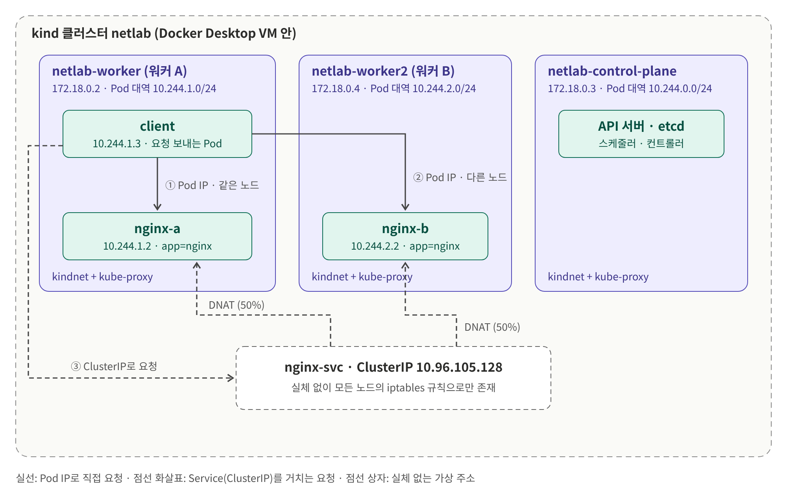

- 클러스터 안에 노드 3개가 있고, Pod는 특정 노드 위에서 실행됩니다.
- 노드마다 kindnet(CNI)과 kube-proxy가 하나씩 동작합니다.
- client는 클러스터 안에서 요청을 보내기 위해 만든 Pod이며, 같은 노드·다른 노드 통신을 비교하려고 nginx-a와 같은 워커 A에 배치했습니다.
- Service(nginx-svc)는 특정 노드에 올라가 있지 않습니다. kube-proxy가 모든 노드에 같은 iptables 규칙을 만들어, 어느 노드에서 ClusterIP로 요청해도 실제 Pod로 바뀌어 전달됩니다.

## 실습 준비

### 클러스터 생성

```yaml
# kind.yaml
kind: Cluster
apiVersion: kind.x-k8s.io/v1alpha4
networking:
  kubeProxyMode: iptables
nodes:
  - role: control-plane
  - role: worker
  - role: worker
```

```bash
kind create cluster --name netlab --config kind.yaml
kubectl get nodes -o wide
```

### Pod와 Service 배포

`nodeSelector`로 client와 nginx-a는 `netlab-worker`(워커 A)에, nginx-b는 `netlab-worker2`(워커 B)에 배치했습니다.

```yaml
# pods.yaml
apiVersion: v1
kind: Pod
metadata:
  name: client
spec:
  nodeSelector:
    kubernetes.io/hostname: netlab-worker
  containers:
    - name: client
      image: nicolaka/netshoot
      command: ["sleep", "infinity"]
---
apiVersion: v1
kind: Pod
metadata:
  name: nginx-a
  labels:
    app: nginx
spec:
  nodeSelector:
    kubernetes.io/hostname: netlab-worker
  containers:
    - name: nginx
      image: nginx:1.27
      ports:
        - containerPort: 80
---
apiVersion: v1
kind: Pod
metadata:
  name: nginx-b
  labels:
    app: nginx
spec:
  nodeSelector:
    kubernetes.io/hostname: netlab-worker2
  containers:
    - name: nginx
      image: nginx:1.27
      ports:
        - containerPort: 80
```

```yaml
# svc.yaml (서비스 설정)
apiVersion: v1
kind: Service
metadata:
  name: nginx-svc
spec:
  type: ClusterIP
  selector:
    app: nginx
  ports:
    - port: 80
      targetPort: 80
```

```bash
kubectl apply -f pods.yaml
kubectl apply -f svc.yaml
```

어느 Pod가 응답했는지 구분하기 위해 각 nginx의 첫 페이지를 바꿨습니다.

```bash
kubectl exec nginx-a -- sh -c 'echo "hello from nginx-a (worker A)" > /usr/share/nginx/html/index.html'
kubectl exec nginx-b -- sh -c 'echo "hello from nginx-b (worker B)" > /usr/share/nginx/html/index.html'
```

## 기초 1. Pod와 Service의 구성 확인

| Pod | Pod IP | 노드 | 노드 IP |
| --- | --- | --- | --- |
| client | 10.244.1.3 | netlab-worker (워커 A) | 172.18.0.2 |
| nginx-a | 10.244.1.2 | netlab-worker (워커 A) | 172.18.0.2 |
| nginx-b | 10.244.2.2 | netlab-worker2 (워커 B) | 172.18.0.4 |

워커 A의 Pod는 `10.244.1.x`, 워커 B의 Pod는 `10.244.2.x`처럼 노드마다 Pod IP 대역이 나뉘어 있습니다.

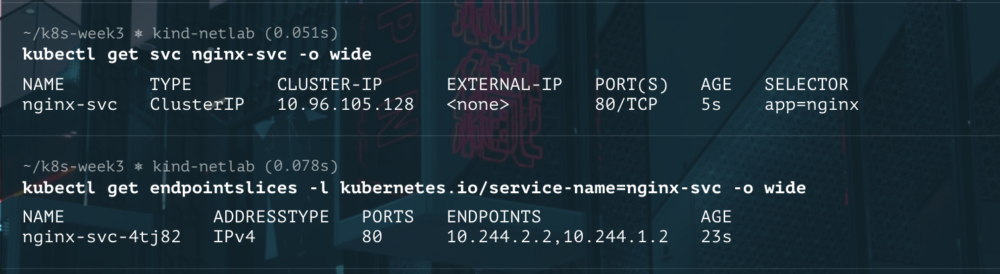

| 항목 | 값 |
| --- | --- |
| ClusterIP | 10.96.105.128 |
| port / targetPort | 80 / 80 |
| selector | `app=nginx` |
| EndpointSlice 백엔드 | 10.244.1.2 (nginx-a), 10.244.2.2 (nginx-b) |

EndpointSlice에는 `app=nginx` 라벨이 붙은 nginx-a, nginx-b의 IP만 등록됐고, 라벨이 없는 client는 들어가지 않았습니다.

## 기초 2. 같은 노드와 다른 노드의 Pod 간 통신

```bash
kubectl exec client -- curl -s 10.244.1.2                       # 같은 노드 Pod IP
kubectl exec client -- curl -s 10.244.2.2                       # 다른 노드 Pod IP
kubectl exec client -- sh -c 'for i in $(seq 1 10); do curl -s 10.96.105.128; done'  # ClusterIP
kubectl exec client -- nslookup nginx-svc                       # DNS 조회
kubectl exec client -- curl -s nginx-svc                        # DNS 이름
```

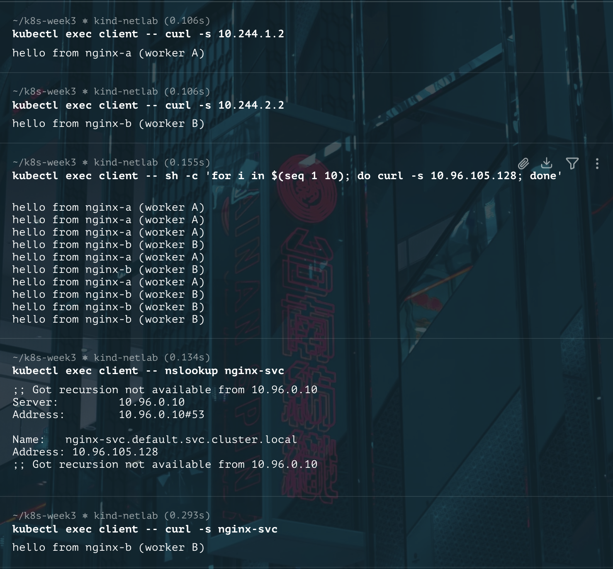

| 요청 대상 | 결과 |
| --- | --- |
| nginx-a Pod IP (10.244.1.2) | 항상 nginx-a 응답 |
| nginx-b Pod IP (10.244.2.2) | 항상 nginx-b 응답 |
| ClusterIP (10.96.105.128), 10회 | nginx-a 5회, nginx-b 5회가 무작위 순서로 섞여 응답. 매번 동일 횟수로 호출되진 않음 (한 번 더 해봤는데, nginx-a 6회, nginx-b 4회 호출됐었음) |
| DNS 이름 (nginx-svc) | CoreDNS(10.96.0.10)가 `nginx-svc.default.svc.cluster.local`을 10.96.105.128로 응답, 이후 정상 응답 |

### 실제 네트워크 구성 확인

CNI는 kindnet이고, kindnet과 kube-proxy가 노드마다 하나씩 동작합니다.

client Pod 안에서는 모든 트래픽을 노드(`10.244.1.1`)로 넘깁니다. `eth0@if12`는 이 인터페이스의 반대쪽 끝(veth)이 노드에 있다는 뜻입니다.

워커 A의 라우팅 표와 인터페이스입니다.


```text
10.244.1.2 dev vethe73c6d98 scope host     # nginx-a: 같은 노드, veth로 바로 전달
10.244.1.3 dev veth09594565 scope host     # client
10.244.2.0/24 via 172.18.0.4 dev eth0      # 워커 B 대역: 워커 B 노드로 전달
10.244.0.0/24 via 172.18.0.3 dev eth0      # 컨트롤 플레인 대역
```

- Pod마다 veth가 하나씩 있습니다(워커 A에 Pod 2개, veth 2개).
- `tunl0`, `gre0` 같은 터널 장치는 모두 `DOWN` 상태로 사용되지 않습니다. 노드 간 통신은 VXLAN 같은 터널 없이 Docker 네트워크(172.18.0.0/16) 위에서 라우팅으로 이뤄집니다.

워커 B의 라우팅 표도 같은 구조입니다.

```text
10.244.2.2 dev vethf745b371 scope host     # nginx-b
10.244.1.0/24 via 172.18.0.2 dev eth0      # 워커 A 대역 (응답이 돌아가는 길)
```

### 패킷 경로

**같은 노드 (client → nginx-a)**: 노드 안에서 veth만 갈아타고 끝나며, 노드의 eth0을 거치지 않습니다.

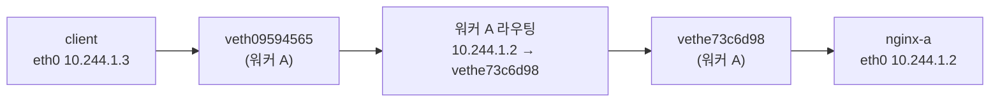

**다른 노드 (client → nginx-b)**: 워커 A의 eth0으로 나가 Docker 네트워크를 거쳐 워커 B로 갑니다. 패킷을 감싸지 않고 목적지 10.244.2.2를 그대로 단 채로 라우팅됩니다.

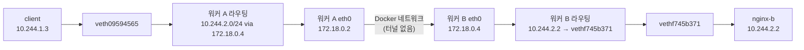

## 기초 3. Service는 어떻게 동작할까요?

**selector와 EndpointSlice는 백엔드 연결에 어떻게 관여하나요?**

-> selector는 백엔드 Pod를 고르는 조건이고, 이 조건에 맞는 Pod들의 IP와 포트가 EndpointSlice에 명단으로 기록됩니다. 

kube-proxy는 이 명단을 보고 iptables 규칙을 만듭니다. 실습에서 client는 `app=nginx` 라벨이 없어서 명단에 들어가지 않았습니다.

**Pod IP 직접 접근과 ClusterIP 접근은 무엇이 다른가요?**

-> Pod IP로 보내면 주소 변환 없이 그 Pod로 바로 갑니다(실습에선 항상 nginx-a가 응답). ClusterIP로 보내면 노드의 iptables가 목적지를 실제 Pod IP로 바꾸고(DNAT), 여러 Pod 중 하나로 나눠 보냅니다(nginx-a, nginx-b가 섞여서 응답). ClusterIP는 Pod가 다시 만들어져도 바뀌지 않습니다.

**ClusterIP의 목적지 주소와 포트는 어떻게 실제 Pod의 주소와 포트로 바뀌나요?**

-> 노드의 iptables nat 테이블에서 `KUBE-SEP-*` 체인의 DNAT 규칙이 목적지를 바꿉니다. 실습에서는 `10.96.105.128:80`이 `--to-destination 10.244.1.2:80` 또는 `10.244.2.2:80`으로 바뀌었습니다.

**여러 백엔드 Pod 중 요청을 받을 대상은 어떻게 선택되나요?**

-> `KUBE-SVC-*` 체인의 `statistic --mode random` 규칙으로 무작위로 선택합니다. 백엔드가 2개라 첫 규칙은 50% 확률로 nginx-a, 나머지는 조건 없이 nginx-b로 갑니다. 순서대로 돌아가는 방식이 아니라서 10번 요청 결과가 순서 없이 섞여 나왔습니다.

**kube-proxy의 역할과 실제로 패킷을 처리하는 주체는 무엇인가요?**

-> kube-proxy는 Service와 EndpointSlice의 변화를 지켜보다가 노드의 iptables 규칙을 만들고 갱신합니다. 실제 패킷의 매칭과 DNAT는 리눅스 커널(netfilter)이 처리합니다. 그래서 만약 kube-proxy가 잠시 멈춰도 이미 만든 규칙으로 기존 Service는 계속 동작합니다.

**Service의 DNS 이름으로 요청하면 DNS는 어느 단계에 관여하나요?**

-> 요청을 보내기 전, 이름을 IP로 바꾸는 단계에서만 관여합니다. client는 `/etc/resolv.conf`에 적힌 CoreDNS(`10.96.0.10`)에 `nginx-svc`를 물어보고 ClusterIP `10.96.105.128`을 받습니다. 그 뒤의 DNAT와 라우팅은 ClusterIP로 직접 요청할 때와 같습니다.

## 기초 4. Service 관련 iptables 규칙

client가 있는 워커 A(`netlab-worker`)의 호스트 네트워크 네임스페이스에서 확인했습니다.

```bash
docker exec netlab-worker iptables -t nat -nvL PREROUTING
docker exec netlab-worker iptables-save -t nat | grep 'default/nginx-svc'
```

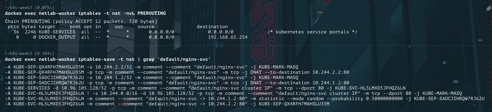

처리 순서대로 정리하면 다음과 같습니다.

| 순서 | 규칙 | 역할 |
| --- | --- | --- |
| 0 | `PREROUTING → KUBE-SERVICES` | 노드로 들어온 패킷을 쿠버네티스 Service 규칙으로 보냄 |
| 1 | `KUBE-SERVICES -d 10.96.105.128/32 --dport 80 -j KUBE-SVC-HL5LMXD5JFHQZ6LN` | ClusterIP와 포트가 일치하면 nginx-svc 체인으로 |
| 2 | `KUBE-SVC-HL5L... --probability 0.5 -j KUBE-SEP-SADCJIHRQW7RJ62U` | 50% 확률로 nginx-a 담당 체인 선택 |
| 2 | `KUBE-SVC-HL5L... -j KUBE-SEP-QX4RFH7MAHSLU35M` | 나머지는 nginx-b 담당 체인으로 |
| 3 | `KUBE-SEP-SADC... -j DNAT --to-destination 10.244.1.2:80` | 목적지를 nginx-a Pod IP와 targetPort로 변환 |
| 3 | `KUBE-SEP-QX4R... -j DNAT --to-destination 10.244.2.2:80` | 목적지를 nginx-b Pod IP와 targetPort로 변환 |

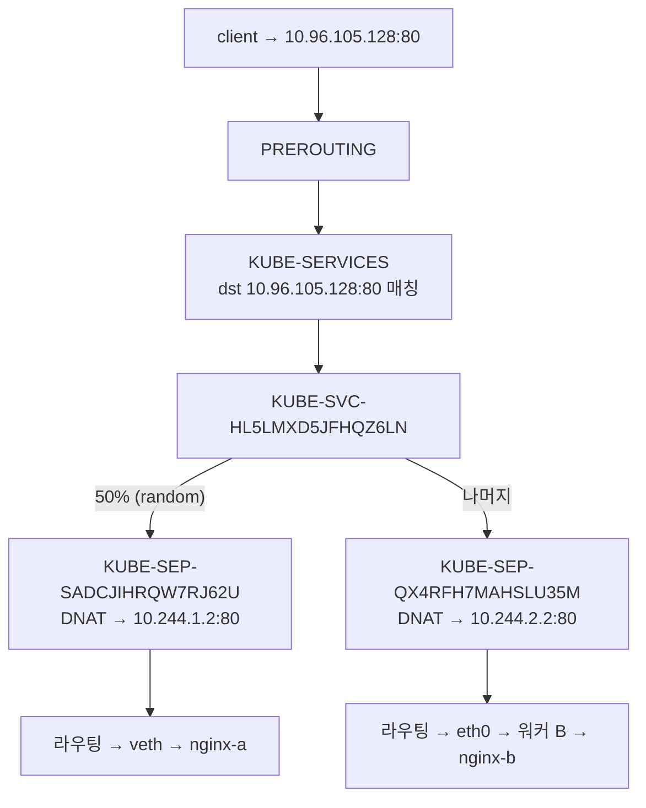

- ClusterIP는 어떤 인터페이스에도 붙어 있지 않고, `KUBE-SERVICES`의 매칭 조건으로만 존재합니다.
- `KUBE-MARK-MASQ` 규칙도 있었습니다. Pod가 아닌 곳(`! -s 10.244.0.0/16`)에서 ClusterIP로 요청하거나, Pod가 Service를 통해 자기 자신에게 요청하는 경우 출발지 주소도 바꾸도록 표시하는 규칙입니다. 이번 실습의 client 요청은 두 경우에 해당하지 않습니다.
- PREROUTING의 패킷 카운터(36 pkts)는 HTTP 요청 횟수가 아닙니다. nat 규칙은 새 연결의 첫 패킷에서 주로 평가되고, DNS 등 다른 트래픽도 섞여 있습니다.

---

# 과제 2. Ingress의 한계와 Gateway API로 전환하는 이유

참고 자료: [Migrating from Ingress](https://gateway-api.sigs.k8s.io/guides/getting-started/migrating-from-ingress/)

## 기초 1. Ingress와 Ingress controller

Ingress는 "이 호스트와 경로는 저 Service로"라는 라우팅 규칙을 적어둔 리소스이고, 실제로 트래픽을 받아 전달하는 것은 **Ingress controller(nginx, Traefik 등)** 입니다. Ingress만 만들고 컨트롤러가 없으면 아무 일도 일어나지 않습니다. 어떤 컨트롤러가 처리할지는 IngressClass로 정합니다.

## 기초 2. 기본 기능과 컨트롤러별 확장 기능

Ingress API는 호스트·경로 기반 라우팅과 TLS 종료만 기본으로 지원합니다. 

HTTP→HTTPS 리다이렉트, 헤더 조작, 트래픽 분배 같은 기능은 컨트롤러별 annotation으로 추가해야 합니다.

## 기초 3. annotation 의존의 문제

annotation은 컨트롤러마다 이름과 의미가 달라서, 컨트롤러를 바꾸면 설정을 다시 써야 합니다. 다른 컨트롤러는 모르는 annotation을 에러 없이 무시하기 때문에 기능이 조용히 사라질 수도 있습니다. 또 구조 없는 문자열이라 오타가 나도 검증되지 않고, 개수가 늘수록 관리하기 어렵습니다.

## 기초 4. GatewayClass, Gateway, HTTPRoute

- **GatewayClass**: 어떤 구현체(컨트롤러)를 쓸지 정합니다.
- **Gateway**: 그 구현체로 만들 진입점(listener의 포트, 호스트, TLS)을 선언합니다. `gatewayClassName`으로 GatewayClass를 참조합니다.
- **HTTPRoute**: `parentRefs`로 Gateway에 연결되어, 요청을 어떤 Service로 보낼지 라우팅 규칙을 정합니다.

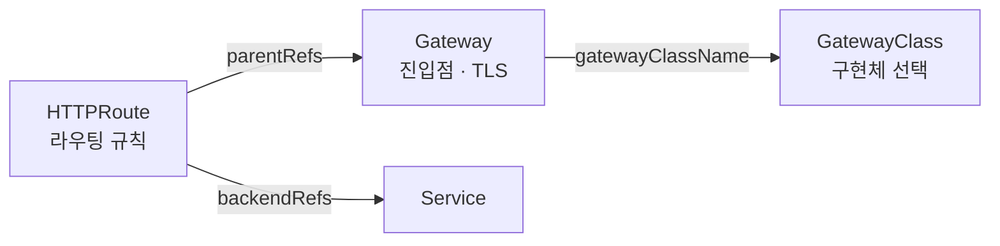

## 기초 5. Ingress API와 Gateway API 비교

| 기준 | Ingress | Gateway API |
| --- | --- | --- |
| 기능 | 호스트·경로 라우팅, TLS 위주 | 리다이렉트, 헤더 조작, 트래픽 가중치 분배, 헤더·쿼리·메서드 매칭을 표준 필드로 지원 |
| 진입점 | 컨트롤러가 암묵적으로 제공 | Gateway의 listener로 명시적으로 선언 |
| 확장 방식 | 컨트롤러별 annotation | 표준 필드와 정해진 확장 지점(Policy, `extensionRef`). annotation 확장은 권장하지 않음 |
| 관리 책임 | 한 리소스에 모든 설정이 섞여 있음 | GatewayClass(인프라) / Gateway(운영) / HTTPRoute(개발)로 나뉘어 팀별로 권한 분리 가능 |

예를 들어 개발팀이 새 경로를 추가할 때, Gateway API에서는 HTTPRoute만 수정하면 되고 Gateway(공통 진입점)는 건드리지 않아도 됩니다.

---

# 과제 3. Envoy Gateway로 Gateway API 적용하기

## 실습 환경 구조

과제 1의 클러스터에 Envoy Gateway를 추가하고, 맥에서 들어오는 요청을 nginx로 전달했습니다.

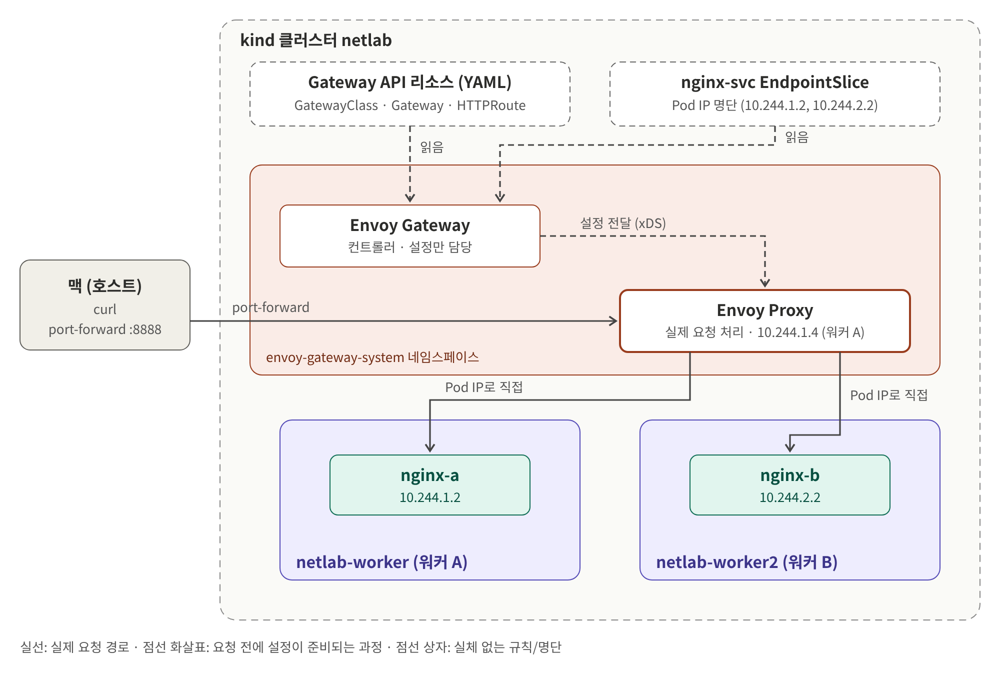

- 실선은 실제 요청 경로, 점선은 요청이 오기 전에 설정이 준비되는 과정입니다.
- Envoy Gateway(컨트롤러)는 YAML과 Pod 명단을 읽고 Envoy Proxy를 설정하며, 요청은 직접 처리하지 않습니다.
- 실제 요청은 Envoy Proxy가 받아 nginx Pod IP로 바로 전달합니다.
- kind에는 LoadBalancer가 없어 맥에서 포트포워딩으로 Envoy Proxy에 접근했습니다.

## 설치

```bash
helm install eg oci://docker.io/envoyproxy/gateway-helm \
  --version v1.10.0 \
  -n envoy-gateway-system --create-namespace

kubectl wait --timeout=5m -n envoy-gateway-system \
  deployment/envoy-gateway --for=condition=Available

kubectl get pods -n envoy-gateway-system
kubectl get crd | grep gateway.networking.k8s.io
helm list -n envoy-gateway-system
```

Helm 차트 하나로 Gateway API CRD와 Envoy Gateway 컨트롤러가 함께 설치됐습니다.

| 항목 | 버전 |
| --- | --- |
| Envoy Gateway | v1.10.0 (`gateway-helm-v1.10.0`) |
| Gateway API (CRD bundle-version) | v1.6.1 |
| Helm | v4.2.3 |

## 기초 1~2. GatewayClass, Gateway, HTTPRoute 구성

```yaml
# gateway.yaml
apiVersion: gateway.networking.k8s.io/v1
kind: GatewayClass
metadata:
  name: eg
spec:
  controllerName: gateway.envoyproxy.io/gatewayclass-controller
---
apiVersion: gateway.networking.k8s.io/v1
kind: Gateway
metadata:
  name: nginx-gateway
  namespace: default
spec:
  gatewayClassName: eg
  listeners:
    - name: http
      protocol: HTTP
      port: 80
```

```bash
kubectl apply -f gateway.yaml
kubectl get gateway nginx-gateway
kubectl get pods,svc -n envoy-gateway-system
```

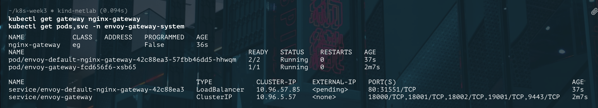

Gateway를 만들자 Envoy Gateway 컨트롤러가 `envoy-default-nginx-gateway-*` Pod와 Service(Envoy Proxy)를 새로 띄웠습니다. Envoy Proxy Pod는 Envoy 본체와 보조 컨테이너로 구성되어 `READY 2/2`입니다. Service가 `LoadBalancer` 타입이지만 kind에는 외부 IP를 할당하는 장치가 없어 `EXTERNAL-IP`가 `<pending>`으로 남습니다.

## 기초 3. 호스트·경로 기반 라우팅

nginx가 `/hello` 경로에 응답하도록 파일을 준비했습니다.

```bash
kubectl exec nginx-a -- sh -c 'echo "hello path from nginx-a" > /usr/share/nginx/html/hello'
kubectl exec nginx-b -- sh -c 'echo "hello path from nginx-b" > /usr/share/nginx/html/hello'
```

```yaml
# httproute.yaml
apiVersion: gateway.networking.k8s.io/v1
kind: HTTPRoute
metadata:
  name: nginx-route
  namespace: default
spec:
  parentRefs:
    - name: nginx-gateway
  hostnames:
    - "nginx.local"
  rules:
    - matches:
        - path:
            type: PathPrefix
            value: /hello
      backendRefs:
        - name: nginx-svc
          port: 80
```

```bash
kubectl apply -f httproute.yaml
```

## 기초 4. 상태 조건과 요청 결과 확인

kind에는 LoadBalancer가 없으므로 공식 Quickstart처럼 포트포워딩으로 진입 경로를 만들었습니다. 도메인이 없어서 `Host` 헤더를 직접 지정했습니다.

```bash
# 별도 터미널
kubectl -n envoy-gateway-system port-forward \
  service/envoy-default-nginx-gateway-42c88ea3 8888:80

# 요청
for i in $(seq 1 10); do curl -s -H "Host: nginx.local" http://localhost:8888/hello; done
curl -s -o /dev/null -w "%{http_code}\n" -H "Host: other.local" http://localhost:8888/hello
curl -s -o /dev/null -w "%{http_code}\n" -H "Host: nginx.local" http://localhost:8888/bye
```

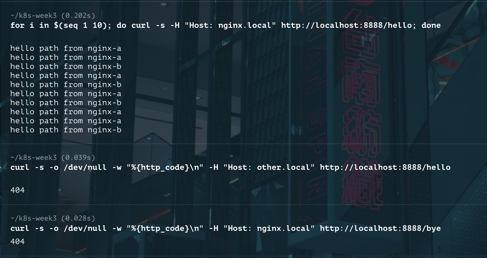

| 요청 | 결과 | 의미 |
| --- | --- | --- |
| Host `nginx.local`, `/hello` (10회) | nginx-a 6회, nginx-b 4회 응답 | 규칙과 일치, 두 백엔드로 나뉘어 전달 |
| Host `other.local`, `/hello` | 404 | 호스트가 규칙과 다름 (호스트 기반 라우팅) |
| Host `nginx.local`, `/bye` | 404 | 경로가 규칙과 다름 (경로 기반 라우팅) |

404는 nginx가 아니라 Envoy Proxy가 반환한 것으로, 일치하는 라우팅 규칙이 없어 백엔드로 전달하지 않았습니다.

```bash
kubectl get httproute nginx-route -o jsonpath='{range .status.parents[*].conditions[*]}{.type}={.status} ({.reason}){"\n"}{end}'
kubectl get gateway nginx-gateway -o jsonpath='{range .status.conditions[*]}{.type}={.status} ({.reason}){"\n"}{end}'
```

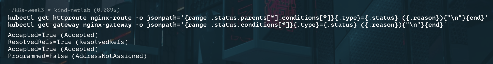

| 리소스 | 조건 | 의미 |
| --- | --- | --- |
| HTTPRoute | `Accepted=True` | Gateway가 이 라우트를 받아들임 |
| HTTPRoute | `ResolvedRefs=True` | backendRefs의 nginx-svc를 정상적으로 찾음 |
| Gateway | `Accepted=True` | 컨트롤러가 Gateway를 처리함 |
| Gateway | `Programmed=False (AddressNotAssigned)` | kind에 LoadBalancer가 없어 외부 주소를 받지 못함 |

Gateway의 `Programmed=False`는 외부 주소가 할당되지 않았다는 뜻입니다.(kind로 해서 로드밸런서가 없음) Envoy Proxy는 정상 동작했으며, 포트포워딩으로 보낸 요청이 규칙대로 처리된 것으로 이를 확인했습니다.

## 기초 5. 구성 요소의 역할

| 구성 요소 | 종류 | 역할 |
| --- | --- | --- |
| GatewayClass (`eg`) | API 리소스 | 어떤 컨트롤러가 Gateway를 처리할지 지정 |
| Gateway (`nginx-gateway`) | API 리소스 | 진입점(HTTP 80번 listener) 선언 |
| HTTPRoute (`nginx-route`) | API 리소스 | Host·경로 조건과 보낼 백엔드(nginx-svc) 지정 |
| Envoy Gateway | 프로그램 (컨트롤러) | 위 리소스를 읽고 Envoy Proxy를 생성·설정. 요청은 직접 처리하지 않음 |
| Envoy Proxy | 프로그램 (데이터 플레인) | 실제 HTTP 요청을 받아 규칙에 따라 백엔드로 전달 |
| Service (`nginx-svc`) | API 리소스 | selector로 백엔드 Pod 명단(EndpointSlice)을 제공 |
| Nginx Pod | 프로그램 | 최종적으로 요청에 응답하는 웹 서버 |

과제 1과 비교하면, Service(규칙)·kube-proxy(규칙 작성)·커널(패킷 처리)의 관계가 Gateway API 리소스(규칙)·Envoy Gateway(설정)·Envoy Proxy(요청 처리)로 이어집니다.

## 기초 6. 요청 경로

Envoy Gateway는 Service의 ClusterIP를 거치지 않고, nginx-svc의 EndpointSlice에서 Pod IP를 받아 Envoy Proxy에 넘겨줍니다. Envoy Proxy의 관리 페이지(admin, 19000번 포트)에서 Envoy가 알고 있는 백엔드 목록을 확인했습니다.

```bash
ENVOY_POD=$(kubectl get pod -n envoy-gateway-system -l gateway.envoyproxy.io/owning-gateway-name=nginx-gateway -o jsonpath='{.items[0].metadata.name}')
kubectl -n envoy-gateway-system port-forward pod/$ENVOY_POD 19000:19000   # 별도 터미널
curl -s localhost:19000/clusters | grep -E '::(10\.244|10\.96)\.' | grep health_flags
```

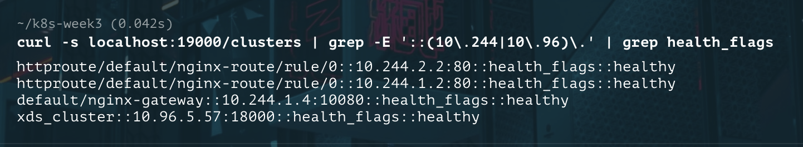

| 클러스터 | 주소 | 의미 |
| --- | --- | --- |
| `httproute/default/nginx-route/rule/0` | 10.244.2.2:80, 10.244.1.2:80 | HTTPRoute의 백엔드가 ClusterIP(10.96.105.128)가 아니라 nginx Pod IP로 등록됨 |
| `xds_cluster` | 10.96.5.57:18000 | `envoy-gateway` 컨트롤러 Service. Envoy Proxy가 이 주소로 설정을 받아옴 |

따라서 이번 실습에서 nginx-a, nginx-b를 고른 것은 iptables가 아니라 Envoy Proxy입니다. Envoy가 Pod 목록을 직접 가지고 있으면 연결 단위가 아니라 요청 단위로 분산하고, 가중치·재시도 같은 세밀한 제어를 할 수 있습니다.

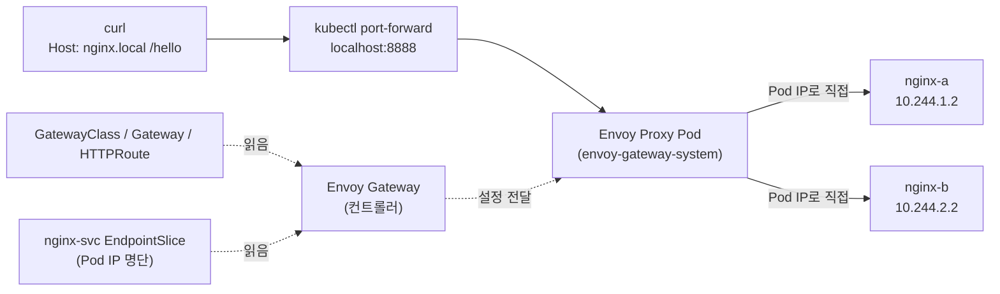

실선은 실제 요청이 지나가는 경로이고, 점선은 요청이 오기 전에 설정이 준비되는 과정입니다. API 리소스는 요청 경로에 포함되지 않습니다.

---

## 해결하지 못한 문제

- Gateway의 `Programmed` 조건이 `False (AddressNotAssigned)`로 남았습니다. kind 환경에 LoadBalancer 구현이 없어서였고 우선은 포트포워딩으로 대신 접근해 동작을 확인했습니다.
