# Week 3. YAML·Kustomize·Helm 비교와 CI/CD·GitOps

작성자: 강소연

개인 실습 저장소: [wosyh18/CC_kuber_practice](https://github.com/wosyh18/CC_kuber_practice) (Private)

이미지 저장소: [GHCR nginx-api](https://github.com/users/wosyh18/packages/container/package/nginx-api) (Public)

기본 과제 1~3을 진행했다. 일반 YAML·Kustomize·Helm으로 Nginx를 배포한 뒤, Actions가 직접 배포하는 v1/v2 구성을 만들었다. 마지막에는 배포 담당을 Argo CD로 옮겨 Git의 이미지 참조 변경이 v3 배포로 이어지는 것을 확인했다. 딥다이브와 selfHeal·prune 선택 실험은 수행하지 않았다.

실습 저장소가 비공개이므로 실제 사용한 workflow·배포 설정을 문서 하단에 첨부했다. 토큰 값, SSH 개인 키, 비밀번호, kubeconfig 내용은 포함하지 않았다.

## 실습 환경

| 항목 | 버전·구성 |
| --- | --- |
| 실습일 | 2026-11-19 |
| 로컬 환경 | macOS / Apple Silicon ARM64, Docker Desktop |
| kind | v0.33.0, `netlab`, control-plane 1개 + worker 2개 |
| Kubernetes 서버 | v1.37.0 / linux/arm64 |
| kubectl | v1.37.2 / darwin/arm64 |
| kubectl 내장 Kustomize | v5.8.1 |
| Helm | v4.3.1 |
| Docker client / server | 29.3.0 / 29.3.0 |
| self-hosted runner | v2.338.2, 공식 Linux ARM64 runner 이미지 기반 Docker 컨테이너 |
| Argo CD | v3.6.2, 공식 Non-HA 설치 매니페스트 |
| 기본 이미지 | `nginx:alpine` |
| 직접 배포 context | `kind-netlab` |

`nginx:alpine`은 갱신 가능한 태그다. API용 이미지는 전체 소스 커밋 SHA를 태그로 사용하고 digest도 별도로 기록했다.

| namespace | 용도 | 접근에 사용한 로컬 포트 |
| --- | --- | --- |
| `cicd-plain` | 일반 YAML | 18080 |
| `cicd-kustomize` | Kustomize dev | 18081 |
| `cicd-helm` | Helm | 18082 |
| `cicd-ci` | Actions 직접 배포, v1 → v2 | 18083 |
| `argocd` | Argo CD 자체와 Application | 18443 (HTTPS) |
| `cicd-gitops` | Argo CD 배포, v2 → v3 | 18085 |

## 과제 1. 일반 YAML·Kustomize·Helm

### 1-1. 구성과 배포

세 방식 모두 공식 `nginx:alpine`으로 Deployment와 ClusterIP Service를 만들었다. 컨테이너 포트, Service의 port와 targetPort는 모두 80이다. 공통 매니페스트에 namespace를 고정하지 않고 배포 명령에서 지정했다.

```text
deploy/plain/                         Deployment + Service
deploy/kustomize/base/                공통 Deployment + Service
deploy/kustomize/overlays/dev/        replicas 1
deploy/kustomize/overlays/prod/       replicas 2
deploy/helm/nginx/                    Chart + values.yaml + templates/
```

namespace를 먼저 생성한 뒤 다음 명령으로 배포했다.

```bash
kubectl --context kind-netlab apply -n cicd-plain -f deploy/plain/
kubectl --context kind-netlab apply -n cicd-kustomize -k deploy/kustomize/overlays/dev/
helm upgrade --install nginx deploy/helm/nginx \
  --kube-context kind-netlab -n cicd-helm --wait --timeout 180s
```

Kustomize는 dev overlay를 실제 배포했다. prod는 replicas 2 설정과 렌더링 결과를 준비했으며 별도로 배포하지 않았다. Helm release 이름을 `nginx`로 지정해 Deployment·Service 이름이 `nginx`가 되도록 했다.

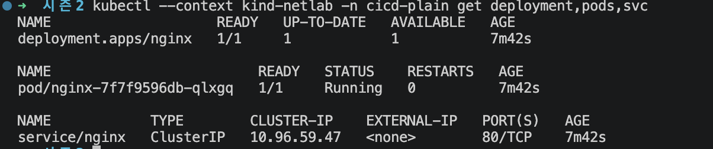

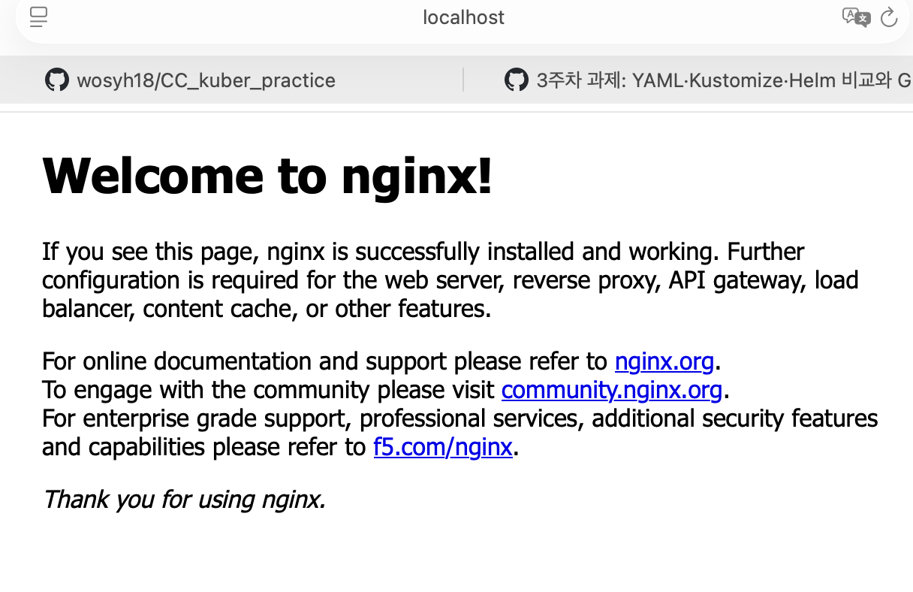

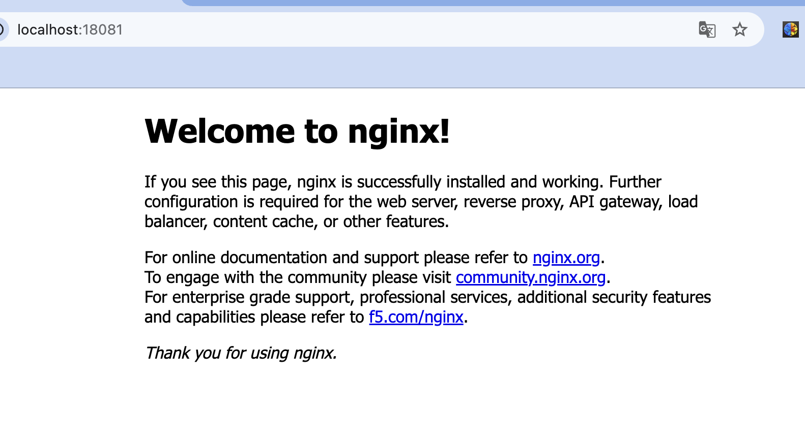

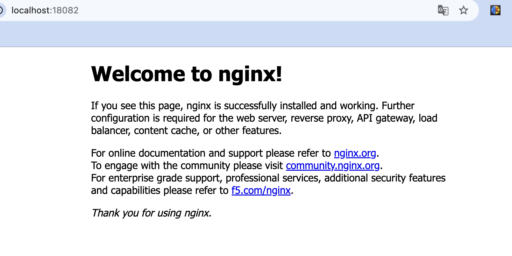

확인에 사용한 port-forward 명령이다. 각 명령은 별도 터미널에서 실행하거나 확인 후 `Ctrl+C`로 종료하고 다음 명령을 실행했다.

```bash
kubectl --context kind-netlab -n cicd-plain port-forward svc/nginx 18080:80
kubectl --context kind-netlab -n cicd-kustomize port-forward svc/nginx 18081:80
kubectl --context kind-netlab -n cicd-helm port-forward svc/nginx 18082:80
```

### 1-2. 비교

| 비교 항목 | 일반 YAML | Kustomize | Helm |
| --- | --- | --- | --- |
| 공통 설정 재사용 | 같은 YAML을 재적용한다. 환경별로 복사하면 중복이 생긴다. | base를 overlay에서 참조한다. | templates에 values를 채운다. |
| dev/prod 분리 | 별도 파일이나 디렉터리를 관리한다. | `overlays/dev`, `overlays/prod`에 차이를 둔다. | 환경별 values 파일을 `-f`로 전달할 수 있다. 이번에는 기본 values.yaml을 작성했다. |
| 이미지 변경 위치 | Deployment의 `image` | 공통 base의 `image` 또는 overlay의 `images` | values.yaml의 `image.repository`, `image.tag` |
| replicas 변경 위치 | Deployment의 `spec.replicas` | overlay의 `replicas[].count` | values.yaml의 `replicaCount` |
| 장점 | 최종 리소스 구조를 바로 읽기 쉽다. | 공통 YAML을 유지하며 환경별 차이만 작성할 수 있다. | 설정값을 모으고 release 단위로 설치·변경 이력을 관리한다. |
| 관리 부담 | 환경이 늘면 중복 파일을 수정해야 한다. | overlay가 많아지면 합쳐진 결과를 확인해야 한다. | 템플릿 문법을 익히고 렌더링 결과를 확인해야 한다. |
| 선택할 상황 | 적은 리소스나 Kubernetes 구조를 익히는 단계 | 비슷한 앱의 dev/prod 설정을 관리할 때 | 여러 설정 조합을 Chart로 묶어 배포할 때 |

### 1-3. 생성된 YAML 비교

```bash
kubectl kustomize deploy/kustomize/overlays/dev/
kubectl kustomize deploy/kustomize/overlays/prod/
helm template nginx deploy/helm/nginx
```

위 명령은 최종 매니페스트를 출력한다. 출력만으로 클러스터를 변경하지 않는다. 렌더링 결과는 개인 저장소의 `docs/rendered/`에도 저장했다.

| 핵심 설정 | 일반 YAML | Kustomize dev | Kustomize prod | Helm 기본값 |
| --- | --- | --- | --- | --- |
| 앱 리소스 | Deployment + Service | 동일 | 동일 | 동일 |
| Deployment / Service 이름 | nginx / nginx | 동일 | 동일 | release `nginx` 기준 동일 |
| image | nginx:alpine | 동일 | 동일 | 동일 |
| replicas | 1 | 1 | 2 | 1 |
| 컨테이너 포트 | 80 | 80 | 80 | 80 |
| Service 종류·port·targetPort | ClusterIP / 80 / 80 | 동일 | 동일 | 동일 |

이번 구성에서는 Kustomize의 출력 순서나 Helm의 `# Source` 주석 같은 표현 차이가 있어도 앱의 핵심 설정은 같았다. Kubernetes는 적용된 Deployment를 바탕으로 ReplicaSet과 Pod를 만든다. Helm은 앱 리소스 외에 release 추적 정보도 관리한다.

## 과제 2. GitHub Actions·GHCR·Kubernetes

### 2-1. 빌드와 직접 배포 연결

```text
main에 소스 push
→ GitHub-hosted Ubuntu runner에서 AMD64·ARM64 이미지 빌드
→ GITHUB_TOKEN으로 GHCR에 전체 소스 SHA 태그 이미지 push
→ build job output으로 이미지 주소 전달
→ Mac의 self-hosted runner가 kubectl 실행
→ cicd-ci Deployment의 이미지 변경 및 Service 적용
→ rollout 완료
```

빌드 job에는 `contents: read`, `packages: write`를 지정했다. GHCR 패키지는 Public으로 설정해 kind 노드가 별도 이미지 레지스트리 인증 없이 pull할 수 있게 했다.

배포 job은 `[self-hosted, Linux, ARM64, kind-netlab]` 라벨로 로컬 Docker runner를 선택했다. 개인 저장소의 main push만 대상으로 하고 외부 PR 실행 트리거는 작성하지 않았다.

GitHub-hosted runner는 이 Mac의 로컬 kind API에 기본적으로 직접 접근할 수 없으므로 두 job을 분리했다. 로컬 runner를 kind 노드와 같은 `kind` Docker 네트워크에 연결하고, 내부 API인 `netlab-control-plane:6443`을 사용하는 kubeconfig를 Docker volume에 보관했다. runner 환경에서 `kind-netlab` context와 `cicd-ci` 접근을 확인했다. kubeconfig 자체는 GitHub나 제출물에 넣지 않았다.

API는 Nginx의 8080번 포트에서 JSON을 응답한다. Service는 `port: 80`을 `targetPort: 8080`에 연결한다. Deployment 이름은 `nginx-api`, 컨테이너 이름은 `nginx`다.

배포 job은 `kubectl set image --local`로 이번 이미지 주소가 들어간 YAML을 출력한 뒤 `kubectl apply -f -`로 적용한다. 따라서 Git의 CI용 원본 YAML에는 `replaced-by-ci` 자리가 남아 있고, 실제 클러스터의 Deployment에는 전체 SHA 이미지가 들어간다.

### 2-2. Actions 실행 링크

| 배포 | 실행 전체 | build job | deploy job | 결과 |
| --- | --- | --- | --- | --- |
| v1 | [실행](https://github.com/wosyh18/CC_kuber_practice/actions/runs/44453060799) | [GHCR 빌드](https://github.com/wosyh18/CC_kuber_practice/actions/runs/44453060799/job/135321429665) | [kind 배포](https://github.com/wosyh18/CC_kuber_practice/actions/runs/44453060799/job/135321690923) | 둘 다 success |
| v2 | [실행](https://github.com/wosyh18/CC_kuber_practice/actions/runs/44454880456) | [GHCR 빌드](https://github.com/wosyh18/CC_kuber_practice/actions/runs/44454880456/job/135327367706) | [kind 배포](https://github.com/wosyh18/CC_kuber_practice/actions/runs/44454880456/job/135327608418) | 둘 다 success |

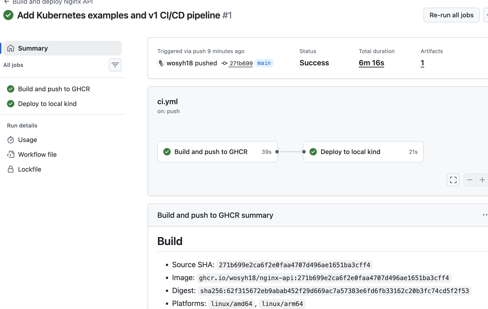

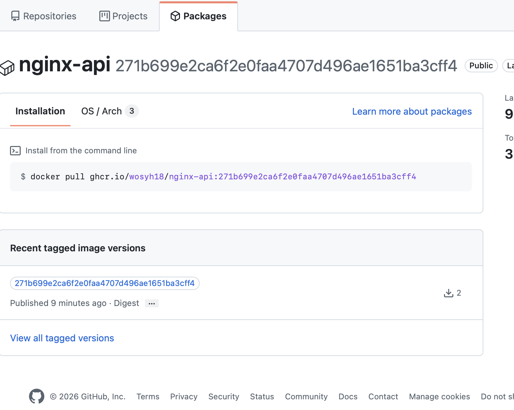

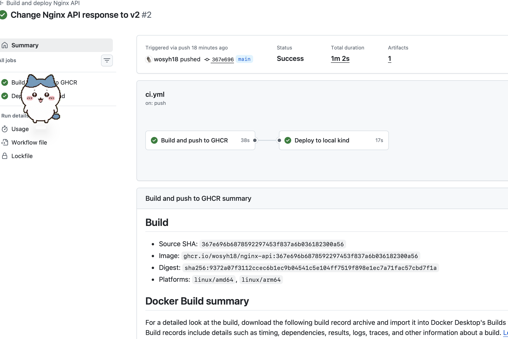

### 2-3. v1 → v2 전후 비교

Nginx 설정의 version만 v1에서 v2로 변경해 다시 push했다. 이미지 태그를 수동으로 고치거나 로컬에서 배포 명령을 실행하지 않고 workflow가 새 SHA 이미지를 적용했다.

| 항목 | v1 | v2 |
| --- | --- | --- |
| 소스 SHA | `271b699e2ca6f2e0faa4707d496ae1651ba3cff4` | `367e696b6878592297453f837a6b036182300a56` |
| GHCR 이미지 | `ghcr.io/wosyh18/nginx-api:271b699e2ca6f2e0faa4707d496ae1651ba3cff4` | `ghcr.io/wosyh18/nginx-api:367e696b6878592297453f837a6b036182300a56` |
| Deployment image | `ghcr.io/wosyh18/nginx-api:271b699e2ca6f2e0faa4707d496ae1651ba3cff4` | `ghcr.io/wosyh18/nginx-api:367e696b6878592297453f837a6b036182300a56` |
| Pod 이름 | `nginx-api-5954f7b856-xcbsx` | `nginx-api-77d88d5786-ccw4d` |
| Pod image | `ghcr.io/wosyh18/nginx-api:271b699e2ca6f2e0faa4707d496ae1651ba3cff4` | `ghcr.io/wosyh18/nginx-api:367e696b6878592297453f837a6b036182300a56` |
| Pod imageID | `ghcr.io/wosyh18/nginx-api@sha256:62f315672eb9abab452f29d669ac7a57383e6fd6fb33162c20b3fc74cd5f2f53` | `ghcr.io/wosyh18/nginx-api@sha256:9372a07f3112ccec6b1ec9b04541c5e104ff7519f898e1ec7a71fac57cbd7f1a` |
| 응답 | `{"message":"hello from nginx","version":"v1"}` | `{"message":"hello from nginx","version":"v2"}` |
| HTTP / 준비 상태 | 200 / Deployment 1/1, Pod Ready | 200 / Deployment 1/1, Pod Ready |

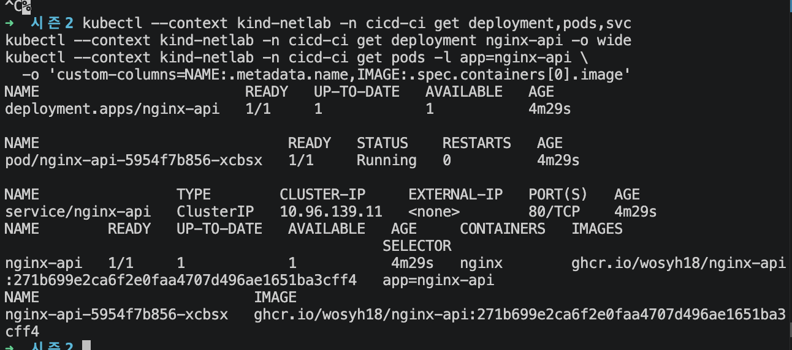

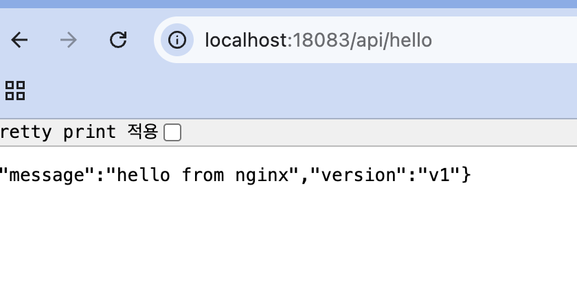

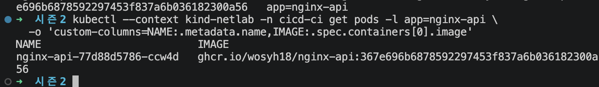

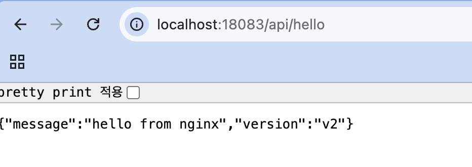

SHA 태그는 소스를 추적하기 위한 이름이다. 태그는 덮어쓸 수 있으므로 이미지 내용 자체를 고정하는 digest와 구분한다. 멀티 플랫폼 상위 인덱스와 플랫폼별 이미지의 imageID도 항상 같은 문자열이어야 하는 것은 아니다. 표의 값은 실습에서 실제로 기록한 값이다.

```bash
kubectl --context kind-netlab -n cicd-ci get deployment nginx-api -o wide
kubectl --context kind-netlab -n cicd-ci get pods -l app=nginx-api \
  -o 'custom-columns=NAME:.metadata.name,IMAGE:.spec.containers[0].image,IMAGE_ID:.status.containerStatuses[0].imageID'
kubectl --context kind-netlab -n cicd-ci port-forward svc/nginx-api 18083:80
# 다른 터미널
curl http://localhost:18083/api/hello
```

## 과제 3. Argo CD와 GitOps

### 3-1. 설치·저장소 인증·Application

기존 kind에 Argo CD v3.6.2를 설치하고, Argo CD의 Pod 7개가 Ready가 되는 것을 확인했다. API 목적지는 별도 `cicd-gitops` namespace로 나눴다.

```bash
kubectl --context kind-netlab create namespace argocd
kubectl --context kind-netlab create namespace cicd-gitops
kubectl --context kind-netlab apply --server-side -k deploy/argocd/install/
kubectl --context kind-netlab apply -f deploy/argocd/application.yaml
```

Argo CD가 비공개 저장소를 읽도록 GitHub에 읽기 전용 SSH deploy key를 등록했다. 개인 키는 `argocd` namespace의 repository Secret으로 등록했으며 내용은 제출물에서 제외했다.

Application `nginx-api-gitops`는 `main`의 `deploy/gitops`를 읽어 `cicd-gitops`에 배포한다. 동일 클러스터를 대상으로 하므로 destination server는 `https://kubernetes.default.svc`다. Application 자체는 bootstrap 파일로 적용했고, 이 Application이 감시하는 경로는 앱의 Deployment·Service가 있는 `deploy/gitops`다.

### 3-2. 첫 Sync와 자동 배포

처음에는 자동 Sync를 끄고 기존 v2 이미지로 수동 Sync를 한 번 실행했다. 실제 상태는 `OutOfSync / Missing → Synced / Progressing → Synced / Healthy` 순서로 바뀌었다. 새 namespace의 `/api/hello`에서 HTTP 200과 v2 응답도 확인했다.

그다음 Actions의 직접 배포 job을 제거하고 Git의 image를 갱신하는 `update_manifest` job을 작성했다. 이 job에는 `contents: write`를 주어 bot이 설정 커밋을 push하도록 했다. 자동 Sync를 켠 뒤 응답을 v3로 바꿔 push했다.

```text
소스 커밋 A
→ Actions가 이미지 :<A의 SHA> 빌드·GHCR 게시
→ deploy/gitops/deployment.yaml의 image를 :<A의 SHA>로 변경
→ github-actions[bot]의 설정 커밋 B
→ Argo CD가 B를 읽고 자동 Sync
→ Kubernetes가 새 Pod 생성
→ kind 노드가 GHCR 이미지를 pull
→ version: v3 응답
```

workflow의 push 경로는 `app/**`, `.github/workflows/ci.yml`로 제한했다. 배포 YAML만 바뀐 설정 커밋이 이미지 빌드를 반복하지 않도록 했다. 두 Actions job은 모두 GitHub-hosted runner에서 실행했고, 로컬 self-hosted runner는 중지한 상태로 배포를 완료했다.

| GitOps 실행 근거 | 값 |
| --- | --- |
| 소스 커밋 A / 이미지 태그 | `1f559dbbfdcf029b11863697284ff4388ffb618c` |
| 설정 커밋 B | [3306ee266bbfada9ef1d789c1ea4e58beb74d52a](https://github.com/wosyh18/CC_kuber_practice/commit/3306ee266bbfada9ef1d789c1ea4e58beb74d52a) |
| 설정 커밋 작성자 | `github-actions[bot]` |
| 변경 파일 | `deploy/gitops/deployment.yaml` |
| Actions 전체 | [실행](https://github.com/wosyh18/CC_kuber_practice/actions/runs/44458408070) |
| 이미지 빌드 job | [성공](https://github.com/wosyh18/CC_kuber_practice/actions/runs/44458408070/job/135338990593) |
| Git 설정 갱신 job | [성공](https://github.com/wosyh18/CC_kuber_practice/actions/runs/44458408070/job/135339288598) |
| Argo CD 자동 Sync | `operation.initiatedBy.automated: true`, `Succeeded` |

이미지 태그는 소스 A이고, 배포 YAML을 바꾼 커밋은 B다. Argo CD가 B를 읽어도 실행 이미지는 A를 가리키는 것이 정상이다. 이후 문서 커밋이 main에 추가되면 현재 비교 revision은 더 최신일 수 있다. 아래 B는 v3 자동 Sync 작업에서 기록한 revision이다.

| 항목 | 첫 Sync | 자동 GitOps 배포 |
| --- | --- | --- |
| API 버전 | v2 | v3 |
| 배포 설정 revision | `573ac197b4a349688f72c3adda23a9b1387f4741` | `3306ee266bbfada9ef1d789c1ea4e58beb74d52a` |
| Deployment image | `ghcr.io/wosyh18/nginx-api:367e696b6878592297453f837a6b036182300a56` | `ghcr.io/wosyh18/nginx-api:1f559dbbfdcf029b11863697284ff4388ffb618c` |
| Pod 이름 | `nginx-api-77d88d5786-xhjnq` | `nginx-api-65d79f97f9-ccmg8` |
| Pod image | `ghcr.io/wosyh18/nginx-api:367e696b6878592297453f837a6b036182300a56` | `ghcr.io/wosyh18/nginx-api:1f559dbbfdcf029b11863697284ff4388ffb618c` |
| Sync / Health | Synced / Healthy | Synced / Healthy |
| HTTP / readyReplicas | 200 / 1 | 200 / 1 |
| automated.enabled | false | true |

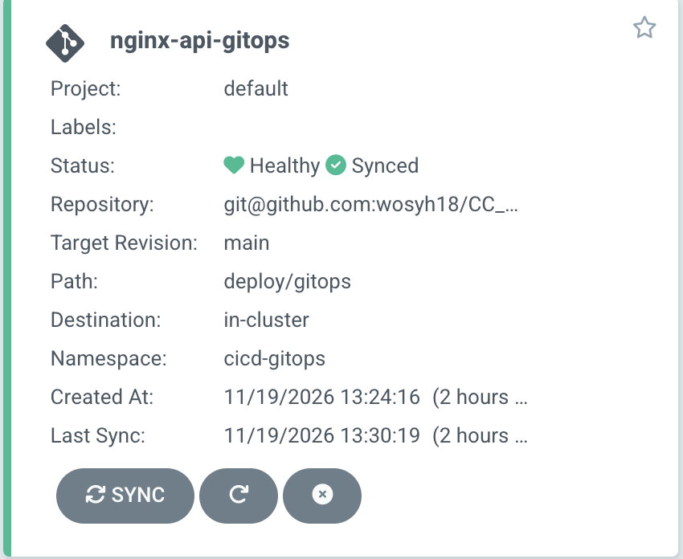

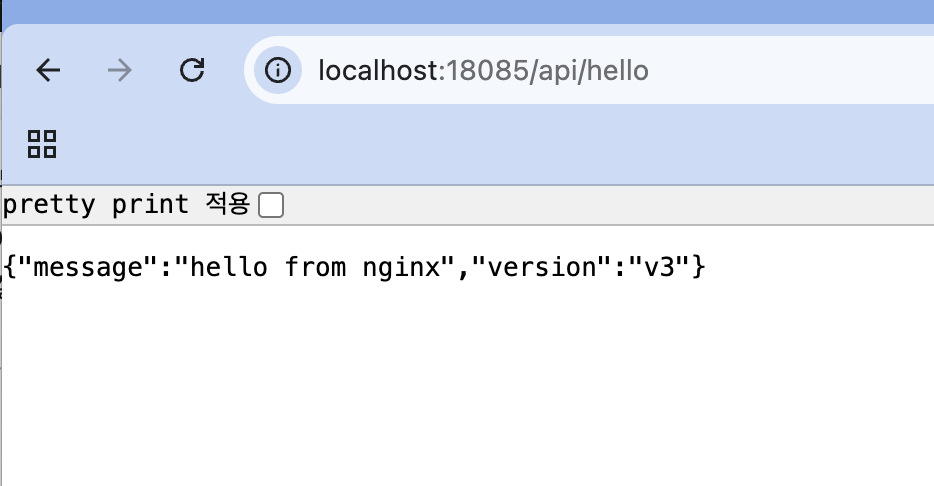

이 단계에서는 수동 Sync나 수동 이미지 변경으로 v3를 배포하지 않았다. 마지막 자동 작업의 `automated: true`, 설정 B, Deployment·Pod 이미지, 실제 응답을 함께 확인했다. 과제 2의 `cicd-ci`는 v2로 유지하고 GitOps 결과는 `cicd-gitops`에서 확인했다.

```bash
kubectl --context kind-netlab -n argocd get application nginx-api-gitops
kubectl --context kind-netlab -n cicd-gitops get deployment nginx-api -o wide
kubectl --context kind-netlab -n cicd-gitops get pods -l app=nginx-api \
  -o 'custom-columns=NAME:.metadata.name,IMAGE:.spec.containers[0].image,IMAGE_ID:.status.containerStatuses[0].imageID'
kubectl --context kind-netlab -n cicd-gitops port-forward svc/nginx-api 18085:80
# 다른 터미널
curl http://localhost:18085/api/hello
```

Argo CD 화면은 `kubectl --context kind-netlab -n argocd port-forward svc/argocd-server 18443:443`으로 연결해 확인했다.

### 3-3. 전체 흐름

다음 그림은 구성 설명용으로 만든 흐름도다. 위 화면 캡처들과 구분해 첨부했다.

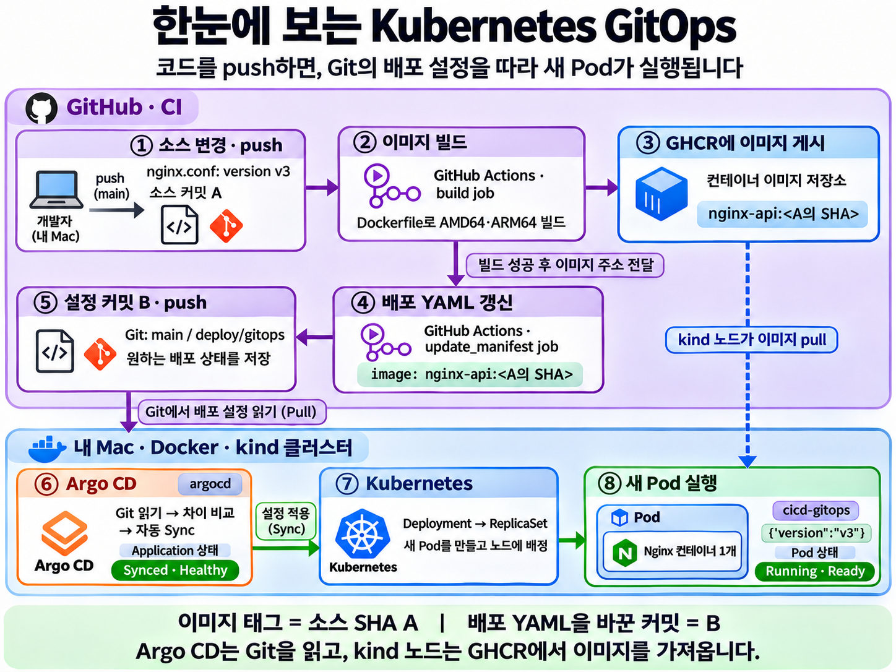

### 3-4. GitOps 질문 답변

| 질문 | 이번 구성과 연결한 설명 |
| --- | --- |
| 선언적 상태 | Git에는 image, replicas 1, 컨테이너 포트 8080, Service의 ClusterIP·80→8080 같은 원하는 상태를 저장한다. Argo CD가 이 설정과 실제 리소스를 비교한다. |
| 버전과 변경 이력 | 소스 A, Actions 실행, bot의 설정 B를 연결해 어떤 이미지가 배포됐는지 추적한다. 이번 개인 실습은 main에 직접 push했고 별도 PR 리뷰 승인은 구성하지 않았다. PR 승인과 배포 승인을 연결하려면 보호 브랜치·리뷰·merge 규칙을 함께 정해야 한다. |
| Pull 방식 | 과제 2는 Actions의 로컬 runner가 클러스터 API에 명령을 보냈다. 과제 3은 클러스터 안의 Argo CD가 읽기 전용 인증으로 Git을 읽는다. Actions에는 kind API 접근이 필요하지 않다. |
| Reconciliation | Git의 원하는 Deployment·Service와 Kubernetes의 실제 상태를 비교하고 Sync로 반영한다. 이후 Kubernetes가 Pod를 만들고 유지한다. Synced는 설정 일치, Healthy는 준비 상태이므로 두 상태를 함께 본다. |
| 드리프트와 selfHeal | Git의 replicas가 1인데 수동 scale로 실제 값을 3으로 바꾸면 차이가 생긴다. 이번 단일 source에서 Git 변경·수동 Sync가 없고 selfHeal이 false이면 라이브 변경만으로 자동 복원을 기대하지 않는다. selfHeal을 켜면 이 차이에 대해서도 다시 Sync할 수 있다. |
| 삭제·prune·복구 | prune을 켜면 Git에서 제거된 Argo CD 관리 리소스를 Sync 때 클러스터에서도 삭제할 수 있다. 복구할 때는 Git의 image 참조를 이전 정상 SHA로 되돌린 뒤 동기화한다. 현재 prune은 false다. |
| CI와 CD의 책임 | Actions가 빌드·GHCR 게시와 Git 이미지 참조 갱신을 맡고, Argo CD가 배포 상태를 반영한다. GHCR에 새 이미지를 올리기만 해서는 이번 Argo CD 구성이 갱신되지 않는다. Git의 image도 바뀌어야 한다. |

자동 Sync는 켰지만 selfHeal·prune은 false로 두었다. 수동 scale 복원, 리소스 삭제, 존재하지 않는 이미지로 실패시키는 선택 실험은 진행하지 않았다.

## 해결한 문제와 확인 범위

| 상황 | 확인 및 처리 |
| --- | --- |
| 실행 중인 kind는 있지만 kubectl 접속 설정이 없었음 | `kind export kubeconfig --name netlab`으로 접속 설정을 복구하고 `kind-netlab` context를 사용했다. 설정 파일 내용은 제출하지 않는다. |
| Mac용 runner 등록 중 `GetDomainName: -1` 오류 | 공식 Linux ARM64 runner에 kubectl을 추가한 Docker 컨테이너로 구성했다. kind 네트워크의 내부 API 연결을 확인했다. |
| 최초 GHCR 패키지가 Private으로 생성됨 | 소스 저장소는 Private으로 두고 GHCR 패키지만 Public으로 변경했다. 익명 이미지 manifest 조회와 실제 Pod 실행으로 확인했다. |
| 18085의 브라우저 화면에 v2가 남아 있었음 | 실제 HTTP 요청은 v3였고 Argo CD·Pod 이미지도 정상이었다. 열린 브라우저 탭을 새로고침해 v3로 바뀌는 것을 확인했다. 배포 설정은 변경하지 않았다. |

기본 과제 1~3의 배포·응답 확인은 완료했다. prod overlay는 설정·렌더링만 준비했고 dev를 실제 배포했다. 캡처에 없는 SHA와 imageID는 실습 중 저장한 Deployment·Pod·Argo CD 조회 기록에서 옮겼다. 선택 실험의 결과는 포함하지 않았다.

## 부록. 실제 사용한 설정

아래 경로는 개인 실습 저장소 기준이다. 실제 토큰이나 인증 파일 내용은 첨부하지 않았다. `${{ secrets.GITHUB_TOKEN }}`은 Actions가 실행 시 제공하는 값의 참조식이다.

<details>
<summary>A. 일반 YAML과 Kustomize</summary>

**deploy/plain/deployment.yaml**

```yaml
apiVersion: apps/v1
kind: Deployment
metadata:
  name: nginx
spec:
  replicas: 1
  selector:
    matchLabels:
      app: nginx
  template:
    metadata:
      labels:
        app: nginx
    spec:
      containers:
        - name: nginx
          image: nginx:alpine
          imagePullPolicy: IfNotPresent
          ports:
            - containerPort: 80
```

**deploy/plain/service.yaml**

```yaml
apiVersion: v1
kind: Service
metadata:
  name: nginx
spec:
  type: ClusterIP
  selector:
    app: nginx
  ports:
    - port: 80
      targetPort: 80
```

Kustomize base의 deployment.yaml과 service.yaml은 위 일반 YAML 파일과 내용이 같다.

**deploy/kustomize/base/kustomization.yaml**

```yaml
apiVersion: kustomize.config.k8s.io/v1beta1
kind: Kustomization
resources:
  - deployment.yaml
  - service.yaml
```

**deploy/kustomize/overlays/dev/kustomization.yaml**

```yaml
apiVersion: kustomize.config.k8s.io/v1beta1
kind: Kustomization
resources:
  - ../../base
replicas:
  - name: nginx
    count: 1
```

**deploy/kustomize/overlays/prod/kustomization.yaml**

```yaml
apiVersion: kustomize.config.k8s.io/v1beta1
kind: Kustomization
resources:
  - ../../base
replicas:
  - name: nginx
    count: 2
```

</details>

<details>
<summary>B. Helm Chart</summary>

**deploy/helm/nginx/Chart.yaml**

```yaml
apiVersion: v2
name: nginx
description: 과제 1 - 공식 Nginx 이미지를 배포하는 실습용 Chart
type: application
version: 0.1.0
appVersion: "alpine"
```

**deploy/helm/nginx/values.yaml**

```yaml
replicaCount: 1

image:
  repository: nginx
  tag: alpine
  pullPolicy: IfNotPresent
```

**deploy/helm/nginx/templates/deployment.yaml**

```yaml
apiVersion: apps/v1
kind: Deployment
metadata:
  name: {{ .Release.Name }}
spec:
  replicas: {{ .Values.replicaCount }}
  selector:
    matchLabels:
      app: {{ .Release.Name }}
  template:
    metadata:
      labels:
        app: {{ .Release.Name }}
    spec:
      containers:
        - name: nginx
          image: "{{ .Values.image.repository }}:{{ .Values.image.tag }}"
          imagePullPolicy: {{ .Values.image.pullPolicy }}
          ports:
            - containerPort: 80
```

**deploy/helm/nginx/templates/service.yaml**

```yaml
apiVersion: v1
kind: Service
metadata:
  name: {{ .Release.Name }}
spec:
  type: ClusterIP
  selector:
    app: {{ .Release.Name }}
  ports:
    - port: 80
      targetPort: 80
```

</details>

<details>
<summary>C. API 이미지와 과제 2 배포 설정</summary>

**app/Dockerfile**

```dockerfile
FROM nginx:alpine
COPY nginx.conf /etc/nginx/conf.d/default.conf
EXPOSE 8080
```

다음은 최종 v3 설정이다. 과제 2의 첫 배포는 같은 /api/hello 응답의 version을 v1로 두었고, 이후 v2로 변경했다.

**app/nginx.conf**

```nginx
server {
    listen 8080;
    server_name _;
    default_type application/json;

    location = /healthz {
        return 200 '{"status":"ok"}\n';
    }
    location = /api/hello {
        return 200 '{"message":"hello from nginx","version":"v3"}\n';
    }
    location / {
        return 404 '{"error":"not found"}\n';
    }
}
```

**deploy/ci/deployment.yaml**

```yaml
apiVersion: apps/v1
kind: Deployment
metadata:
  name: nginx-api
spec:
  replicas: 1
  selector:
    matchLabels:
      app: nginx-api
  template:
    metadata:
      labels:
        app: nginx-api
    spec:
      containers:
        - name: nginx
          # GitHub Actions replaces this tag locally with the full source SHA before applying.
          image: ghcr.io/wosyh18/nginx-api:replaced-by-ci
          imagePullPolicy: IfNotPresent
          ports:
            - containerPort: 8080
          readinessProbe:
            httpGet:
              path: /healthz
              port: 8080
            initialDelaySeconds: 2
            periodSeconds: 3
```

**deploy/ci/service.yaml**

```yaml
apiVersion: v1
kind: Service
metadata:
  name: nginx-api
spec:
  type: ClusterIP
  selector:
    app: nginx-api
  ports:
    - port: 80
      targetPort: 8080
```

**runner/Dockerfile**

```dockerfile
FROM ghcr.io/actions/actions-runner:2.338.2@sha256:6d0b2d80d80f143f77dcb676e50920100bbb547e39e883454d57f45ab8c31300

USER root
ARG TARGETARCH
ARG KUBECTL_VERSION=v1.37.2
RUN cd /tmp \
    && curl -fsSLo kubectl "https://dl.k8s.io/release/${KUBECTL_VERSION}/bin/linux/${TARGETARCH}/kubectl" \
    && curl -fsSLo kubectl.sha256 "https://dl.k8s.io/release/${KUBECTL_VERSION}/bin/linux/${TARGETARCH}/kubectl.sha256" \
    && sed 's/$/  kubectl/' kubectl.sha256 | sha256sum --check \
    && install -m 0755 kubectl /usr/local/bin/kubectl \
    && rm kubectl kubectl.sha256

USER runner
WORKDIR /home/runner
CMD ["./run.sh"]
```

runner의 kubeconfig와 등록 자격 증명은 Docker volume에 보관했다. 위 Dockerfile에는 포함하지 않았다.

</details>

<details>
<summary>D. 과제 2 workflow: Actions 직접 배포</summary>

당시 `.github/workflows/ci.yml`이다. 과제 3 전환 전에 개인 저장소의 `docs/examples/task2-ci.yml`로 보관한 내용을 첨부한다.

**.github/workflows/ci.yml (과제 2 시점)**

```yaml
name: Build and deploy Nginx API

on:
  push:
    branches: [main]
    paths:
      - 'app/**'
      - 'deploy/ci/**'
      - '.github/workflows/ci.yml'

permissions:
  contents: read

concurrency:
  group: nginx-api-${{ github.ref }}
  cancel-in-progress: false

jobs:
  build:
    name: Build and push to GHCR
    runs-on: ubuntu-latest
    permissions:
      contents: read
      packages: write
    outputs:
      image: ${{ steps.image.outputs.image }}
      digest: ${{ steps.build.outputs.digest }}
    steps:
      - name: Check out source
        uses: actions/checkout@3d3c42e5aac5ba805825da76410c181273ba90b1 # v7.0.1
        with:
          persist-credentials: false

      - name: Set full SHA image tag
        id: image
        shell: bash
        run: |
          set -euo pipefail
          owner="${GITHUB_REPOSITORY_OWNER,,}"
          image="ghcr.io/${owner}/nginx-api:${GITHUB_SHA}"
          printf 'image=%s\n' "$image" >> "$GITHUB_OUTPUT"

      - name: Set up QEMU
        uses: docker/setup-qemu-action@99012661954931238ded8c8b007157a8430204e1 # v4.4.0

      - name: Set up Docker Buildx
        uses: docker/setup-buildx-action@f87e5991a6d7451dcb8d9637bfbc97413f497069 # v4.4.1

      - name: Log in to GHCR
        uses: docker/login-action@8aa5831fb8d48d8f76594c7ddde61ae58019f550 # v4.8.0
        with:
          registry: ghcr.io
          username: ${{ github.actor }}
          password: ${{ secrets.GITHUB_TOKEN }}

      - name: Build and push AMD64 and ARM64 images
        id: build
        uses: docker/build-push-action@c3c9e263c25d99ce0380d002d59b67737d91b0dc # v7.4.0
        with:
          context: ./app
          push: true
          platforms: linux/amd64,linux/arm64
          tags: ${{ steps.image.outputs.image }}
          labels: |
            org.opencontainers.image.source=${{ github.server_url }}/${{ github.repository }}
            org.opencontainers.image.revision=${{ github.sha }}

      - name: Record build result
        shell: bash
        env:
          IMAGE: ${{ steps.image.outputs.image }}
          IMAGE_DIGEST: ${{ steps.build.outputs.digest }}
        run: |
          {
            printf '## Build\n\n'
            printf -- '- Source SHA: `%s`\n' "$GITHUB_SHA"
            printf -- '- Image: `%s`\n' "$IMAGE"
            printf -- '- Digest: `%s`\n' "$IMAGE_DIGEST"
            printf -- '- Platforms: `linux/amd64`, `linux/arm64`\n'
          } >> "$GITHUB_STEP_SUMMARY"

  deploy:
    name: Deploy to local kind
    needs: build
    if: github.event_name == 'push' && github.ref == 'refs/heads/main' && github.repository == 'wosyh18/CC_kuber_practice'
    runs-on: [self-hosted, Linux, ARM64, kind-netlab]
    timeout-minutes: 10
    permissions:
      contents: read
    env:
      IMAGE: ${{ needs.build.outputs.image }}
      KUBE_CONTEXT: kind-netlab
    steps:
      - name: Check out deployment manifests
        uses: actions/checkout@3d3c42e5aac5ba805825da76410c181273ba90b1 # v7.0.1
        with:
          persist-credentials: false

      - name: Check cluster connection
        shell: bash
        run: |
          set -euo pipefail
          test -s "$HOME/.kube/config"
          kubectl --context "$KUBE_CONTEXT" get namespace cicd-ci

      - name: Apply this run's SHA image and wait for rollout
        shell: bash
        run: |
          set -euo pipefail
          kubectl set image --local -f deploy/ci/deployment.yaml nginx="$IMAGE" -o yaml \
            | kubectl --context "$KUBE_CONTEXT" -n cicd-ci apply -f -
          kubectl --context "$KUBE_CONTEXT" -n cicd-ci apply -f deploy/ci/service.yaml
          kubectl --context "$KUBE_CONTEXT" -n cicd-ci rollout status deployment/nginx-api --timeout=180s

      - name: Record deployed image
        shell: bash
        run: |
          set -euo pipefail
          deployed_image="$(kubectl --context "$KUBE_CONTEXT" -n cicd-ci get deployment nginx-api -o jsonpath='{.spec.template.spec.containers[0].image}')"
          test "$deployed_image" = "$IMAGE"
          {
            printf '## Deployment\n\n'
            printf -- '- Source SHA: `%s`\n' "$GITHUB_SHA"
            printf -- '- Context: `%s`\n' "$KUBE_CONTEXT"
            printf -- '- Namespace: `cicd-ci`\n'
            printf -- '- Deployment image: `%s`\n\n' "$deployed_image"
            printf '```text\n'
            kubectl --context "$KUBE_CONTEXT" -n cicd-ci get pods -l app=nginx-api \
              -o 'custom-columns=NAME:.metadata.name,IMAGE:.spec.containers[0].image,IMAGE_ID:.status.containerStatuses[0].imageID'
            printf '```\n'
          } | tee -a "$GITHUB_STEP_SUMMARY"
```

</details>

<details>
<summary>E. Argo CD 설치·Application·GitOps 배포 설정</summary>

**deploy/argocd/install/kustomization.yaml**

```yaml
apiVersion: kustomize.config.k8s.io/v1beta1
kind: Kustomization
namespace: argocd
resources:
  - https://raw.githubusercontent.com/argoproj/argo-cd/v3.6.2/manifests/install.yaml
```

**deploy/argocd/application.yaml**

```yaml
apiVersion: argoproj.io/v1alpha1
kind: Application
metadata:
  name: nginx-api-gitops
  namespace: argocd
spec:
  project: default
  source:
    repoURL: git@github.com:wosyh18/CC_kuber_practice.git
    targetRevision: main
    path: deploy/gitops
  destination:
    server: https://kubernetes.default.svc
    namespace: cicd-gitops
  syncPolicy:
    automated:
      enabled: true
      prune: false
      selfHeal: false
    syncOptions:
      - CreateNamespace=true
```

**deploy/gitops/deployment.yaml**

```yaml
apiVersion: apps/v1
kind: Deployment
metadata:
  name: nginx-api
spec:
  replicas: 1
  selector:
    matchLabels:
      app: nginx-api
  template:
    metadata:
      labels:
        app: nginx-api
    spec:
      containers:
        - name: nginx
          image: ghcr.io/wosyh18/nginx-api:1f559dbbfdcf029b11863697284ff4388ffb618c
          imagePullPolicy: IfNotPresent
          ports:
            - containerPort: 8080
          readinessProbe:
            httpGet:
              path: /healthz
              port: 8080
            initialDelaySeconds: 2
            periodSeconds: 3
```

**deploy/gitops/service.yaml**

```yaml
apiVersion: v1
kind: Service
metadata:
  name: nginx-api
spec:
  type: ClusterIP
  selector:
    app: nginx-api
  ports:
    - port: 80
      targetPort: 8080
```

Application은 최종 자동 Sync 설정이다. 첫 Sync 당시에는 `automated.enabled: false`였다. 저장소 인증은 별도 repository Secret으로 등록했으며 SSH 개인 키를 포함한 Secret 내용은 제외했다.

</details>

<details>
<summary>F. 과제 3 workflow: 이미지 게시 후 Git 설정 갱신</summary>

**.github/workflows/ci.yml**

```yaml
name: Build image and update GitOps manifests

on:
  push:
    branches: [main]
    paths:
      - 'app/**'
      - '.github/workflows/ci.yml'

permissions:
  contents: read

concurrency:
  group: nginx-api-${{ github.ref }}
  cancel-in-progress: false

jobs:
  build:
    name: Build and push to GHCR
    runs-on: ubuntu-latest
    permissions:
      contents: read
      packages: write
    outputs:
      image: ${{ steps.image.outputs.image }}
      digest: ${{ steps.build.outputs.digest }}
    steps:
      - name: Check out source
        uses: actions/checkout@3d3c42e5aac5ba805825da76410c181273ba90b1 # v7.0.1
        with:
          persist-credentials: false

      - name: Set full SHA image tag
        id: image
        shell: bash
        run: |
          set -euo pipefail
          owner="${GITHUB_REPOSITORY_OWNER,,}"
          image="ghcr.io/${owner}/nginx-api:${GITHUB_SHA}"
          printf 'image=%s\n' "$image" >> "$GITHUB_OUTPUT"

      - name: Set up QEMU
        uses: docker/setup-qemu-action@99012661954931238ded8c8b007157a8430204e1 # v4.4.0

      - name: Set up Docker Buildx
        uses: docker/setup-buildx-action@f87e5991a6d7451dcb8d9637bfbc97413f497069 # v4.4.1

      - name: Log in to GHCR
        uses: docker/login-action@8aa5831fb8d48d8f76594c7ddde61ae58019f550 # v4.8.0
        with:
          registry: ghcr.io
          username: ${{ github.actor }}
          password: ${{ secrets.GITHUB_TOKEN }}

      - name: Build and push AMD64 and ARM64 images
        id: build
        uses: docker/build-push-action@c3c9e263c25d99ce0380d002d59b67737d91b0dc # v7.4.0
        with:
          context: ./app
          push: true
          platforms: linux/amd64,linux/arm64
          tags: ${{ steps.image.outputs.image }}
          labels: |
            org.opencontainers.image.source=${{ github.server_url }}/${{ github.repository }}
            org.opencontainers.image.revision=${{ github.sha }}

      - name: Record build result
        shell: bash
        env:
          IMAGE: ${{ steps.image.outputs.image }}
          IMAGE_DIGEST: ${{ steps.build.outputs.digest }}
        run: |
          {
            printf '## Build\n\n'
            printf -- '- Source SHA: `%s`\n' "$GITHUB_SHA"
            printf -- '- Image: `%s`\n' "$IMAGE"
            printf -- '- Digest: `%s`\n' "$IMAGE_DIGEST"
            printf -- '- Platforms: `linux/amd64`, `linux/arm64`\n'
          } >> "$GITHUB_STEP_SUMMARY"

  update_manifest:
    name: Commit new image to GitOps manifests
    needs: build
    if: github.event_name == 'push' && github.ref == 'refs/heads/main' && github.repository == 'wosyh18/CC_kuber_practice'
    runs-on: ubuntu-latest
    permissions:
      contents: write
    outputs:
      manifest_commit: ${{ steps.update.outputs.manifest_commit }}
    steps:
      - name: Check out latest main
        uses: actions/checkout@3d3c42e5aac5ba805825da76410c181273ba90b1 # v7.0.1
        with:
          ref: main

      - name: Update image and push configuration commit
        id: update
        shell: bash
        env:
          IMAGE: ${{ needs.build.outputs.image }}
          SOURCE_SHA: ${{ github.sha }}
        run: |
          set -euo pipefail
          python3 - <<'PY_UPDATE'
          from pathlib import Path
          import os
          import re

          image = os.environ['IMAGE']
          if not re.fullmatch(r'ghcr\.io/wosyh18/nginx-api:[0-9a-f]{40}', image):
              raise SystemExit('Unexpected image address')
          path = Path('deploy/gitops/deployment.yaml')
          text, count = re.subn(r'(?m)^(\s*image:\s*)\S+$', lambda match: match.group(1) + image, path.read_text())
          if count != 1:
              raise SystemExit('Expected exactly one image field')
          path.write_text(text)
          PY_UPDATE
          git config user.name 'github-actions[bot]'
          git config user.email '41898282+github-actions[bot]@users.noreply.github.com'
          git add deploy/gitops/deployment.yaml
          if ! git diff --cached --quiet; then
            git commit -m "Deploy nginx-api image ${SOURCE_SHA}"
            git pull --rebase origin main
            git push origin HEAD:main
          fi
          manifest_commit="$(git rev-parse HEAD)"
          printf 'manifest_commit=%s\n' "$manifest_commit" >> "$GITHUB_OUTPUT"
          {
            printf '## GitOps configuration update\n\n'
            printf -- '- Source commit A: `%s`\n' "$SOURCE_SHA"
            printf -- '- Image: `%s`\n' "$IMAGE"
            printf -- '- Configuration commit B: `%s`\n' "$manifest_commit"
            printf -- '- Manifest path: `deploy/gitops/deployment.yaml`\n'
            printf -- '- Argo CD reads main and synchronizes cicd-gitops.\n'
          } >> "$GITHUB_STEP_SUMMARY"
```

</details>

## 참고 자료

- [Kubernetes: Kustomize](https://kubernetes.io/docs/tasks/manage-kubernetes-objects/kustomization/)
- [Helm: values 파일](https://helm.sh/docs/chart_template_guide/values_files/)
- [GitHub Actions: Docker 이미지 게시](https://docs.github.com/en/actions/tutorials/publish-packages/publish-docker-images)
- [GitHub Actions: self-hosted runner](https://docs.github.com/en/actions/reference/runners/self-hosted-runners)
- [Argo CD: 시작하기](https://argo-cd.readthedocs.io/en/stable/getting_started/)
- [Argo CD: 비공개 저장소](https://argo-cd.readthedocs.io/en/stable/user-guide/private-repositories/)
- [Argo CD: 자동 Sync·selfHeal·prune](https://argo-cd.readthedocs.io/en/stable/user-guide/auto_sync/)
