# 3주차 과제: 쿠버네티스 네트워크와 Gateway API

## 수행 범위

| 과제 | 기초 | 심화 |
|---|---|---|
| 과제 1 | 전부 수행 | tcpdump 패킷 경로 검증, 부하 분산 비율 측정은 수행. Service 생성 전후 비교, 백엔드 변경 관찰, iptables·IPVS·nftables 비교는 미수행 |
| 과제 2 | 수행 | 아래 과제 2 참고 |
| 과제 3 | 전부 수행 | Nginx v1·v2 가중치 80:20은 미수행 |

## 실습 환경

Windows 노트북의 WSL2(Ubuntu)에 Docker Engine을 설치하고 그 위에 kind 클러스터를 만들었습니다. kind 노드는 컨테이너라서 노드끼리는 Docker 브리지(172.18.0.0/16)로 통신합니다. 물리 NIC나 스위치 구간은 이 환경에서 볼 수 없습니다.

과제 1과 과제 3은 클러스터를 따로 썼습니다. 과제 3에서 Envoy Gateway를 v1.31 클러스터에 설치하지 못해 새로 만들었기 때문입니다(아래 트러블슈팅 참고).

| 항목 | 과제 1 (`netlab`) | 과제 3 (`gw`) |
|---|---|---|
| kind | v0.24.0 | v0.33.0 |
| Kubernetes (서버) | v1.31.0 | v1.37.0 |
| kubectl | v1.37.2 (서버와 버전 차이 경고 있음) | v1.37.2 |
| 노드 구성 | control-plane 1, worker 2 | control-plane 1 |
| 노드 OS / 런타임 | Debian 12 / containerd 1.7.18 | Debian 13 / containerd 2.3.4 |
| 커널 | 6.18.33.2-microsoft-standard-WSL2 | 같음 |
| CNI | kindnet (`ptp` + `host-local` + `portmap`, `ipMasq: false`) | kindnet |
| kube-proxy 모드 | iptables | iptables |
| Pod CIDR | `10.244.0.0/16` (control-plane `.0.0/24`, worker2 `.1.0/24`, worker `.2.0/24`) | `10.244.0.0/16` |
| Envoy Gateway | - | v1.10.0 |
| Gateway API CRD | - | v1.6.1 |
| Envoy Proxy | - | distroless-v1.40.2 |

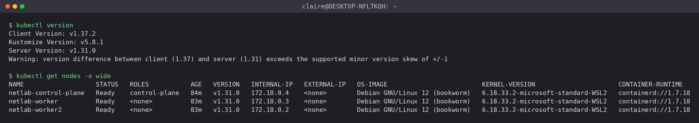
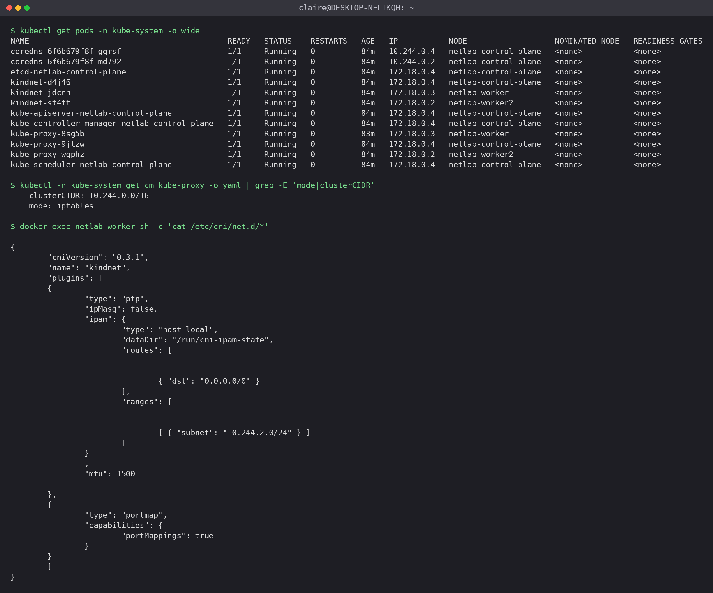

# 과제 1. Nginx로 알아보는 Pod 통신과 Service 동작 원리

## 1. Pod와 Service 구성 확인

client와 nginx-a는 `netlab-worker`(워커 A), nginx-b는 `netlab-worker2`(워커 B)에 nodeSelector로 배치했습니다. YAML은 문서 끝의 `lab.yaml`입니다.

| Pod | Pod IP | 노드 |
|---|---|---|
| client | 10.244.2.2 | netlab-worker |
| nginx-a | 10.244.2.3 | netlab-worker |
| nginx-b | 10.244.1.2 | netlab-worker2 |

Service `web`은 ClusterIP `10.96.191.35`, port 80, targetPort 80, selector `app=web`입니다. EndpointSlice `web-ssbwg`에는 `10.244.1.2`, `10.244.2.3`이 등록돼 있었고, 각각 nginx-b와 nginx-a의 Pod IP입니다.

```bash
kubectl get pods -o wide
kubectl get svc web -o yaml
kubectl get endpointslice -l kubernetes.io/service-name=web -o wide
```

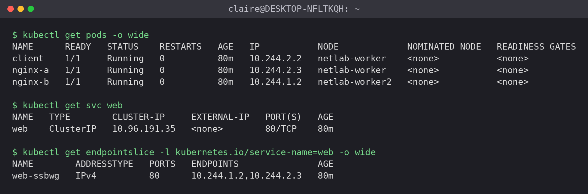

## 2. 같은 노드와 다른 노드의 Pod 간 통신

client Pod에서 네 가지로 요청했고 모두 200이 나왔습니다.

| 요청 대상 | 값 | 결과 |
|---|---|---|
| nginx-a Pod IP (같은 노드) | 10.244.2.3 | 200 |
| nginx-b Pod IP (다른 노드) | 10.244.1.2 | 200 |
| Service ClusterIP | 10.96.191.35 | 200 |
| Service DNS 이름 | web.default.svc.cluster.local | 200 |

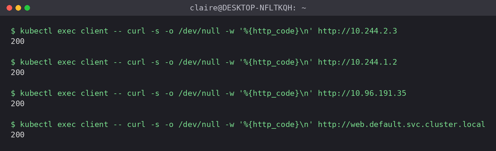

### CNI 구성

`netlab-worker`의 `ip link`에는 `lo`, `eth0`, 그리고 Pod마다 하나씩 붙은 veth만 있었습니다. `cni0` 같은 브리지나 vxlan 인터페이스는 없습니다. CNI 설정을 보면 타입이 `ptp`(Pod마다 veth 쌍, 브리지 없음)이고 `ipMasq`는 `false`입니다.

`netlab-worker`의 라우팅 테이블입니다.

```
10.244.0.0/24 via 172.18.0.4 dev eth0
10.244.1.0/24 via 172.18.0.2 dev eth0
10.244.2.2 dev vethcdbd5d4d scope host
10.244.2.3 dev vethb69b5d34 scope host
172.18.0.0/16 dev eth0 proto kernel scope link src 172.18.0.3
```

같은 노드의 Pod는 `/32` 경로로 veth에 바로 연결되고, 다른 노드의 Pod 대역은 그 노드 IP를 next hop으로 보냅니다. 터널은 쓰지 않습니다. 노드 사이 경로는 CNI 설정 파일이 아니라 kindnet 데몬이 노드마다 넣어 둔 것입니다.

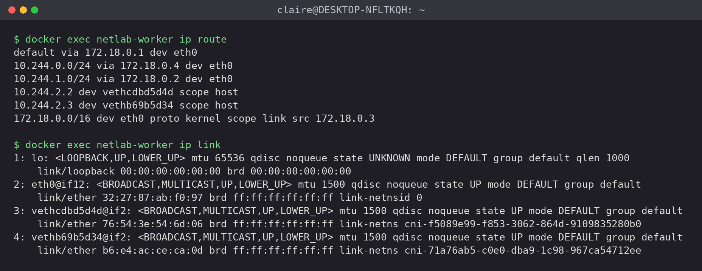

### 경로 그림

```
[같은 노드: client → nginx-a]
client eth0 ─ vethcdbd5d4d ─ (노드 L3 라우팅, /32 경로) ─ vethb69b5d34 ─ nginx-a eth0

[다른 노드: client → nginx-b]
client eth0 ─ vethcdbd5d4d ─ (노드 라우팅: 10.244.1.0/24 via 172.18.0.2)
  ─ netlab-worker eth0(172.18.0.3) ═ Docker 네트워크(172.18.0.0/16) ═ netlab-worker2 eth0(172.18.0.2)
  ─ (노드 라우팅) ─ veth ─ nginx-b eth0

[Service 경유]
요청할 때 노드 커널이 ClusterIP:80 을 Pod IP:80 으로 DNAT, 응답은 conntrack이 되돌림
```

## 3. Service는 어떻게 동작할까요?

### selector와 EndpointSlice는 백엔드 연결에 어떻게 관여하나요?

selector(`app=web`)로 라벨이 맞는 Pod를 고르고, EndpointSlice 컨트롤러가 그중 Ready인 Pod의 IP와 포트를 EndpointSlice에 적습니다. 실습에서도 EndpointSlice 주소 두 개가 nginx-a, nginx-b의 Pod IP와 같았습니다. kube-proxy는 이 EndpointSlice를 보고 노드에 규칙을 만듭니다.

### Pod IP 직접 접근과 ClusterIP 접근은 무엇이 다른가요?

Pod IP는 veth에 실제로 붙어 있는 주소라서 라우팅만으로 닿습니다. ClusterIP는 어느 인터페이스에도 없는 가상 IP이고, 노드의 netfilter 규칙이 목적지를 Pod IP로 바꿔 줘야 통신이 됩니다. Pod가 다시 만들어지면 Pod IP는 바뀌지만 ClusterIP는 그대로입니다.

### ClusterIP로 보낸 요청의 목적지 주소와 포트는 어떻게 바뀌나요?

Pod에서 나온 패킷이 노드의 PREROUTING에 들어오면 `KUBE-SERVICES`에서 `10.96.191.35:80`이 매칭되어 `KUBE-SVC-*`로 넘어가고, 고른 `KUBE-SEP-*`에서 `DNAT --to-destination <Pod IP>:80`이 적용됩니다. tcpdump로 보면 client 쪽 veth에서는 목적지가 ClusterIP였고 nginx 쪽 veth에서는 Pod IP였습니다. 그 사이, 즉 노드 커널에서 주소가 바뀐다는 뜻입니다. 응답은 conntrack에 남은 기록대로 출발지가 다시 ClusterIP로 바뀌어 client에 도착합니다.

### 여러 백엔드 중 요청을 받을 대상은 어떻게 고르나요?

`KUBE-SVC-*` 체인에서 `statistic --mode random --probability 0.5` 규칙이 먼저 평가되어 절반 확률로 nginx-b로 가고, 거기 걸리지 않으면 조건 없는 마지막 규칙이 nginx-a로 보냅니다. 새 TCP 연결의 첫 패킷마다 따로 정하고, 번갈아 보내는 방식은 아닙니다. 100번 요청했을 때는 nginx-a 49, nginx-b 51이었고 1000번에서는 nginx-a 499, nginx-b 501이었습니다. 처음 100번을 돌렸을 때는 40:60이 나온 적도 있어서, 적은 횟수에서는 한쪽으로 꽤 쏠릴 수 있다는 것도 같이 봤습니다.

### kube-proxy의 역할과 iptables 모드에서 패킷을 처리하는 주체는?

kube-proxy는 Service와 EndpointSlice가 바뀌는 것을 보고 노드에 iptables 규칙을 넣고 고칩니다. 패킷을 실제로 바꾸는 건 커널의 netfilter입니다. 과제 3 클러스터에서 kube-proxy가 죽어 있을 때 `10.96.0.1:443` 접속이 timeout 났고, kube-proxy를 살리자 바로 접속됐습니다. 규칙이 없으면 ClusterIP가 동작하지 않는다는 걸 직접 확인한 셈입니다.

### DNS 이름으로 요청하면 DNS는 어느 단계에 관여하나요?

CoreDNS가 `web.default.svc.cluster.local`을 `10.96.191.35`로 바꿔 주는 처음 단계에만 관여합니다. 그다음부터는 ClusterIP로 직접 요청한 것과 똑같이 흘러가고, 실습에서도 두 방식 모두 200이었습니다.

## 4. Service 관련 iptables 규칙

client가 있는 `netlab-worker`에서 확인했습니다.

```bash
docker exec netlab-worker iptables-save -t nat | grep -E "default/web|KUBE-SERVICES"
docker exec netlab-worker iptables -t nat -nvL KUBE-SVC-LOLE4ISW44XBNF3G --line-numbers
```

| 확인할 내용 | 실제 규칙 |
|---|---|
| ClusterIP와 포트 매칭 | `KUBE-SERVICES -d 10.96.191.35/32 -p tcp --dport 80 -j KUBE-SVC-LOLE4ISW44XBNF3G` |
| 백엔드 선택 | `KUBE-SVC-LOLE4...`에서 `statistic --mode random --probability 0.5`면 `KUBE-SEP-MQ4W7Q2CV67URU6Q`(nginx-b), 아니면 `KUBE-SEP-7QE66YRUUVCO6FRM`(nginx-a) |
| DNAT | `KUBE-SEP-MQ4W...`: `DNAT --to-destination 10.244.1.2:80`, `KUBE-SEP-7QE6...`: `DNAT --to-destination 10.244.2.3:80` |

처리 순서입니다.

```
PREROUTING / OUTPUT → KUBE-SERVICES (dst 10.96.191.35:80 매칭)
  → KUBE-SVC-LOLE4... : ① ! -s 10.244.0.0/16 이면 KUBE-MARK-MASQ (클러스터 밖에서 온 경우만)
                        ② 50% → KUBE-SEP-MQ4W... (nginx-b)
                        ③ 나머지 → KUBE-SEP-7QE6... (nginx-a)
    → KUBE-SEP-* : DNAT로 목적지를 Pod IP:80 으로 변경
```

`KUBE-SEP-*`의 `-s <자기 Pod IP> -j KUBE-MARK-MASQ`는 Pod가 자기 자신이 백엔드인 Service로 요청할 때(hairpin)를 위한 규칙입니다.

캡처 시점의 카운터는 규칙 1이 0, 규칙 2(nginx-b)가 570, 규칙 3(nginx-a)이 545였습니다. 실습 내내 보낸 요청이 누적된 값입니다. client(10.244.2.2)는 Pod 대역 안에서 출발하니 규칙 1에는 걸리지 않습니다. NAT 카운터는 새 연결의 첫 패킷에서만 올라가서 HTTP 요청 수와 같다고 보면 안 됩니다. 이 실습에서는 curl이 요청마다 연결을 새로 맺어서 숫자가 요청 수에 가깝게 나왔을 뿐입니다. 처음 12번 요청했을 때는 5:7이었는데, 요청이 쌓이면서 570:545로 비슷해졌습니다.

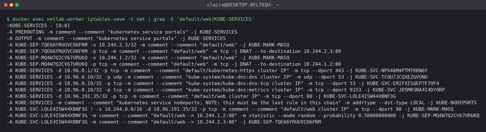
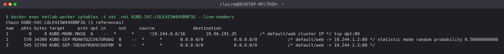

## 심화: tcpdump로 패킷 경로 확인

`netlab-worker`에서 `-i any`로 잡았습니다. In/Out은 노드 네트워크 네임스페이스 기준입니다.

| 상황 | 캡처 위치 | 방향 | 출발지 → 목적지 |
|---|---|---|---|
| 다른 노드 (nginx-b) | vethcdbd5d4d In | 요청 | 10.244.2.2 → 10.244.1.2 |
| | eth0 Out | 요청 | 10.244.2.2 → 10.244.1.2 |
| | eth0 In | 응답 | 10.244.1.2 → 10.244.2.2 |
| 같은 노드 (nginx-a) | vethcdbd5d4d In | 요청 | 10.244.2.2 → 10.244.2.3 |
| | vethb69b5d34 Out | 요청 | 10.244.2.2 → 10.244.2.3 |
| Service 경유 | vethcdbd5d4d In | 요청 | 10.244.2.2 → 10.96.191.35 |
| | vethb69b5d34 Out | 요청 | 10.244.2.2 → 10.244.2.3 |
| | vethcdbd5d4d Out | 응답 | 10.96.191.35 → 10.244.2.2 |

다른 노드로 갈 때 `eth0`에서도 TCP 패킷이 주소 그대로 보였고 VXLAN 헤더가 없었습니다. `ip link`에 터널 인터페이스가 없던 것과 맞습니다. 같은 노드끼리는 veth 두 개 사이에서만 오가고 `eth0`에는 한 번도 안 나타났습니다. Service 경유는 nginx-a가 고른 경우만 잡았고, nginx-b로 DNAT되는 경우는 캡처하지 못했습니다.

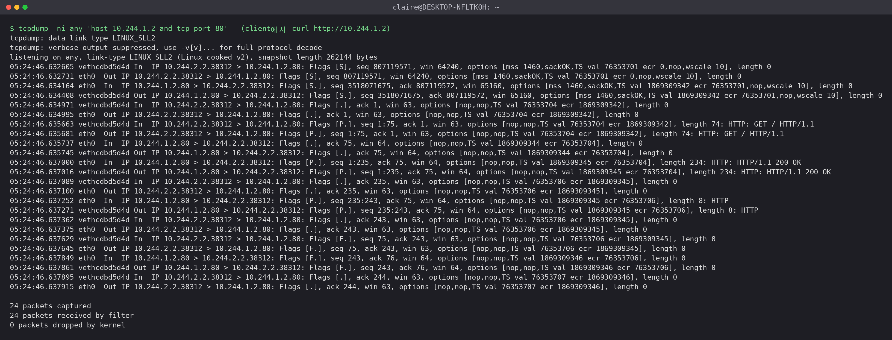
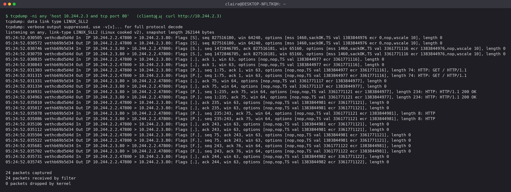
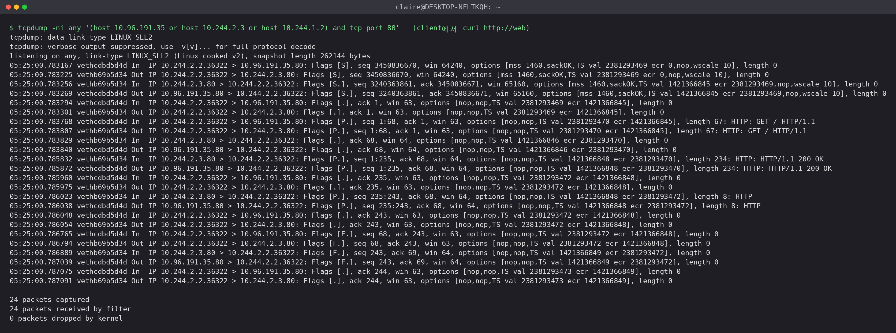

## 심화: 부하 분산 비율

client Pod 안에서 `curl -s http://web`을 반복하고 `sort | uniq -c`로 셌습니다. curl이 매번 새 연결을 맺어서 연결마다 백엔드가 따로 정해집니다.

```bash
kubectl exec client -- sh -c 'for i in $(seq 1 100); do curl -s http://web; done' | sort | uniq -c
kubectl exec client -- sh -c 'for i in $(seq 1 1000); do curl -s http://web; done' | sort | uniq -c
```

| 요청 횟수 | nginx-a | nginx-b |
|---|---|---|
| 100 (첫 측정) | 40 | 60 |
| 100 (재측정) | 49 | 51 |
| 1000 | 499 | 501 |

100번일 때 표준편차가 5(√(100×0.5×0.5))라서 첫 측정의 40:60은 기대값에서 2σ쯤 벗어난 결과였고, 다시 돌리니 49:51이 나왔습니다. 1000번으로 늘리면 표준편차가 약 16이고 결과도 499:501로 거의 반반이었습니다. 첫 측정은 스크린샷이 없고, 이미지는 재측정 결과입니다. 연결마다 확률로 고르는 방식이라 적은 횟수에서 딱 반반이 안 나오는 건 정상입니다.

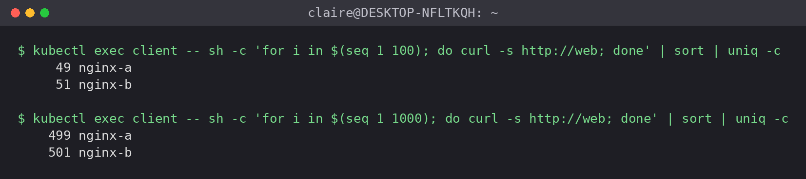

## 하지 못한 것

- 심화 중 Service 생성 전후 iptables 비교, 백엔드 변경 관찰, iptables·IPVS·nftables 비교는 하지 못했습니다.
- Service 경유 tcpdump에서 nginx-b로 가는 경우는 잡지 못했습니다.
- kind 노드가 WSL2 커널 위의 컨테이너라 물리 NIC·스위치 구간은 확인할 수 없었습니다.

# 과제 2. Ingress의 한계와 Gateway API로 전환하는 이유

<!-- 과제 2 내용 붙여 넣기 -->

# 과제 3. Envoy Gateway로 Gateway API 적용하기

## 1. 설치

과제 3은 새로 만든 `gw` 클러스터(K8s v1.37.0)에서 했습니다.

```bash
helm install eg oci://docker.io/envoyproxy/gateway-helm \
  --version v1.10.0 -n envoy-gateway-system --create-namespace --wait

kubectl apply -f https://github.com/envoyproxy/gateway/releases/download/v1.10.0/quickstart.yaml -n default
```

공식 호환 매트릭스에서 v1.10은 Gateway API v1.6.1, Envoy Proxy v1.40.x, Kubernetes v1.34~v1.37 조합입니다. 설치된 버전도 Gateway API CRD 번들 v1.6.1, Envoy Proxy distroless-v1.40.2로 맞았습니다.

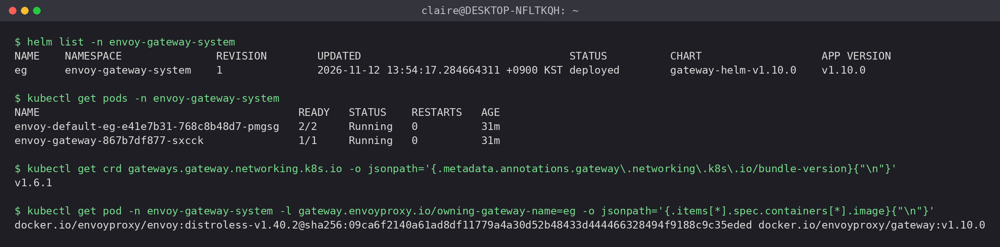

## 2. GatewayClass, Gateway, HTTPRoute 구성

Quickstart로 `GatewayClass eg`, `Gateway eg`, 예제 앱용 `HTTPRoute backend`를 만들어 먼저 동작을 확인했습니다. 그다음 기존 Nginx를 백엔드로 하는 `nginx-route`를 추가했습니다(`nginx-gw.yaml`). kind에는 LoadBalancer가 없어서 Quickstart에 나온 대로 포트포워딩으로 들어갔습니다.

```bash
export ENVOY_SERVICE=$(kubectl get svc -n envoy-gateway-system \
  --selector=gateway.envoyproxy.io/owning-gateway-namespace=default,gateway.envoyproxy.io/owning-gateway-name=eg \
  -o jsonpath='{.items[0].metadata.name}')
kubectl -n envoy-gateway-system port-forward service/${ENVOY_SERVICE} 8888:80 &
```

Quickstart 요청(`Host: www.example.com`, `/get`)은 200 OK였고, 응답 본문에 `backend` Pod 이름과 Envoy가 붙인 `X-Forwarded-For`, `X-Envoy-External-Address` 헤더가 보였습니다. 포트포워딩 로그에 `8888 -> 10080`으로 찍힌 건 Envoy Service의 80 포트가 Envoy 리스너 포트 10080으로 연결돼 있어서입니다.

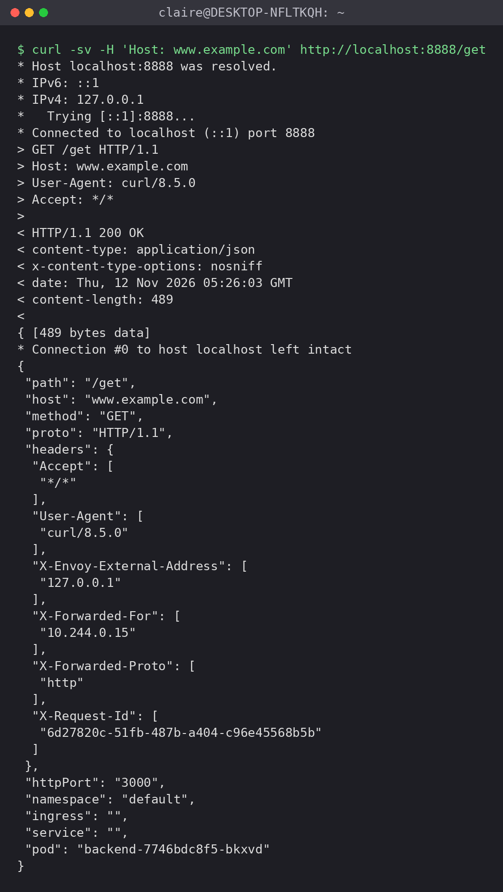

## 3. 호스트·경로 기반 라우팅

`nginx-route`는 호스트가 `nginx.example.com`일 때만 동작합니다. `/app`으로 들어오면 `URLRewrite`(`ReplacePrefixMatch: /`)로 `/`로 바꿔서 보내고, `/`는 그대로 `web` Service로 보냅니다. Nginx는 `/app` 경로를 모르기 때문에 경로를 바꿔야 응답합니다.

| 요청 | 결과 |
|---|---|
| `Host: nginx.example.com`, `/` | `hello from nginx` |
| `Host: nginx.example.com`, `/app` | `hello from nginx` (`/`로 바뀌어 전달) |
| `Host: other.example.com`, `/` | 404 (맞는 HTTPRoute 호스트가 없음) |

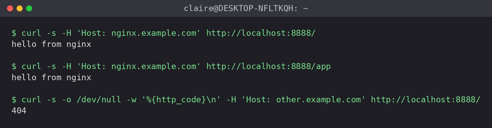

## 4. 상태 조건

| 리소스 | 조건 |
|---|---|
| GatewayClass `eg` | `Accepted=True` |
| HTTPRoute `backend`, `nginx-route` | `Accepted=True`, `ResolvedRefs=True` |
| Gateway `eg` 리스너 | `Programmed=True`, `attachedRoutes: 2` |
| Gateway `eg` 전체 | `Programmed=False`, reason `AddressNotAssigned` |

Gateway 전체가 `Programmed=False`인 건 주소를 못 받아서입니다. Envoy Proxy Service(`envoy-default-eg-...`)가 `LoadBalancer` 타입인데 kind에는 이걸 처리할 구현이 없어서 `EXTERNAL-IP`가 계속 `<pending>`이고, 그래서 Gateway에 주소가 할당되지 않았습니다. 리스너는 `Programmed=True`이고 포트포워딩으로 보낸 요청이 200과 404로 제대로 나뉘었으니 Envoy 쪽 설정은 정상 반영된 상태입니다.

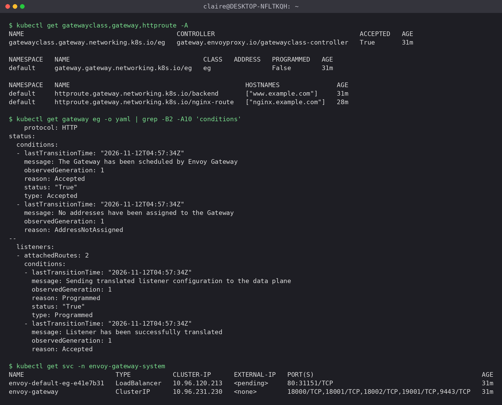

## 5. 구성 요소 역할

| 구성 요소 | 종류 | 역할 |
|---|---|---|
| GatewayClass `eg` | API 리소스 | 어떤 컨트롤러가 Gateway를 구현할지 지정 |
| Gateway `eg` | API 리소스 | 포트 80 HTTP 리스너 같은 공통 진입점 정의. 운영자가 관리 |
| HTTPRoute | API 리소스 | 호스트·경로 규칙과 백엔드 지정. 개발팀이 관리하고 `parentRefs`로 Gateway에 붙음 |
| Envoy Gateway | 컨트롤러 | 위 리소스를 읽어 Envoy 설정(xDS)으로 바꾸고 Gateway마다 Envoy Proxy Pod를 만듦. 트래픽은 직접 받지 않음 |
| Envoy Proxy | 데이터 플레인 | 실제 HTTP 요청을 받아 Host와 경로를 보고 백엔드로 넘김 |
| Service `envoy-default-eg-...` | Service | Envoy Proxy Pod의 진입 주소. 실습에서는 포트포워딩 대상 |
| Service `web` | Service | Nginx Pod의 ClusterIP |
| Nginx Pod | 워크로드 | 최종 응답 |

## 6. 요청 경로 그림

```
[요청 경로: 실제 패킷이 지나가는 길]
curl (Host: nginx.example.com)
  │ localhost:8888
  ▼
kubectl port-forward  (kind에 LoadBalancer가 없어 이 방법으로 진입)
  ▼
Service envoy-default-eg-... :80 ──► Envoy Proxy Pod :10080
                                       │ ① 호스트 nginx.example.com 매칭
                                       │ ② /app 이면 / 로 재작성
                                       ▼
                                  Service web (ClusterIP, kube-proxy iptables DNAT)
                                       ▼
                                  Nginx Pod :80

[설정 경로: 트래픽은 여기를 지나가지 않음]
GatewayClass / Gateway / HTTPRoute ──(watch)──► Envoy Gateway ──(xDS)──► Envoy Proxy
```

GatewayClass, Gateway, HTTPRoute는 설정 객체라서 패킷이 거쳐 가지 않습니다. 실제로 요청을 받아 넘기는 건 Envoy Proxy입니다.

## 트러블슈팅

처음에는 과제 1 클러스터와 같은 K8s v1.31에 Envoy Gateway v1.9.1을 설치하려 했는데 CRD 등록에서 실패했습니다. Gateway API CRD의 CEL 검증 규칙 `format.dns1123Label()`을 v1.31 API 서버가 몰라서 `undeclared reference to 'format'` 에러가 났습니다. 호환 매트릭스를 보니 v1.9는 K8s 1.33 이상에서 검증된 버전이었고, 그래서 kind를 v0.33.0으로 올리고 K8s v1.37.0 클러스터를 새로 만들었습니다.

새 클러스터에서는 Helm의 `certgen` Job이 `dial tcp 10.96.0.1:443: i/o timeout`으로 계속 실패했습니다. API 서버 Service에 접속이 안 되는 상황이라 kube-system을 확인해 보니 kube-proxy가 `fsnotify watcher init: too many open files`로 CrashLoopBackOff 상태였습니다. 클러스터 두 개를 동시에 띄우면서 WSL2의 inotify 한도가 모자랐던 것으로 보입니다. kube-proxy가 없으니 Service 규칙이 없었고 coredns도 Ready가 아니었습니다.

```bash
sudo sysctl -w fs.inotify.max_user_instances=512
sudo sysctl -w fs.inotify.max_user_watches=524288
kubectl -n kube-system rollout restart ds/kube-proxy
```

한도를 올리고 kube-proxy를 재시작하니 바로 Running이 됐고, Pod에서 `https://10.96.0.1/version`이 응답했습니다. 그 뒤 v1.37.0을 지원 범위에 포함하는 Envoy Gateway v1.10.0으로 설치했습니다.

## 하지 못한 것

- 심화(Nginx v1·v2, 가중치 80:20 측정)는 하지 못했습니다.
- Gateway `Programmed=False`는 kind에 LoadBalancer 구현이 없어서 생긴 것이고, MetalLB 같은 걸 붙여 해결하지는 않았습니다.

# 재현용 YAML

### kind.yaml (과제 1)

```yaml
kind: Cluster
apiVersion: kind.x-k8s.io/v1alpha4
networking:
  kubeProxyMode: iptables
nodes:
  - role: control-plane
  - role: worker
  - role: worker
```

```bash
kind create cluster --name netlab --config kind.yaml
```

### lab.yaml (과제 1)

```yaml
apiVersion: v1
kind: Pod
metadata:
  name: client
spec:
  nodeSelector:
    kubernetes.io/hostname: netlab-worker
  containers:
  - name: client
    image: nicolaka/netshoot
    command: ["sleep", "infinity"]
---
apiVersion: v1
kind: Pod
metadata:
  name: nginx-a
  labels:
    app: web
spec:
  nodeSelector:
    kubernetes.io/hostname: netlab-worker
  containers:
  - name: nginx
    image: nginx:latest
    ports:
    - containerPort: 80
---
apiVersion: v1
kind: Pod
metadata:
  name: nginx-b
  labels:
    app: web
spec:
  nodeSelector:
    kubernetes.io/hostname: netlab-worker2
  containers:
  - name: nginx
    image: nginx:latest
    ports:
    - containerPort: 80
---
apiVersion: v1
kind: Service
metadata:
  name: web
spec:
  selector:
    app: web
  ports:
  - port: 80
    targetPort: 80
```

### nginx-gw.yaml (과제 3)

```yaml
apiVersion: apps/v1
kind: Deployment
metadata:
  name: nginx
spec:
  replicas: 1
  selector:
    matchLabels:
      app: web
  template:
    metadata:
      labels:
        app: web
    spec:
      containers:
      - name: nginx
        image: nginx:latest
        ports:
        - containerPort: 80
---
apiVersion: v1
kind: Service
metadata:
  name: web
spec:
  selector:
    app: web
  ports:
  - port: 80
    targetPort: 80
---
apiVersion: gateway.networking.k8s.io/v1
kind: HTTPRoute
metadata:
  name: nginx-route
spec:
  parentRefs:
  - name: eg
  hostnames:
  - nginx.example.com
  rules:
  - matches:
    - path:
        type: PathPrefix
        value: /app
    filters:
    - type: URLRewrite
      urlRewrite:
        path:
          type: ReplacePrefixMatch
          replacePrefixMatch: /
    backendRefs:
    - name: web
      port: 80
  - matches:
    - path:
        type: PathPrefix
        value: /
    backendRefs:
    - name: web
      port: 80
```

```bash
kubectl apply -f nginx-gw.yaml
kubectl exec deploy/nginx -- sh -c 'echo "hello from nginx" > /usr/share/nginx/html/index.html'
```
