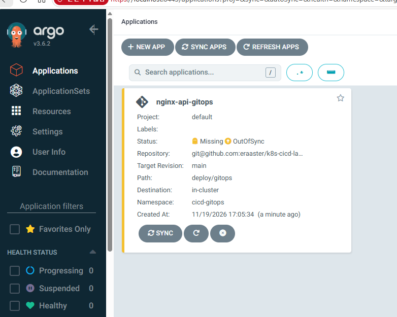
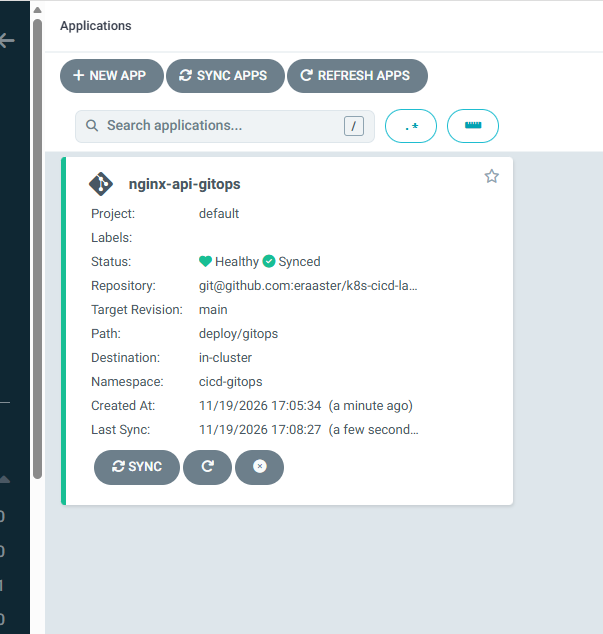

# 3주차 과제: Kubernetes CI/CD

- 개인 실습 저장소(비공개): https://github.com/eraaster/k8s-cicd-lab
- 이미지 패키지(공개): `ghcr.io/eraaster/nginx-api`
- 저장소가 비공개라 워크플로와 배포 설정은 아래에 그대로 첨부했습니다. 토큰, 비밀번호, kubeconfig는 넣지 않았습니다.

## 수행 범위

| 과제 | 수행 여부 |
|---|---|
| 과제 1. YAML·Kustomize·Helm 비교 | 수행 |
| 과제 2. Actions·GHCR·Kubernetes 연동 | 수행 (v1 → v2 자동 배포 확인) |
| 과제 3. Argo CD와 GitOps | 수행 (첫 Sync, 자동 동기화, v3 흐름 확인) |
| 딥다이브 | 미수행 |

## 실습 환경

Windows 노트북의 WSL2(Ubuntu)에 Docker Engine을 깔고 kind로 단일 노드 클러스터 `cicd`를 만들었습니다. self-hosted runner도 같은 WSL에 등록했습니다.

| 항목 | 버전 |
|---|---|
| 클러스터 | kind `cicd` (control-plane 1개) |
| kind | v0.33.0 |
| Kubernetes (서버) | v1.37.0 |
| kubectl | v1.37.2 |
| Helm | v3.22.1 |
| Docker Engine | 29.9.3 |
| Argo CD | v3.6.2 (stable 매니페스트) |
| GitHub Actions runner | GitHub-hosted `ubuntu-latest`(빌드), self-hosted Linux x64(배포) |
| 과제 1 이미지 | `nginx:alpine` (Helm 확인용 `nginx:1.27-alpine`) |
| 과제 2·3 베이스 이미지 | `nginx:alpine` |

# 과제 1. 일반 YAML, Kustomize, Helm 비교

## 구성

```
deploy/
├── plain/                  deployment.yaml, service.yaml
├── kustomize/
│   ├── base/               deployment.yaml, service.yaml, kustomization.yaml
│   └── overlays/
│       ├── dev/            replicas 1
│       └── prod/           replicas 2
└── helm/nginx/             Chart.yaml, values.yaml, templates/
```

세 방식 모두 Deployment `nginx`(이미지 `nginx:alpine`, 포트 80)와 ClusterIP Service `nginx`(port 80 → targetPort 80)를 만듭니다. 공통 YAML에는 namespace를 넣지 않고 배포할 때 지정했습니다.

```bash
kubectl apply -n cicd-plain -f deploy/plain/
kubectl apply -n cicd-kustomize -k deploy/kustomize/overlays/dev/
helm upgrade --install nginx deploy/helm/nginx -n cicd-helm

kubectl -n cicd-plain port-forward svc/nginx 18080:80
curl -s localhost:18080 | grep -i title
# <title>Welcome to nginx!</title>
```

세 namespace 모두 같은 방식으로 Nginx 기본 페이지를 확인했습니다.

## 생성된 YAML 확인

```bash
kubectl kustomize deploy/kustomize/overlays/dev  > rendered/kustomize-dev.yaml
kubectl kustomize deploy/kustomize/overlays/prod > rendered/kustomize-prod.yaml
helm template nginx deploy/helm/nginx > rendered/helm.yaml
helm template nginx deploy/helm/nginx --set replicaCount=2 --set image.tag=1.27-alpine > rendered/helm-custom.yaml
grep -H -E "replicas|image:" rendered/*.yaml
```

```
rendered/helm-custom.yaml:  replicas: 2
rendered/helm-custom.yaml:        image: "nginx:1.27-alpine"
rendered/helm.yaml:  replicas: 1
rendered/helm.yaml:        image: "nginx:alpine"
rendered/kustomize-dev.yaml:  replicas: 1
rendered/kustomize-dev.yaml:      - image: nginx:alpine
rendered/kustomize-prod.yaml:  replicas: 2
rendered/kustomize-prod.yaml:      - image: nginx:alpine
```

세 방식 모두 최종적으로는 같은 Deployment와 Service 두 개를 만듭니다. 다른 점은 도구가 붙이는 메타데이터 정도입니다. Kustomize overlay는 `env: dev`/`env: prod` 라벨을 더하고, Helm은 `app.kubernetes.io/managed-by: Helm`, `helm.sh/chart` 라벨과 릴리스 이름을 리소스 이름으로 씁니다. Kubernetes 입장에서는 어떤 도구로 만들었는지와 상관없이 같은 리소스를 받습니다.

## 비교

| 비교 항목 | 일반 YAML | Kustomize | Helm |
|---|---|---|---|
| 공통 설정 재사용 | 파일을 복사해서 씀 | `base`를 overlay가 `resources`로 참조 | 템플릿 하나에 values를 바꿔 넣음 |
| dev/prod 나누기 | 디렉터리를 통째로 복사해 각각 수정 | overlay마다 바뀌는 부분만 적음(`replicas`, 라벨) | `values-dev.yaml`, `values-prod.yaml` 또는 `--set` |
| 이미지·replicas 변경 위치 | Deployment YAML 본문 | overlay의 `replicas`, `images` 필드 | `values.yaml`의 `replicaCount`, `image.tag` |
| 장점 | 바로 읽히고 도구가 필요 없음 | 원본 YAML을 그대로 두고 차이만 관리. `kubectl -k` 내장 | 값으로 바꾸는 범위가 넓고, 릴리스 단위로 설치·업그레이드·롤백 가능 |
| 불편했던 점 | 환경이 늘면 같은 내용이 여러 곳에 생김 | 조건문이나 반복 같은 로직이 없음 | 템플릿 문법(`{{ }}`) 때문에 YAML이 읽기 어렵고, 최종 결과를 `helm template`으로 따로 봐야 함 |
| 언제 쓸지 | 리소스가 적고 환경이 하나일 때 | 우리 팀 앱을 환경별로 조금씩 다르게 배포할 때 | 남에게 배포할 패키지나, 설정값이 많은 외부 앱(Argo CD, 모니터링 등)을 설치할 때 |

# 과제 2. 개인 GitHub Actions·GHCR·Kubernetes 연동

## 연결 구조

```
소스 push (main, app/**)
  → [build] GitHub-hosted runner: buildx로 linux/amd64,linux/arm64 빌드
           → ghcr.io/eraaster/nginx-api:<전체 github.sha> push (GITHUB_TOKEN)
  → [deploy] 내 WSL의 self-hosted runner
           → kubectl --context kind-cicd 로 cicd-ci 에 적용
  → kind 노드가 GHCR(Public)에서 이미지 pull → Pod 실행
```

GitHub-hosted runner는 내 노트북의 kind API에 접근할 수 없어서 job을 둘로 나눴습니다. 빌드 job이 만든 이미지 주소는 job output(`needs.build.outputs.image`)으로 배포 job에 넘겼습니다. 배포 job은 `runs-on: [self-hosted, linux]`라서 내 WSL의 runner에서만 돕니다. runner가 claire 계정으로 실행되어 `~/.kube/config`의 `kind-cicd` context를 그대로 씁니다. 이 runner는 비공개 저장소의 main push에만 쓰고, 외부 PR은 받지 않습니다.

runner 등록은 토큰을 화면에서 복사하지 않고 `gh`로 받았습니다.

```bash
TOKEN=$(gh api -X POST repos/eraaster/k8s-cicd-lab/actions/runners/registration-token --jq .token)
./config.sh --url https://github.com/eraaster/k8s-cicd-lab --token "$TOKEN" --unattended --name wsl-kind
./run.sh
```

## 워크플로 (과제 2 시점의 `.github/workflows/ci.yml`)

```yaml
name: ci

on:
  push:
    branches: [main]
    paths:
      - "app/**"
      - "deploy/ci/**"
      - ".github/workflows/ci.yml"
  workflow_dispatch:

permissions:
  contents: read
  packages: write

jobs:
  build:
    runs-on: ubuntu-latest
    outputs:
      image: ${{ steps.meta.outputs.image }}
    steps:
      - uses: actions/checkout@v4

      - name: Set image name
        id: meta
        run: |
          OWNER="${GITHUB_REPOSITORY_OWNER,,}"
          echo "image=ghcr.io/${OWNER}/nginx-api:${GITHUB_SHA}" >> "$GITHUB_OUTPUT"

      - uses: docker/setup-qemu-action@v3
      - uses: docker/setup-buildx-action@v3

      - uses: docker/login-action@v3
        with:
          registry: ghcr.io
          username: ${{ github.actor }}
          password: ${{ secrets.GITHUB_TOKEN }}

      - uses: docker/build-push-action@v6
        with:
          context: app
          platforms: linux/amd64,linux/arm64
          push: true
          tags: ${{ steps.meta.outputs.image }}

  deploy:
    needs: build
    # 내 WSL에 등록한 개인 runner에서만 실행
    runs-on: [self-hosted, linux]
    env:
      IMAGE: ${{ needs.build.outputs.image }}
      KUBE_CONTEXT: kind-cicd
    steps:
      - uses: actions/checkout@v4

      - name: Deploy to kind
        shell: bash
        run: |
          set -euo pipefail
          echo "IMAGE=$IMAGE"
          kubectl set image --local -f deploy/ci/deployment.yaml nginx="$IMAGE" -o yaml \
            | kubectl --context "$KUBE_CONTEXT" -n cicd-ci apply -f -
          kubectl --context "$KUBE_CONTEXT" -n cicd-ci apply -f deploy/ci/service.yaml
          kubectl --context "$KUBE_CONTEXT" -n cicd-ci rollout status deployment/nginx-api --timeout=180s
          kubectl --context "$KUBE_CONTEXT" -n cicd-ci get deployment nginx-api \
            -o jsonpath='{.spec.template.spec.containers[0].image}'
          echo
          kubectl --context "$KUBE_CONTEXT" -n cicd-ci get pods -l app=nginx-api \
            -o jsonpath='{range .items[*]}{.metadata.name}{"  "}{.spec.containers[0].image}{"  "}{.status.containerStatuses[0].imageID}{"\n"}{end}'
```

## 배포 설정 (`deploy/ci/`)

```yaml
apiVersion: apps/v1
kind: Deployment
metadata:
  name: nginx-api
  labels:
    app: nginx-api
spec:
  replicas: 1
  selector:
    matchLabels:
      app: nginx-api
  template:
    metadata:
      labels:
        app: nginx-api
    spec:
      containers:
      - name: nginx
        # 배포 job이 이번 실행의 SHA 태그로 바꿔서 적용함
        image: ghcr.io/eraaster/nginx-api:placeholder
        ports:
        - containerPort: 8080
        readinessProbe:
          httpGet:
            path: /healthz
            port: 8080
```

```yaml
apiVersion: v1
kind: Service
metadata:
  name: nginx-api
  labels:
    app: nginx-api
spec:
  type: ClusterIP
  selector:
    app: nginx-api
  ports:
  - port: 80
    targetPort: 8080
```

## v1 → v2 변경 결과

`app/nginx.conf`의 version만 v1에서 v2로 바꿔 push했고, 그 뒤로는 손대지 않았습니다.

| 항목 | v1 | v2 |
|---|---|---|
| 소스 커밋 SHA | `773f5a640c27e42e6dd7e98b6810ad57964f16e5` | `e5c354f8d93d05a3f245ac991d3d6cf8e7ca1f12` |
| Actions 실행 | [44482406996](https://github.com/eraaster/k8s-cicd-lab/actions/runs/44482406996) | [44483665249](https://github.com/eraaster/k8s-cicd-lab/actions/runs/44483665249) |
| GHCR 태그 | `nginx-api:773f5a64...` | `nginx-api:e5c354f8...` |
| Deployment 이미지 | `ghcr.io/eraaster/nginx-api:773f5a640c27...` | `ghcr.io/eraaster/nginx-api:e5c354f8d93d...` |
| Pod | `nginx-api-75d8cb8b7c-7ff6q` | `nginx-api-69959cb99f-4xgnl` |
| Pod imageID | `sha256:ca39012146e9...` | `sha256:4660c8d83c36...` |
| rollout revision | 1 | 2 |
| `/api/hello` | `{"message":"hello from nginx","version":"v1"}` | `{"message":"hello from nginx","version":"v2"}` |

소스 커밋이 바뀌면서 태그가 바뀌었고, Deployment와 새 Pod가 새 태그를 썼습니다. Pod template이 바뀌어서 ReplicaSet 해시(`75d8cb8b7c` → `69959cb99f`)와 revision도 바뀌었고, 응답이 v2가 됐습니다.

SHA 태그는 "이 이미지가 어느 커밋으로 만들어졌는지"를 알려 주지만, 태그는 다시 push하면 다른 이미지를 가리키게 바꿀 수 있습니다. 이미지 내용 자체를 고정하는 건 digest(`@sha256:...`)입니다. 위 표의 imageID가 그 digest입니다.

## 겪은 문제

- 첫 배포에서 Pod가 `ImagePullBackOff`였습니다. 이벤트에 `failed to fetch anonymous token ... 401 Unauthorized`가 찍혀서 GHCR 패키지가 Private이라는 걸 알았습니다.
- Public으로 바꾼다고 저장소 visibility를 바꿨는데, 이미지 패키지는 그대로 Private이었습니다. 소스 저장소와 패키지 공개 범위가 별개라는 걸 여기서 확인했습니다. 저장소는 다시 Private으로 돌리고 패키지만 Public으로 바꾼 뒤 Pod를 지우고 실패한 job을 다시 돌려 해결했습니다.
- 액션들이 Node.js 20 기반이라 경고가 떴지만 Node 24로 실행되어 동작에는 문제가 없었습니다.

# 과제 3. Argo CD 연동과 GitOps

## 설치와 저장소 연결

```bash
kubectl create ns argocd
kubectl apply -n argocd --server-side --force-conflicts \
  -f https://raw.githubusercontent.com/argoproj/argo-cd/stable/manifests/install.yaml
```

비공개 저장소를 읽게 하려고 읽기 전용 deploy key를 만들어 등록했습니다. 개인 키는 Argo CD의 repository Secret에만 넣었습니다.

```bash
ssh-keygen -t ed25519 -N "" -C argocd -f ~/.ssh/argocd_k8s_cicd
gh repo deploy-key add ~/.ssh/argocd_k8s_cicd.pub --repo eraaster/k8s-cicd-lab --title argocd   # 읽기 전용
kubectl -n argocd create secret generic repo-k8s-cicd-lab \
  --from-literal=type=git \
  --from-literal=url=git@github.com:eraaster/k8s-cicd-lab.git \
  --from-file=sshPrivateKey=$HOME/.ssh/argocd_k8s_cicd
kubectl -n argocd label secret repo-k8s-cicd-lab argocd.argoproj.io/secret-type=repository
```

## Application

처음에는 자동 동기화 없이 만들어 수동으로 Sync했고, 확인한 뒤 `automated`를 켰습니다. 최종 설정은 다음과 같습니다.

```yaml
# 첫 수동 Sync 확인 후 적용: 자동 동기화 켜기
apiVersion: argoproj.io/v1alpha1
kind: Application
metadata:
  name: nginx-api-gitops
  namespace: argocd
spec:
  project: default
  source:
    repoURL: git@github.com:eraaster/k8s-cicd-lab.git
    targetRevision: main
    path: deploy/gitops
  destination:
    server: https://kubernetes.default.svc
    namespace: cicd-gitops
  syncPolicy:
    automated:
      prune: false
      selfHeal: false
    syncOptions:
    - CreateNamespace=true
```

## 첫 Sync

Application을 만들자 Git에는 있고 클러스터에는 없는 상태라 Missing / OutOfSync로 보였습니다. deploy key로 저장소를 읽는 데는 성공했다는 뜻입니다.



SYNC 후 Healthy / Synced가 됐습니다.



```
deployment image: ghcr.io/eraaster/nginx-api:42ba7fb3bb44eebbce4ca0b6aaec3b9e63eec998
pod: nginx-api-5588488bcf-djfbd   1/1   Running
/api/hello: {"message":"hello from nginx","version":"v2"}
```

## 워크플로 수정 (GitOps용 `ci.yml`)

배포 job을 빼고, 새 SHA 태그로 `deploy/gitops/deployment.yaml`의 image 줄을 바꿔 commit·push하는 `update-manifest` job을 넣었습니다. 이 job에만 `contents: write`를 줬습니다. 경로 필터를 `app/**`와 워크플로 파일로 줄여서, 봇이 만든 `deploy/gitops` commit이 다시 빌드를 일으키지 않게 했습니다. 클러스터 반영은 Argo CD가 맡습니다.

```yaml
name: ci

# 과제 3: 이미지 빌드 후 클러스터에 직접 배포하지 않고
# deploy/gitops 의 image 를 새 SHA 로 바꿔 commit 한다. 배포는 Argo CD 담당.
on:
  push:
    branches: [main]
    paths:
      - "app/**"
      - ".github/workflows/ci.yml"
  workflow_dispatch:

permissions:
  contents: read

jobs:
  build:
    runs-on: ubuntu-latest
    permissions:
      contents: read
      packages: write
    outputs:
      image: ${{ steps.meta.outputs.image }}
    steps:
      - uses: actions/checkout@v4

      - name: Set image name
        id: meta
        run: |
          OWNER="${GITHUB_REPOSITORY_OWNER,,}"
          echo "image=ghcr.io/${OWNER}/nginx-api:${GITHUB_SHA}" >> "$GITHUB_OUTPUT"

      - uses: docker/setup-qemu-action@v3
      - uses: docker/setup-buildx-action@v3

      - uses: docker/login-action@v3
        with:
          registry: ghcr.io
          username: ${{ github.actor }}
          password: ${{ secrets.GITHUB_TOKEN }}

      - uses: docker/build-push-action@v6
        with:
          context: app
          platforms: linux/amd64,linux/arm64
          push: true
          tags: ${{ steps.meta.outputs.image }}

  update-manifest:
    needs: build
    runs-on: ubuntu-latest
    permissions:
      contents: write
    env:
      IMAGE: ${{ needs.build.outputs.image }}
    steps:
      - uses: actions/checkout@v4

      - name: Update image in deploy/gitops
        shell: bash
        run: |
          set -euo pipefail
          sed -i -E "s#^(\s*image:\s*)ghcr\.io/[^[:space:]]+/nginx-api:[^[:space:]]+#\1${IMAGE}#" deploy/gitops/deployment.yaml
          grep -n "image:" deploy/gitops/deployment.yaml
          if git diff --quiet; then
            echo "no change"; exit 0
          fi
          git config user.name  "github-actions[bot]"
          git config user.email "41898282+github-actions[bot]@users.noreply.github.com"
          git add deploy/gitops/deployment.yaml
          git commit -m "deploy(gitops): nginx-api -> ${GITHUB_SHA}"
          git pull --rebase origin main
          git push origin HEAD:main
```

```yaml
apiVersion: apps/v1
kind: Deployment
metadata:
  name: nginx-api
  labels:
    app: nginx-api
spec:
  replicas: 1
  selector:
    matchLabels:
      app: nginx-api
  template:
    metadata:
      labels:
        app: nginx-api
    spec:
      containers:
      - name: nginx
        # Actions가 새 SHA 태그로 이 줄을 바꿔서 commit함
        image: ghcr.io/eraaster/nginx-api:<Actions가 갱신하는 SHA>
        ports:
        - containerPort: 8080
        readinessProbe:
          httpGet:
            path: /healthz
            port: 8080
```

## 소스 commit과 배포 설정 commit

```
38c9f86 deploy(gitops): nginx-api -> 4062cbb48d42719c50576014d2bda94e5fb999fd   ← 설정 commit B (봇)
4062cbb feat: api v3                                                              ← 소스 commit A
9610277 chore: enable argocd auto sync
3e27498 deploy(gitops): nginx-api -> 42ba7fb3bb44eebbce4ca0b6aaec3b9e63eec998
42ba7fb feat: gitops with argo cd
```

| 단계 | 첫 GitOps 배포 | v3 배포 |
|---|---|---|
| 소스 commit A | `42ba7fb` feat: gitops with argo cd | `4062cbb` feat: api v3 |
| 이미지 태그 | `nginx-api:42ba7fb3bb44...` | `nginx-api:4062cbb48d42...` |
| 설정 commit B (봇) | `3e27498` deploy(gitops): nginx-api -> 42ba7fb... | `38c9f86` deploy(gitops): nginx-api -> 4062cbb... |
| Actions 실행 | [44484701700](https://github.com/eraaster/k8s-cicd-lab/actions/runs/44484701700) | [44485210239](https://github.com/eraaster/k8s-cicd-lab/actions/runs/44485210239) |
| Argo CD | 수동 Sync → Synced / Healthy | 자동 동기화 → Synced / Healthy |
| Pod | `nginx-api-5588488bcf-djfbd` | `nginx-api-75bd67b85-q44rv` |
| `/api/hello` | v2 | v3 |

v3는 `app/nginx.conf`만 바꿔 push한 뒤 아무것도 하지 않았고, Actions 빌드 → 봇 commit → Argo CD 자동 동기화 → 새 Pod 순서로 반영되어 응답이 v3로 바뀌었습니다.

이미지 태그는 소스 commit A의 SHA이고, Argo CD가 읽은 건 그 태그를 적어 넣은 설정 commit B입니다. 두 SHA는 다릅니다. 이미지만 GHCR에 올리고 Git의 image 줄을 바꾸지 않으면 Argo CD는 바뀐 게 없다고 보고 아무것도 하지 않습니다.

## GitOps 질문

**선언적 상태.** Git에는 `kubectl apply` 같은 명령이 아니라 "nginx-api는 이 이미지(`:SHA`)로 1개 떠 있고, Service는 80을 8080으로 보낸다"는 결과 상태를 저장합니다. 이미지, replicas, Service 포트가 모두 `deploy/gitops/`의 YAML 값입니다.

**버전과 변경 이력.** 배포 상태가 바뀔 때마다 commit이 남습니다. 이번 실습에서는 소스 변경은 제 commit, 이미지 반영은 `github-actions[bot]`의 commit으로 구분됩니다. 브랜치 보호를 켜면 봇 commit도 PR과 리뷰를 거치게 해서 어떤 배포가 승인됐는지 PR 기록으로 남길 수 있습니다.

**Pull 방식.** 과제 2는 Actions(내 runner)가 kubeconfig로 클러스터에 직접 명령을 보내는 push 방식이라, CI가 클러스터 자격 증명을 가져야 합니다. 과제 3은 클러스터 안의 Argo CD가 Git을 읽어 와서 적용하는 pull 방식입니다. Actions는 Git에 쓰기만 하고 클러스터 접근 권한이 없습니다. Argo CD는 읽기 전용 deploy key만 가집니다.

**상태 조정(reconciliation).** 원하는 상태는 Git의 YAML이고, 실제 상태는 클러스터에 떠 있는 리소스입니다. Argo CD는 주기적으로(기본 약 3분) Git을 다시 읽고 클러스터와 비교해, 다르면 OutOfSync로 표시합니다. 자동 동기화가 켜져 있으면 Git 쪽에 맞춰 적용합니다.

**드리프트.** `kubectl scale --replicas=3`처럼 클러스터를 직접 바꾸면 Git(1)과 실제(3)가 달라져 OutOfSync가 됩니다. 자동 동기화는 Git이 바뀌었을 때 따라가는 기능이라, 클러스터만 바뀐 경우에는 selfHeal이 켜져 있어야 Git 값으로 되돌립니다. 이번 설정은 `selfHeal: false`라서 차이만 표시됩니다. (직접 실습하지는 않았습니다.)

**삭제와 복구.** prune을 켜면 Git에서 지운 리소스를 클러스터에서도 지웁니다. 끄면(이번 설정) OutOfSync로 남기만 합니다. 문제가 생기면 이미지 줄을 이전 SHA로 되돌리는 commit(revert)을 만들면 Argo CD가 그 상태로 다시 맞추고, 이전 이미지로 Pod가 바뀝니다.

**CI와 CD의 책임.** CI(Actions)는 코드로 이미지를 만들어 GHCR에 올리고, Git의 image 참조를 바꾸는 데까지 맡습니다. CD(Argo CD)는 Git의 선언을 클러스터에 반영합니다. 이미지 push만으로는 Argo CD가 새 이미지를 알 수 없고, Git의 image 줄이 바뀌어야 배포됩니다.

## 전체 흐름

```
[과제 2: push 방식]
개발자 push ─► Actions build ─► GHCR (:SHA)
                    └─► self-hosted runner ─kubectl─► kind (cicd-ci) ─pull─► GHCR

[과제 3: GitOps]
개발자 push (commit A) ─► Actions build ─► GHCR (:A)
                              └─► update-manifest ─► Git commit B (image: :A)
kind 안의 Argo CD ─(deploy key로 읽기)─► Git main / deploy/gitops
        └─► cicd-gitops 에 적용 ─► kind 노드가 GHCR에서 :A pull ─► Pod
```

# 해결하지 못한 것

- 딥다이브는 하지 못했습니다.
- selfHeal과 prune은 설명만 하고 실습하지 않았습니다.
- 액션 버전이 Node.js 20 기반이라 경고가 남아 있습니다.
