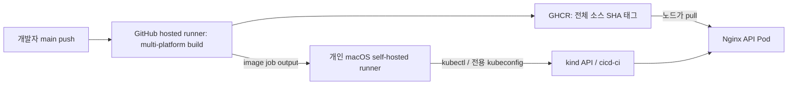
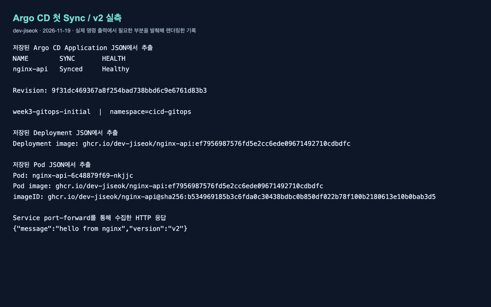
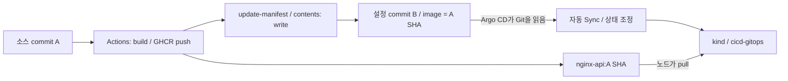
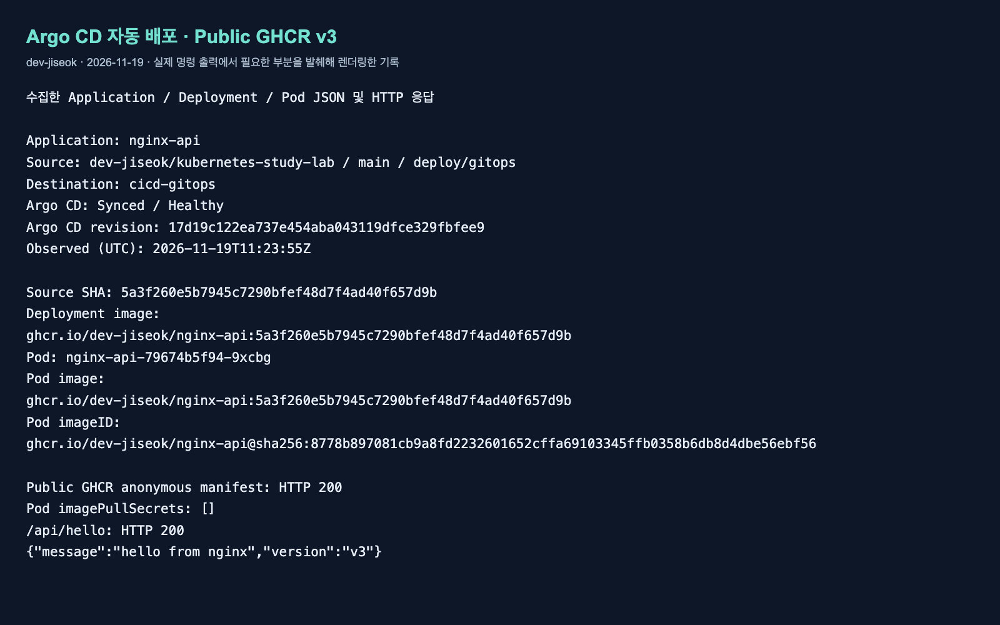

# 3주차 과제: Kubernetes CI/CD — 이지석

> **작성 중인 초안입니다.** 공개 GHCR 이미지로 직접 CI와 GitOps 배포를 재검증한 뒤 제출 상태로 전환합니다.

- GitHub: **dev-jiseok**
- 개인 실습 저장소: [dev-jiseok/kubernetes-study-lab](https://github.com/dev-jiseok/kubernetes-study-lab) (비공개)
- 이미지: `ghcr.io/dev-jiseok/nginx-api:<전체 소스 commit SHA>`
- 기준 과제: [Issue #14](https://github.com/cloud-club/10th-kubernetes-study/issues/14)
- 실습일: 2026-11-19, macOS ARM64

## 수행 범위와 남은 조건

| 항목 | 확인 결과 |
|---|---|
| 일반 YAML·Kustomize·Helm | 세 namespace에서 Nginx 기본 페이지 HTTP 200, 렌더링 설정 동등성 검증 |
| Actions 직접 배포 | v1과 v2에서 build/deploy job 성공, 전체 SHA·Pod image/imageID·실제 응답 수집 |
| Argo CD GitOps | 비공개 Git 읽기 전용 인증, 첫 Sync, v3 자동 Git 갱신·배포·응답 검증 |
| **Public GHCR** | **미완료. 패키지는 Private이며 익명 pull은 401. 아래 성공 결과는 임시 인증을 사용한 조건부 검증** |
| 선택 심화 1 | replicas 변경과 Pod template 이미지 변경의 ReplicaSet 차이 관찰 및 초기 설정 복구 |
| 추가 관찰 | selfHeal 꺼짐/켜짐에 따른 수동 replicas 변경의 복원 여부 |

**임시 인증의 범위:** 과제 2는 deploy job의 `packages: read` GITHUB_TOKEN으로 imagePullSecret을 만들었습니다. GitOps는 별도 `registry-session.yml` job이 검증 시간 동안만 동일한 읽기 권한을 제공했습니다. 최종 `ci.yml`의 build/update-manifest job은 클러스터에 접근하지 않습니다. 인증 보조 job은 앱의 image나 replicas를 배포하지 않습니다.

GITHUB_TOKEN은 job 종료 시 만료되므로 이 방식은 지속 가능한 이미지 pull 구성이 아닙니다. 성공한 시점의 실측과, Public 전환 전에는 새 노드/새 이미지 배포를 계속할 수 없다는 한계를 구분합니다. 공개 전환 후 익명 pull과 새 버전 자동 배포를 다시 확인해야 과제의 모든 조건을 충족합니다. [토큰 수명 공식 문서](https://docs.github.com/en/actions/concepts/security/github_token)

## 실습 환경

| 구성 | 실제 사용 버전/설정 |
|---|---|
| 클러스터 | kind `jiseok-netlab`, control-plane 1 + worker 2, 전용 kubeconfig |
| kind / node image | v0.33.0 / `kindest/node:v1.35.0` |
| Kubernetes 서버 / kubectl | v1.35.0 / v1.34.1 |
| 내장 Kustomize / Helm | v5.7.1 / v4.3.2 |
| Docker | Desktop 4.55.0, Engine 29.1.3, ARM64 |
| Argo CD | v3.6.2, 공식 버전 고정 설치 매니페스트 |
| Actions runner | hosted `ubuntu-latest` / 로컬 macOS ARM64 runner v2.338.2, `jiseok-k8s` 라벨 |
| Nginx | 과제 1·API 베이스 `nginx:alpine`, 심화 이미지 변경 `nginx:1.27-alpine` |

`nginx:alpine`은 가변 태그입니다. 본문은 실행 시점의 관찰이며, API 컨테이너의 실제 내용은 아래 imageID도 함께 기록했습니다. 이미지는 `linux/amd64,linux/arm64`로 빌드했고 이 클러스터에서는 ARM64 이미지를 실행했습니다.

## 과제 1. 세 가지 배포 도구

### 구성과 실행

공통 Deployment·Service에는 namespace를 고정하지 않았습니다. 세 방식 모두 `nginx:alpine`, Deployment 이름 `nginx`, 컨테이너 포트 80, Service 이름 `nginx`, ClusterIP, port/targetPort 80을 사용합니다.

```bash
kubectl -n cicd-plain apply -f deploy/plain/
kubectl -n cicd-kustomize apply -k deploy/kustomize/overlays/dev/
helm upgrade --install nginx deploy/helm/nginx -n cicd-helm
kubectl kustomize deploy/kustomize/overlays/dev/
kubectl kustomize deploy/kustomize/overlays/prod/
helm template nginx deploy/helm/nginx
helm template nginx deploy/helm/nginx --set replicaCount=2 --set image.tag=1.27-alpine
# namespace를 바꾸며 동일하게 확인
kubectl -n cicd-plain port-forward svc/nginx 18080:80
curl http://localhost:18080/
```

아래 결과는 실제 수집한 리소스와 HTTP 응답입니다. Argo CD 이미지 두 장은 수집한 JSON/응답을 렌더링한 기록이며 웹 UI 화면 캡처는 아닙니다.

- dev replicas=1, prod replicas=2. prod overlay를 실제 적용해 2개 Pod Ready까지 확인한 뒤 dev로 복구했습니다.
- Helm values의 `replicaCount`, `image.repository`, `image.tag`가 렌더링에 반영됩니다.
- 렌더링 결과를 비교해 기본 세 방식의 Deployment·Service spec이 동일함을 확인했습니다.

### 비교

| 항목 | 일반 YAML | Kustomize | Helm |
|---|---|---|---|
| 공통 설정 재사용 | 같은 파일을 공용으로 적용. 차이가 많아지면 중복 발생 | base를 참조하고 변경분만 overlay에 선언 | templates에 values를 넣어 리소스 생성 |
| dev/prod 분리 | 별도 파일을 관리하거나 생성 도구 필요 | overlays/dev, overlays/prod | 환경별 values 파일 또는 --set |
| 이미지·replicas 위치 | Deployment spec | replicas/images 또는 patch | values.yaml |
| 장점 | 작은 구성의 최종 상태를 직접 읽기 쉽다 | 일반 YAML을 유지하며 환경 차이를 관리 | 배포 패키지와 릴리스 단위의 변경 관리 |
| 불편한 점 | 환경이 늘면 같은 변경을 반복 | 복잡한 patch 대상이나 overlay 구조를 추적해야 한다 | 템플릿과 values를 함께 읽고 렌더링 결과를 확인해야 한다 |
| 선택할 상황 | 단일 환경·작은 실습 | 팀 내부 앱의 환경별 설정 차이 | 여러 사용자에게 배포할 패키지·외부 앱 설치 |

이 Chart는 비교를 위해 이름/label을 최소화했습니다. Kustomize나 Helm이 모든 경우에 자동으로 특정 label을 추가한다고 가정하지 않았습니다. Helm 설치 시 릴리스 소유권 metadata는 추가될 수 있지만, 원하는 동작은 리소스의 spec이 결정합니다. YAML을 만들고 관리하는 도구와 Deployment controller의 역할을 구분해야 합니다.

## 과제 2. GitHub Actions·GHCR·Kubernetes 직접 배포



GitHub-hosted runner에서 로컬 kind API로 바로 접근할 수 없어 build/deploy job을 분리했습니다. 배포 job은 `kind-jiseok-netlab` context를 명시합니다. 개인 비공개 저장소의 main push에만 연결했으며 외부 PR 실행은 구성하지 않았습니다. 클러스터 API를 인터넷에 노출하지 않았습니다.

`build.outputs.image`를 deploy job에 전달합니다. `kubectl set image --local`로 이번 SHA를 manifest에 반영한 다음 apply합니다. `rollout status` 뒤에는 실제 `/api/hello`도 확인합니다. Service는 `80 → 8080`, readinessProbe는 `/healthz:8080`입니다.

### v1과 v2 실측

v2는 `app/nginx.conf`의 응답 버전을 바꾼 source push로 진행했습니다. CI 배포 리소스를 수동으로 수정하거나 수동 배포 명령을 실행하지 않았습니다. 같은 commit에는 GitOps 인증 준비용 별도 워크플로도 추가했지만, 앱의 동작 변경은 version 값뿐입니다.

- **v1**: 소스 `2fd1d557a21844cdbe3a3be3c7cea23c0fa6aed6` / [Actions build·deploy 성공](https://github.com/dev-jiseok/kubernetes-study-lab/actions/runs/44497197652)
- **v2**: 소스 `ef7956987576fd5e2cc6ede09671492710cdbdfc` / [Actions build·deploy 성공](https://github.com/dev-jiseok/kubernetes-study-lab/actions/runs/44497510776)

전체 이미지 참조와 Pod imageID는 아래 표에서 별도로 확인할 수 있습니다. SHA 태그는 소스 추적에 유용하지만 덮어쓸 수 있습니다. 내용 자체를 고정하려면 digest 참조를 사용합니다. 멀티 플랫폼 이미지의 상위 index digest와 ARM64 개별 manifest digest는 서로 다른 객체를 가리킬 수 있어 imageID와 무조건 같다고 단정하면 안 됩니다.

## 과제 3. Argo CD와 GitOps

Argo CD v3.6.2를 설치하고, 개인 비공개 Git 저장소에 한정된 **읽기 전용 deploy key**를 등록했습니다. 개인키는 저장소 밖에서 관리하고 Argo CD repository Secret으로만 전달했습니다. Git 읽기 인증과 GHCR 이미지 pull 인증은 별개입니다.

Application은 `main`의 `deploy/gitops`를 읽고 `cicd-gitops`에 적용합니다. 처음부터 자동 Sync를 켰으며, 첫 배포에서 v2 응답과 Synced/Healthy를 확인한 뒤 CI를 GitOps 방식으로 전환했습니다.





최종 CI는 클러스터 명령 대신 Git의 image 한 줄을 바꿔 commit·push합니다. `app/**`와 `.github/workflows/ci.yml`만 push 트리거에 포함해 설정 commit이 다시 빌드되지 않게 했습니다. job 간 image output으로 전체 SHA를 전달하며, 새 소스가 이미 들어왔다면 오래된 실행이 최신 앱 변경을 덮어쓰지 않도록 source diff를 검사합니다.

### v3 자동 배포

- 소스 commit A: `931143126b7ebce575a0d39b55e2e1dcb29a8c2b`
- 설정 commit B: `c968b72881948efd8234790bcb9b01e42d71d6d2`
- [Actions build/update-manifest](https://github.com/dev-jiseok/kubernetes-study-lab/actions/runs/44498153954)
- Argo CD: `Synced / Healthy`
- 실제 `/api/hello`: `{"message":"hello from nginx","version":"v3"}`

v3 push 이후 수동 Sync나 kubectl 이미지 변경 없이 자동 동기화 타임라인을 수집했습니다. Argo CD의 revision은 설정 commit B이고, Pod 이미지 태그는 소스 commit A입니다.



### GitOps 질문 7개

1. **선언적 상태:** Git에 이미지 주소, replicas=1, Service 80/8080 같은 원하는 결과 상태를 저장합니다. controller가 실제 리소스를 그 값에 맞춥니다.
2. **버전과 변경 이력:** 소스 commit과 봇의 manifest commit을 연결해 어느 이미지가 배포됐는지 추적합니다. 이번 개인 실습은 main 직접 갱신이며 리뷰 승인 절차는 구성하지 않았습니다. 운영 환경에서 보호 브랜치·PR 리뷰를 추가하면 승인 이력을 남길 수 있습니다.
3. **Pull 방식:** Direct CI에서는 runner가 클러스터로 apply합니다. GitOps에서는 클러스터의 Argo CD가 Git을 읽습니다. 최종 build/update-manifest job에는 kubeconfig가 필요하지 않습니다. 다만 이번 임시 이미지 인증 보조 job에는 별도로 클러스터 접근이 있습니다.
4. **상태 조정:** desired state는 Git, live state는 Kubernetes API에서 관찰한 리소스입니다. 차이를 비교해 OutOfSync를 표시하고 허용된 자동 동기화 정책으로 맞춥니다. polling이 있으므로 commit 직후 화면이 즉시 바뀌지 않을 수 있습니다.
5. **드리프트:** Git replicas=1에서 `kubectl scale`로 live replicas=3을 만들면 차이가 생깁니다. 자동 Sync는 새 Git 변경을 반영하고, selfHeal은 같은 Git revision 상태에서 발생한 live 변경도 복구하도록 합니다. 아래 실제 비교 실험에서는 Git commit을 추가하지 않았습니다.
6. **삭제와 복구:** prune은 Git에서 제거된 관리 대상 리소스를 클러스터에서도 삭제합니다. 잘못된 이미지 변경은 이전 참조로 Git을 revert하고 동기화해 복구합니다. 클러스터만 직접 되돌리면 다음 조정에서 Git 값으로 다시 바뀔 수 있습니다. prune 삭제 실험은 수행하지 않았습니다.
7. **CI와 CD:** CI는 이미지 빌드·게시와 Git의 이미지 참조 갱신, CD는 Argo CD의 동기화입니다. GHCR에 새 태그만 올려도 이 구성의 Argo CD가 자동으로 그 태그를 선택하지는 않습니다. image 참조 변경이 필요합니다.

### Synced와 Healthy는 별개

초기 인증 준비 순서 때문에 첫 GitOps Pod가 `ImagePullBackOff`가 됐을 때도 Application은 **Synced / Progressing**이었습니다. Git 선언을 적용했다는 것과 프로세스가 정상적으로 실행된다는 것은 다릅니다. 실제 실패 Events를 저장한 뒤 ServiceAccount의 이미지 인증 설정을 갖춘 새 Pod로 복구했습니다. 이 초기 복구는 수동으로 했으며, 이후 v3 검증은 자동 배포였습니다.

## 선택 심화: Deployment controller가 보는 변경

| 관찰 | replicas=1에서 2 | image=nginx:alpine에서 nginx:1.27-alpine |
|---|---|---|
| 기존 ReplicaSet | `nginx-5878ccc46b`의 desired가 2로 증가 | 기존 desired가 0으로 감소 |
| 새 ReplicaSet | 생성되지 않음 | `nginx-b94d8cf4f` 생성 |
| 이유 | spec.replicas 변경 | spec.template 변경 |
| 복구 | 원본 plain YAML 재적용, replicas=1 | 원본 image=nginx:alpine으로 복구 |

배포 도구는 원하는 리소스를 만들고, 실제 ReplicaSet과 Pod의 조정은 Kubernetes controller가 수행합니다.

### selfHeal 추가 관찰

자동 동기화는 유지하고 selfHeal만 끈 상태와 켠 상태를 비교했습니다. Git revision은 동일하게 유지했습니다.

| 관찰 시각(UTC) | selfHeal | 실제 replicas | Sync / Health |
|---|---|---|---|
| 09:44:28 | false | 3 | OutOfSync / Healthy |
| 09:44:31 | true | 1 | Synced / Healthy |
| 09:44:33, 다시 3으로 변경 | true | 3 | OutOfSync / Healthy |
| 09:44:36 | true | 1 | Synced / Healthy |

## 문제와 해결·미해결 사항

| 상황 | 원인과 처리 |
|---|---|
| 최초 Direct CI 배포 실패 | `cicd-ci` namespace를 배포보다 늦게 생성. 사전 namespace 준비 후 후속 v1/v2 실행 성공 |
| GHCR 익명 pull 401 | 패키지가 Private. 임시 job 토큰으로 실측했지만 **Public 전환은 미완료** |
| GitOps 첫 Pod의 ImagePullBackOff | ServiceAccount 이미지 인증 등록 전에 만들어진 Pod가 익명 pull. 인증 등록 후 해당 Pod만 재생성 |
| 별도 Docker 설정에서 buildx 미발견 | 격리한 DOCKER_CONFIG에 Desktop cli-plugin 링크를 지정해 복구 |
| GitOps polling 대기 | CI 성공과 즉시 동기화는 같은 시점이 아님. 수동 Sync 없이 타임라인으로 관찰 |
| 자격 증명 | 토큰·개인키·kubeconfig를 제출하지 않음. 임시 검증 종료 시 이미지 인증 Secret/참조를 정리 |

**남은 순서:** GHCR Public 변경 → 익명 pull 성공 확인 → 새 응답 버전 push → 새 SHA/Pod/실제 응답 확인. 임시 인증이 종료된 상태에서 이 순서를 통과해야 공개 이미지 기준으로도 완료라고 할 수 있습니다.

## 전체 버전 추적표

이미지 저장소 공통 prefix는 `ghcr.io/dev-jiseok/nginx-api`입니다. 아래에는 실제 전체 참조를 보존했습니다.

<details>
<summary>week3-ci-v1</summary>

```text
namespace: cicd-ci
Deployment image: ghcr.io/dev-jiseok/nginx-api:2fd1d557a21844cdbe3a3be3c7cea23c0fa6aed6
Pod: nginx-api-757b859fdb-6kmpk
Pod image: ghcr.io/dev-jiseok/nginx-api:2fd1d557a21844cdbe3a3be3c7cea23c0fa6aed6
Pod imageID: ghcr.io/dev-jiseok/nginx-api@sha256:1d9d4f25e4f44500d50284e0bc403f2b2098a648365f4920c8775eed80ec25f9
HTTP 200: {"message":"hello from nginx","version":"v1"}
```

</details>

<details>
<summary>week3-ci-v2</summary>

```text
namespace: cicd-ci
Deployment image: ghcr.io/dev-jiseok/nginx-api:ef7956987576fd5e2cc6ede09671492710cdbdfc
Pod: nginx-api-6c48879f69-pcxwf
Pod image: ghcr.io/dev-jiseok/nginx-api:ef7956987576fd5e2cc6ede09671492710cdbdfc
Pod imageID: ghcr.io/dev-jiseok/nginx-api@sha256:b534969185b3c6fda0c30438bdbc0b850df022b78f100b2180613e10b0bab3d5
HTTP 200: {"message":"hello from nginx","version":"v2"}
```

</details>

<details>
<summary>week3-gitops-initial</summary>

```text
namespace: cicd-gitops
Deployment image: ghcr.io/dev-jiseok/nginx-api:ef7956987576fd5e2cc6ede09671492710cdbdfc
Pod: nginx-api-6c48879f69-nkjjc
Pod image: ghcr.io/dev-jiseok/nginx-api:ef7956987576fd5e2cc6ede09671492710cdbdfc
Pod imageID: ghcr.io/dev-jiseok/nginx-api@sha256:b534969185b3c6fda0c30438bdbc0b850df022b78f100b2180613e10b0bab3d5
HTTP 200: {"message":"hello from nginx","version":"v2"}
```

</details>

<details>
<summary>week3-gitops-v3</summary>

```text
namespace: cicd-gitops
Deployment image: ghcr.io/dev-jiseok/nginx-api:931143126b7ebce575a0d39b55e2e1dcb29a8c2b
Pod: nginx-api-5bc66dc678-69lvr
Pod image: ghcr.io/dev-jiseok/nginx-api:931143126b7ebce575a0d39b55e2e1dcb29a8c2b
Pod imageID: ghcr.io/dev-jiseok/nginx-api@sha256:be3c86db1a816335a2ed7ca8cba760ebf3575776780e8d38de5362eb344b0433
HTTP 200: {"message":"hello from nginx","version":"v3"}
```

</details>

## 워크플로와 배포 설정

비공개 실습 저장소의 핵심 설정을 이 문서에 첨부했습니다. 자격 증명은 제외했습니다. 발표 자료와 전체 로그는 제출 PR에서 분리해 보관합니다.

<details>
<summary>과제 2: 실제 사용한 직접 배포 워크플로</summary>

```yaml
name: Build and deploy Nginx API
on:
  push:
    branches: [main]
    paths: ['app/**', '.github/workflows/ci.yml']
  workflow_dispatch:
permissions:
  contents: read
concurrency:
  group: nginx-api-main
  cancel-in-progress: false
jobs:
  build:
    runs-on: ubuntu-latest
    permissions:
      contents: read
      packages: write
    outputs:
      image: ${{ steps.image.outputs.image }}
    steps:
      - uses: actions/checkout@v4
      - id: image
        shell: bash
        run: echo "image=ghcr.io/${GITHUB_REPOSITORY_OWNER,,}/nginx-api:${GITHUB_SHA}" >> "$GITHUB_OUTPUT"
      - uses: docker/setup-qemu-action@v3
      - uses: docker/setup-buildx-action@v3
      - uses: docker/login-action@v3
        with:
          registry: ghcr.io
          username: ${{ github.actor }}
          password: ${{ secrets.GITHUB_TOKEN }}
      - uses: docker/build-push-action@v6
        with:
          context: app
          push: true
          platforms: linux/amd64,linux/arm64
          tags: ${{ steps.image.outputs.image }}
          labels: org.opencontainers.image.source=https://github.com/${{ github.repository }}
  deploy:
    permissions:
      contents: read
      packages: read
    needs: build
    if: github.ref == 'refs/heads/main'
    runs-on: [self-hosted, macOS, ARM64, jiseok-k8s]
    env:
      IMAGE: ${{ needs.build.outputs.image }}
      KUBE_CONTEXT: kind-jiseok-netlab
    steps:
      - uses: actions/checkout@v4
      - name: Temporary private GHCR access for this job
        env:
          GHCR_TOKEN: ${{ secrets.GITHUB_TOKEN }}
        shell: bash
        run: |
          set -euo pipefail
          kubectl --context "$KUBE_CONTEXT" -n cicd-ci create secret docker-registry ghcr-lab-pull \
            --docker-server=ghcr.io --docker-username="$GITHUB_ACTOR" --docker-password="$GHCR_TOKEN" \
            --dry-run=client -o json | kubectl --context "$KUBE_CONTEXT" -n cicd-ci apply --server-side -f -
          kubectl --context "$KUBE_CONTEXT" -n cicd-ci patch serviceaccount default \
            -p '{"imagePullSecrets":[{"name":"ghcr-lab-pull"}]}'
      - name: Deploy exact source SHA
        shell: bash
        run: |
          set -euo pipefail
          kubectl set image --local -f deploy/ci/deployment.yaml nginx="$IMAGE" -o yaml \
            | kubectl --context "$KUBE_CONTEXT" -n cicd-ci apply -f -
          kubectl --context "$KUBE_CONTEXT" -n cicd-ci apply -f deploy/ci/service.yaml
          kubectl --context "$KUBE_CONTEXT" -n cicd-ci rollout status deployment/nginx-api --timeout=180s
          kubectl --context "$KUBE_CONTEXT" -n cicd-ci get deployment nginx-api -o jsonpath='{.spec.template.spec.containers[0].image}'
          kubectl --context "$KUBE_CONTEXT" -n cicd-ci get pods -o wide
      - name: Verify live API response
        shell: bash
        run: |
          set -euo pipefail
          kubectl --context "$KUBE_CONTEXT" -n cicd-ci port-forward svc/nginx-api 19080:80 > "$RUNNER_TEMP/port-forward.log" 2>&1 &
          PF_PID=$!
          trap 'kill "$PF_PID"' EXIT
          curl --fail --retry 20 --retry-connrefused --retry-delay 1 http://127.0.0.1:19080/api/hello
```

</details>

<details>
<summary>과제 3: 최종 GitOps 워크플로</summary>

```yaml
name: Build and deploy Nginx API
on:
  push:
    branches: [main]
    paths: ['app/**', '.github/workflows/ci.yml']
  workflow_dispatch:
permissions:
  contents: read
concurrency:
  group: nginx-api-main
  cancel-in-progress: false
jobs:
  build:
    runs-on: ubuntu-latest
    permissions:
      contents: read
      packages: write
    outputs:
      image: ${{ steps.image.outputs.image }}
    steps:
      - uses: actions/checkout@v4
      - id: image
        shell: bash
        run: echo "image=ghcr.io/${GITHUB_REPOSITORY_OWNER,,}/nginx-api:${GITHUB_SHA}" >> "$GITHUB_OUTPUT"
      - uses: docker/setup-qemu-action@v3
      - uses: docker/setup-buildx-action@v3
      - uses: docker/login-action@v3
        with:
          registry: ghcr.io
          username: ${{ github.actor }}
          password: ${{ secrets.GITHUB_TOKEN }}
      - uses: docker/build-push-action@v6
        with:
          context: app
          push: true
          platforms: linux/amd64,linux/arm64
          tags: ${{ steps.image.outputs.image }}
          labels: org.opencontainers.image.source=https://github.com/${{ github.repository }}
  update-manifest:
    needs: build
    runs-on: ubuntu-latest
    permissions:
      contents: write
    env:
      IMAGE: ${{ needs.build.outputs.image }}
      SOURCE_SHA: ${{ github.sha }}
    steps:
      - uses: actions/checkout@v4
        with:
          ref: main
          fetch-depth: 0
      - name: Update desired state in Git
        shell: bash
        run: |
          set -euo pipefail
          # Refuse to publish an older application over a newer source push.
          git diff --quiet "$SOURCE_SHA" HEAD -- app/ .github/workflows/ci.yml
          python3 - <<'PYTHON'
          import os, re
          from pathlib import Path
          p = Path('deploy/gitops/deployment.yaml')
          text, count = re.subn(r'(?m)^(\s*image:) .+$', lambda m: m[1] + ' ' + os.environ['IMAGE'], p.read_text())
          assert count == 1, 'Expected one API image reference'
          p.write_text(text)
          PYTHON
          git config user.name 'github-actions[bot]'
          git config user.email '41898282+github-actions[bot]@users.noreply.github.com'
          git add deploy/gitops/deployment.yaml
          if git diff --cached --quiet; then exit 0; fi
          git commit -m "deploy: nginx-api ${SOURCE_SHA}"
          git push origin HEAD:main
```

</details>

<details>
<summary>Argo CD Application</summary>

```yaml
apiVersion: argoproj.io/v1alpha1
kind: Application
metadata:
  name: nginx-api
  namespace: argocd
spec:
  project: default
  source:
    repoURL: git@github.com:dev-jiseok/kubernetes-study-lab.git
    targetRevision: main
    path: deploy/gitops
  destination:
    server: https://kubernetes.default.svc
    namespace: cicd-gitops
  syncPolicy:
    automated:
      prune: true
      selfHeal: true
    syncOptions:
      - CreateNamespace=true
```

</details>

<details>
<summary>GitOps Deployment</summary>

```yaml
apiVersion: apps/v1
kind: Deployment
metadata:
  name: nginx-api
spec:
  replicas: 1
  selector:
    matchLabels:
      app: nginx-api
  template:
    metadata:
      labels:
        app: nginx-api
    spec:
      containers:
        - name: nginx
          image: ghcr.io/dev-jiseok/nginx-api:931143126b7ebce575a0d39b55e2e1dcb29a8c2b
          ports:
            - containerPort: 8080
          resources:
            requests:
              cpu: 10m
              memory: 16Mi
            limits:
              memory: 64Mi
          readinessProbe:
            httpGet:
              path: /healthz
              port: 8080
            initialDelaySeconds: 2
            periodSeconds: 2
```

</details>

<details>
<summary>API Service</summary>

```yaml
apiVersion: v1
kind: Service
metadata:
  name: nginx-api
spec:
  type: ClusterIP
  selector:
    app: nginx-api
  ports:
    - port: 80
      targetPort: 8080
```

</details>

<details>
<summary>과제 1: 일반 YAML·Kustomize·Helm 설정</summary>

일반 YAML은 아래 두 리소스이며 Kustomize base에서도 같은 파일을 참조합니다.

```yaml
apiVersion: apps/v1
kind: Deployment
metadata:
  name: nginx
spec:
  replicas: 1
  selector:
    matchLabels:
      app: nginx
  template:
    metadata:
      labels:
        app: nginx
    spec:
      containers:
        - name: nginx
          image: nginx:alpine
          ports:
            - containerPort: 80
          resources:
            requests:
              cpu: 10m
              memory: 16Mi
            limits:
              memory: 64Mi
---
apiVersion: v1
kind: Service
metadata:
  name: nginx
spec:
  type: ClusterIP
  selector:
    app: nginx
  ports:
    - port: 80
      targetPort: 80
```

```yaml
# deploy/kustomize/base/kustomization.yaml
apiVersion: kustomize.config.k8s.io/v1beta1
kind: Kustomization
resources:
  - deployment.yaml
  - service.yaml

# deploy/kustomize/overlays/dev/kustomization.yaml
apiVersion: kustomize.config.k8s.io/v1beta1
kind: Kustomization
resources:
  - ../../base
replicas:
  - name: nginx
    count: 1

# deploy/kustomize/overlays/prod/kustomization.yaml
apiVersion: kustomize.config.k8s.io/v1beta1
kind: Kustomization
resources:
  - ../../base
replicas:
  - name: nginx
    count: 2

```

Helm `values.yaml`:

```yaml
replicaCount: 1
image:
  repository: nginx
  tag: alpine
```

Helm Deployment는 일반 YAML의 replicas를 `{{ .Values.replicaCount }}`, image를 `"{{ .Values.image.repository }}:{{ .Values.image.tag }}"`로 렌더링합니다. Service의 spec은 일반 YAML과 같습니다.

</details>

## 공식 참고 자료

- [Kustomize](https://kubernetes.io/docs/tasks/manage-kubernetes-objects/kustomization/)
- [Helm Chart](https://helm.sh/docs/chart_template_guide/getting_started/)
- [GitHub Actions 이미지 게시](https://docs.github.com/en/actions/tutorials/publish-packages/publish-docker-images)
- [GHCR](https://docs.github.com/en/packages/working-with-a-github-packages-registry/working-with-the-container-registry)
- [GITHUB_TOKEN 수명](https://docs.github.com/en/actions/concepts/security/github_token)
- [Argo CD 비공개 저장소](https://argo-cd.readthedocs.io/en/stable/user-guide/private-repositories/)
- [Argo CD 자동 동기화·selfHeal·prune](https://argo-cd.readthedocs.io/en/stable/user-guide/auto_sync/)
- [Deployment rollout](https://kubernetes.io/docs/concepts/workloads/controllers/deployment/#updating-a-deployment)
- [컨테이너 이미지와 digest](https://kubernetes.io/docs/concepts/containers/images/)
